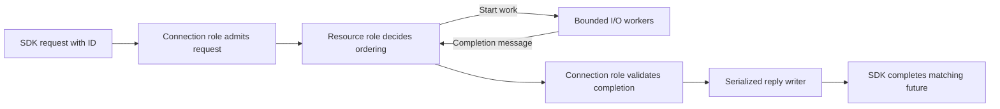

# Asynchronous request dispatch and SDK implementation plan

Status: implementation in progress; see the [validation record](async-request-dispatch-validation.md). The original source assessment uses the checkout based
on `b586dc3a291ebcfbbe46861da8fb51627c65add8`, including its local query,
cache, schedule pagination and deployment follow-up changes.

Allow multiple operations to remain in flight on one connection. Physical socket
writes remain serialized. Every ordinary response carries its request's ID, and
the SDK resolves the matching typed future, promise, task or waiting call without
depending on response order. Slow work must not prevent an independent request
from starting or its completed result from reaching the reply queue.

The implementation is owned internally by Plowshare. Ciotola and Pasta provide
design references and source code that may be selectively copied and adapted;
neither becomes a build or runtime dependency. Internal packages, interfaces,
lifecycle and tests follow Plowshare's contracts and coding standards.

This extends the [query and cache strategy](query-efficiency-and-cache-design.md).
SQL efficiency, authorized DTO reuse, bounded caches, asynchronous dispatch and
independent client rendering each address a different part of latency.
PostgreSQL remains the durable authority; repositories retain persistence and
transaction ownership. An SDK request completes with the operation's outcome.
An `ACCEPTED` job still has its own durable completion and cancellation lifecycle.

## Original source assessment and intended changes

| Owner | Current source behavior | Required work |
| --- | --- | --- |
| [Envelope](../plowshare-protocol/src/main/java/io/aeyer/plowshare/protocol/frames/Envelope.java) | Already carries `id`, `type`, version, payload and optional per-request acting selection. | Retain correlation; define new dispatch semantics, request-ID validation and compatibility. |
| [Event channel](../plowshare-server/src/main/java/io/aeyer/plowshare/server/ws/EventChannelHandler.java) and [EventRequests](../plowshare-server/src/main/java/io/aeyer/plowshare/server/ws/EventRequests.java) | Segmented connections use bounded dispatch. Audited reads overlap; other operations are ordered barriers. Legacy connections route inline. | Connection-owned admission and asynchronous execution for both encodings under the negotiated mode. |
| [EventReadPolicy](../plowshare-server/src/main/java/io/aeyer/plowshare/server/ws/EventReadPolicy.java) | Explicit independent-read allowlist; search, waits, acting selections and unknown operations remain ordered. | Operation-owned execution policies describing actual effects and dependencies. |
| [FrameRouter](../plowshare-server/src/main/java/io/aeyer/plowshare/server/ws/FrameRouter.java) and [ActingRequests](../plowshare-server/src/main/java/io/aeyer/plowshare/server/ws/ActingRequests.java) | Synchronous authorization, handler execution, disclosure filtering and fault conversion. | Preserve that complete pipeline across asynchronous completion. |
| [Java transport](../sdk/java/src/main/java/io/aeyer/plowshare/sdk/Plowshare.java) and [server facade](../sdk/java/src/main/java/io/aeyer/plowshare/sdk/WsServerClient.java) | Concurrent pending futures already exist, but request calls and lazy connection opening block callers. | Genuine typed asynchronous connection and operation APIs; synchronous methods wait on the same exchange engine. |
| [TypeScript transport](../sdk/typescript/src/binding/connection.ts), [Python](../sdk/python/src/plowshare/client.py), [.NET](../sdk/dotnet/Plowshare.Sdk/Client.cs) and [Go](../sdk/go/client.go) | Already correlate simultaneous requests by ID, with a 64-pending-request bound in SDK transports. | Bound all callers waiting to send, unify terminal lifecycle, and cover cancellation and completion races. |
| [Console transport](../plowshare-console/src/events.ts) | Already correlates promises, but has no equivalent pending-count admission bound. | Align limits and lifecycle with the shared transport contract. |
| [MCP main loop](../plowshare-mcp/src/main.ts) | Awaits each stdio request before reading the next complete request into execution. | Bounded concurrent JSON-RPC tasks with per-request deadlines and serialized stdout records. |
| [Desktop schedules](../plowshare-desktop/src/schedules.ts) and [Console schedules](../plowshare-console/src/screens/schedules.ts) | Submit independent requests together but publish a combined refresh after all succeed. | Independent collection completion, loading and error state. |

The existing [segmented transport decision](decisions/0009-segmented-sdk-message-transport.md)
defines both packet serialization and operation barriers. Its current guarantees
must remain accurate until the new mode is implemented and selected.

## Gelato and Ciotola execution model

The references are Pasta at
[`892fbcd508ec856cdcfd90b33102141a5e495a5b`](https://github.com/myrddian/9X-Pasta/tree/892fbcd508ec856cdcfd90b33102141a5e495a5b)
and standalone Ciotola at
[`7ca751fb7a36ab5ffb680d02a47822e538a8d59c`](https://github.com/myrddian/ciotola/tree/7ca751fb7a36ab5ffb680d02a47822e538a8d59c).

[GelatoMessaging](https://github.com/myrddian/9X-Pasta/blob/892fbcd508ec856cdcfd90b33102141a5e495a5b/gelato/src/main/java/gelato/client/GelatoMessaging.java)
owns tag-to-future correlation.
[GelatoParallelRequestHandler](https://github.com/myrddian/9X-Pasta/blob/892fbcd508ec856cdcfd90b33102141a5e495a5b/gelato/src/main/java/gelato/server/manager/GelatoParallelRequestHandler.java)
separately chooses resource/session contention or round-robin scheduling. Carry
that separation into Plowshare: correlation identifies the waiting caller;
execution policy determines which operations may overlap.

Ciotola's
[Role](https://github.com/myrddian/ciotola/blob/7ca751fb7a36ab5ffb680d02a47822e538a8d59c/src/main/java/ciotola/actor/RoleImpl.java)
owns a mailbox, returns a future from submission, and is assigned to one
[Actor](https://github.com/myrddian/ciotola/blob/7ca751fb7a36ab5ffb680d02a47822e538a8d59c/src/main/java/ciotola/actor/CiotolaActor.java).
Use this ownership model for coordination state. A Role is an execution owner,
not an authorization role such as VIEWER or MANAGER.

Several Roles share one Ciotola Actor thread. A blocking script therefore stalls
unrelated Roles on that thread. Plowshare coordination turns must remain short:
start bounded external work, return, and receive its completion as another
message. Only the owning Role changes its coordination state.

The internal implementation must provide bounded mailboxes and callback
execution, fair scheduling, explicit role removal and graceful drain. Ciotola's current
[future implementation](https://github.com/myrddian/ciotola/blob/7ca751fb7a36ab5ffb680d02a47822e538a8d59c/src/main/java/ciotola/actor/CiotolaFutureImpl.java)
records errors without waking an already blocked `get()`, represents completion
through queue occupancy, and can miss callbacks registered after completion.
Null/void script results also need an explicit terminal success. Use standard
`CompletionStage`/`CompletableFuture` semantics at Plowshare's Java boundary.
Pasta's bundled Ciotola and the standalone revision have different APIs; compare
the relevant implementation before adapting source rather than assuming the
versions are interchangeable.

Establish narrow Plowshare contracts first, then implement the bounded coordinator
inside Plowshare. Use the reference designs as inspiration or copy useful source
and reshape it to those contracts. Adapted code is maintained and tested here;
there is no external Ciotola/Pasta runtime or compatibility adapter to adopt.
Record the upstream revision and retain applicable copyright and license notices
for copied source. The reference container, reflection API and producer framework
are outside the initial dispatch slice.

## Coordination ownership

The connection Role owns the active request registry, connection generation,
admission counters and terminal-reply lifecycle. The socket reader hands it
complete messages and continues processing packet credits. The connection Role
never waits for a handler or for socket output.

Resource Roles own conflict ordering and short state transitions. Keys identify
actual resources, such as a conversation, document, schedule source or Relay
subscriber. Use typed keys derived from validated requests and authorized typed
snapshots. A client cannot select an arbitrary execution key or bypass policy.
Avoid a project-wide queue when narrower resources can progress independently.

Blocking JDBC and provider calls run on separately bounded Java virtual-thread
workers. Workers receive immutable execution inputs and return completion
messages. They never mutate actor-owned state from a callback thread. Spring
transactions remain inside the service/repository execution that owns them; a
transaction is not carried across mailbox turns or arbitrary future continuations.

Logical ownership does not require permanent physical-thread affinity in the
Plowshare contract. At most one turn may mutate a Role's state at a time. Shared
registries use suitable concurrent collections with narrow atomic protocols for
capacity and lifecycle. Complete futures, invoke sinks and perform external work
outside registry locks.

A process-wide resource registry coordinates conflicting work across connections
to that server. Bound its size, queued count and bytes, use a finite scheduling
quantum, and reclaim idle keys only when queued/running/completion references are
gone. PostgreSQL transactions, locks and version checks provide cross-process
correctness; process-local actor ownership cannot replace them.

## Request and reply contract

Retain existing operation DTOs and ordinary reply envelopes. The new mode defines:

- A client-generated correlation ID on every request and the same ID/type/version
  on its terminal response. Responses may arrive out of request order.
- IDs unique within a physical connection generation. The proposed new-mode
  limit is 128 UTF-8 bytes, nonblank, without surrounding whitespace or control
  characters; existing SDK-generated IDs fit this bound.
- One terminal operation outcome, including refusal, per admitted request while
  delivery remains possible. Disconnect or transport failure instead settles the
  caller's future exceptionally; it cannot guarantee delivery of a response.
- Separate notification discrimination. A push's domain ID does not make it a
  request response; preserve current envelope/version and push decoding rules.
- Distinct correlation ID, segmented `transferId`, and durable mutation
  `requestId` or receipt ID. Correlation supplies neither authorization nor
  idempotency. A duplicate correlation ID never authorizes mutation replay.

Maintain a per-connection concurrent active-ID registry with atomic admission.
Keep an ID active while queued, running, completing or awaiting reply delivery.
Release its delivery ownership after the reply's transport handoff completes or
the connection terminates. A duplicate active ID is a protocol violation that
closes the connection: an ordinary same-ID refusal could incorrectly settle the
original caller's future. SDKs never reuse retired IDs in that generation;
unknown, duplicate and late replies never settle another request.

In the new mode, an absent or invalid correlation ID is a protocol violation:
there is no safe request completion to address. A valid envelope with an invalid
operation payload instead receives its ordinary correlated refusal without
failing unrelated requests. Old mode keeps its existing malformed-frame behavior.

Negotiate an explicit asynchronous-dispatch capability independently of the
legacy/segmented encoding. Old mode keeps its documented barriers. Updated SDKs
select the new mode only after successful negotiation; capability mismatch fails
clearly before application submission or uses a caller-selected old mode. No
silent reconnect, HTTP fallback or mutation replay is introduced. The first
contract slice must select the exact negotiation encoding and compatibility
matrix before implementation of the new dispatch path.

Dependent operations must be explicit. A client awaits mutation A's terminal
reply before submitting read B when B must observe A. If A only returns a durable
job receipt, B follows that job's owning status/receipt contract. Sending A then B
alone supplies no general completion dependency in the new mode. Conflicting
operations additionally obey their declared resource policy.

## Operation policies and asynchronous routing

Use operation-owned metadata alongside handler registration. Do not classify
work by a `read` suffix or by the absence of an obvious INSERT statement.

| Policy | Execution and ordering |
| --- | --- |
| Independent finite operation | Runs under bounded capacity; may finish out of order. Authorization and disclosure checks still apply. |
| Resource operation | Admits against typed conflict keys. Conflicting work retains the required ordering through completion; unrelated resources continue. |
| Observer | Uses separately bounded waiting capacity. Repeated checks acquire short execution/database capacity only when doing work. |
| Connection lifecycle operation | Orders changes to connection subscriptions, acting contexts or teardown, with explicit acknowledgement/activation semantics. |
| Unaudited operation | Retains the conservative ordered barrier until its full effects and authority lifecycle have been classified. |

An observer cannot hold an exclusive resource lane while waiting for a mutation
that needs that lane. A parent request cannot hold the last worker permit while
waiting for child work requiring that same permit. Queue ownership, execution
capacity and observation capacity are distinct reservations.

The first audit must cover these existing paths:

| Path | Effect to preserve |
| --- | --- |
| [InformationReadiness](../plowshare-server/src/main/java/io/aeyer/plowshare/server/information/InformationReadiness.java) | Readiness observation currently sleeps and polls. Park without occupying an Actor or finite-work slot; retain current readiness and timeout semantics. |
| [InformationCatalogue](../plowshare-server/src/main/java/io/aeyer/plowshare/server/information/InformationCatalogue.java) | Status has a hidden-owner write-admission fallback. Audit its full authority/locking path before allowing overlap. |
| [SearchService](../plowshare-server/src/main/java/io/aeyer/plowshare/server/search/SearchService.java) and [DocumentSearchHandler](../plowshare-server/src/main/java/io/aeyer/plowshare/server/ws/DocumentSearchHandler.java) | Search can call providers, persist result sets or perform accounted embedding work. Preserve expiry, versions, claims and paid-operation attribution. |
| [ProjectRelayPorts](../plowshare-server/src/main/java/io/aeyer/plowshare/server/relay/ProjectRelayPorts.java) | Consume may wait and then claim a durable leased batch. Preserve subscriber/batch ordering and explicit acknowledgement; it is not a pure observer. |
| [UsageSubscriptions](../plowshare-server/src/main/java/io/aeyer/plowshare/server/ws/UsageSubscriptions.java) | Initial report, acknowledgement readiness, subsequent pushes and unsubscribe need a consistent connection lifecycle. |
| [BoundActingContexts](../plowshare-server/src/main/java/io/aeyer/plowshare/server/acting/BoundActingContexts.java) | Context opening, closure, proof/grant checks and connection teardown retain per-request subject authority. |

Introduce narrow capabilities for bounded dispatch, execution policy and
asynchronous handler completion. Keep their inputs typed and immutable. Raw JSON
and arbitrary payload maps stay at the existing transport/codec boundary; they
must not become the new actor or worker application contract. Adapt legacy
synchronous handlers incrementally behind that boundary.

The completion route must preserve `FrameRouter` authorization, Personal and
workspace fences, `ProjectListingFilter`, `ActingRequests` checks and centralized
`Faults` conversion. Exceptions from a completed stage follow the same mapping as
synchronous failures; fatal JVM errors retain their failure behavior. Forwarding
an unchecked handler future directly to the socket would skip this pipeline.

Capture immutable account/acting selection and connection generation. Recheck
live socket authority when queued work starts and before protected disclosure.
Extend `Asking.queryValidity` beyond physical socket openness to current
connection/session validity. Sensitive data already queued for output must be
discarded when that connection generation is revoked or replaced. Request
closure does not undo an admitted durable mutation; its caller retains uncertain
delivery and reconciles through the owning public API.

The reentrancy audit also covers service-level serialization. Currently
`UsageSubscriptions.subscribe` performs a report query under a synchronized
method, and `BoundActingContexts.open` performs repository/authority work under
its monitor. Replace affected long critical sections with short reservation and
finalization turns, external work, then a checked completion. Preserve capacity,
revocation and close races rather than merely swapping map implementations.

## Capacity deadlines and shutdown

Admission reserves count and bytes before a caller waits behind a logical writer
or a server worker is created. Retain the existing SDK default of 64 pending
requests, and add the equivalent Console bound. Define validated configuration
for server execution, observers, mailboxes, reply storage, completion execution
and process-wide budgets. Size database work against the available connection
pool while preserving capacity for lifecycle and recovery work. Existing server
limits are compatibility baselines, not an excuse to allocate one unbounded queue
per Role.

Use an absolute SDK deadline covering admission, queued sending and response
waiting. Distinguish these outcomes:

| Event | Required result |
| --- | --- |
| Invalid input, rejected local capacity, or cancellation before any possible write | `NOT_SUBMITTED`; release owned reservations. |
| Timeout, cancellation or connection loss after possible submission | `UNKNOWN`; stop waiting, preserve receipt identity, never replay. |
| Correlated malformed response | `INVALID_RESPONSE`; no fabricated success or replay. |
| Valid operation refusal | Preserve the operation's existing outcome code and message. |
| Late or duplicate response | Discard without settling another request; retain bounded diagnostics. |

Reply, timeout, cancellation and close compete for one terminal transition and
release every reservation exactly once. A single caller detaching from a shared
cache load must not cancel another caller's load or invalidate an otherwise valid
cached DTO.

Reserve completion capacity as part of admission. Saturation must not drop an
already owed completion or run arbitrary public continuations on the reader as
a fallback. Account for callbacks that block or submit another request; define
their execution/close policy and prove bounded progress before exposing Java's
public futures. An overloaded new request fails admission rather than consuming
the capacity reserved to settle existing requests.

The server stops admission, discards never-started work, detaches observers and
drains running operations/replies for an explicitly configured deadline. Expose
drain completion so Spring closes database/provider resources afterwards. Keep
durable leases/outboxes responsible for restart recovery. Client close settles
all pending calls; neither close nor shutdown repeats a mutation. Callback
execution and role removal must have an owner and a terminal outcome.

Keep the [segmented packet contract](decisions/0009-segmented-sdk-message-transport.md):
physical writes remain serialized, one data packet per direction awaits credit,
and credits bypass waiting logical writes. Credits acknowledge bytes rather than
operation success. Large logical messages still occupy their direction's writer;
interleaving transfers requires a separate transport revision. Test execution
concurrency separately from this remaining output serialization.

## SDK and client delivery

| Owner | Planned API and transport work |
| --- | --- |
| Java | Add typed asynchronous facade counterparts returning `CompletionStage<T>` using existing result/refusal contracts. Return without waiting for packet transmission. Provide shared asynchronous connection opening and synchronous wrappers over the same exchange. Do not use `supplyAsync` around the old blocking call. Keep raw operation/JSON access internal. |
| Java completion | Current response completion runs on the reader and failure completion can run under the lifecycle monitor. Detach terminal state, then dispatch public completion outside locks and away from the reader through bounded owned execution. Nested requests from a continuation must progress. |
| TypeScript and Node | Retain typed promises and the shared transport. Add consistent per-request cancellation/deadline ownership and explicit queued/submitted state. Preserve Node credential and connection-generation fences. |
| Python | Retain `async request(Request[T]) -> Reply[T]`. Bound requests before waiting on the send lock and charge encoded bytes. Document event-loop confinement; thread-confined dictionaries need no concurrent replacement. |
| .NET | Retain typed async operations and asynchronous continuation scheduling. Prefer `ConcurrentDictionary` for shared pending state, with a narrow atomic admission/close protocol. Detach close-drain state before completing tasks outside the gate. |
| Go | Retain context-based operation methods callable concurrently by goroutines. Make queued segmented-writer acquisition context-aware. Keep the typed pending map plus narrow mutex where composite capacity/close invariants make it more suitable than `sync.Map`. |
| Console | Align its local event transport with shared pending/byte bounds and terminal semantics. Reuse the existing owning transport where feasible rather than adding a second correlation protocol. |
| Desktop and Console views | Publish schedules, files, triggers and firings independently with their own loading/errors and retained snapshots. Preserve independent list/facet rendering already implemented in Information collections. |
| MCP | Own each admitted JSON-RPC task and deadline separately; serialize complete stdout records. Keep JSON-RPC IDs distinct from Plowshare envelope IDs. Order initialization/shutdown and bound concurrency. Cancellation of one call cannot abort unrelated calls or replay remote work. |
| TUI CLI and integrations | Preserve existing connection/view generation fences, same-conversation merge queues, subscribe-before-submit, mutation-before-reconciliation and durable journal sequencing. CLI remains one selected command per invocation. |

Every UI completion, including an error, checks account, server, project/scope,
connection generation and view revision before updating state. Independent panel
failure retains that panel's last confirmed snapshot. A stale reply cannot clear
a newer error, change a selection or authorize a mutation.

Actors do not replace the tracked DTO cache. Continue using authorized typed
snapshots already in memory, bounded O(1) LRU storage, coalesced repository loads,
durable versions and recoverable LISTEN/NOTIFY invalidation. Cache version and
scope fences are checked when an asynchronous result is reused/disclosed. Avoid
extra permission/metadata reads solely to compute execution keys when the admitted
typed snapshot already contains those fields. Paid search, leases and mutations
must not enter a generic request coalescer.

## Implementation slices and acceptance gates

Each slice is independently reviewable. Preserve existing local fixes and keep
runtime delivery receipts separate from this proposed plan.
The [slice index](async-request-dispatch-slices/README.md) expands the work below
into owner-specific plans, prerequisites, acceptance gates and parallel lanes.

| Slice | Scope and dependency | Acceptance gate |
| --- | --- | --- |
| [1 Contract and ownership](async-request-dispatch-slices/01-contract-and-ownership.md) | Define negotiation encoding, ID bounds, terminal state, operation policies and narrow actor/dispatcher interfaces. Select reference patterns/source to adapt internally. | Explicit old/new client-server matrix; typed contracts and deterministic lifecycle tests; no implicit ordering change or external Ciotola/Pasta dependency. |
| [2 Bounded coordination](async-request-dispatch-slices/02-bounded-coordination.md) | Connection registry, mailboxes, fairness, active-ID lifecycle, resource registry and owned drain. Depends on 1. | Duplicate-ID protocol close; bounded queues; close races release reservations and settle/discard work as specified. |
| [3 Server completion](async-request-dispatch-slices/03-server-completion.md) | Async routing on both encodings, lifecycle/disclosure fences, reply ownership and audited independent finite operations. Depends on 2. | Independent B reaches its reply while A remains pending; existing refusal, account and acting checks hold. |
| [4 Resource effects and observers](async-request-dispatch-slices/04-resource-effects-and-observers.md) | Search, readiness, leases, subscriptions, acting contexts and conflicting mutations; service-monitor cleanup. Depends on 3. | Conflicts retain ordering; unrelated resources progress; observers cannot starve their unblocking mutations. |
| [5 SDK completions](async-request-dispatch-slices/05-sdk-completions.md) | Genuine Java async APIs, bounded writer waiters/completions and deadline parity across SDKs/Console. Starts after 1; integrates with 2/3. | Calls return before transfer/reply; reverse-order, nested callback, cancellation and close tests pass in every SDK. |
| [6 Independent client views](async-request-dispatch-slices/06-independent-client-views.md) | Independent panel rendering and causal workflow audit. Depends on 3 and 5 for end-to-end acceptance. | Slow facets/files do not delay independent content; stale generations cannot update views. |
| [7 Concurrent MCP](async-request-dispatch-slices/07-concurrent-mcp.md) | Bounded JSON-RPC tasks, per-call lifecycle, shared-presence ordering and serialized output. Depends on 3 and 5 for end-to-end acceptance. | MCP B completes before held A; valid whole records, bounded capacity and safe cancellation/workspace behavior. |
| [8 Conformance and rollout](async-request-dispatch-slices/08-conformance-and-rollout.md) | Shared fixtures, current manuals and staged live acceptance. Integrates 1 through 7. | Source, cross-language and measured live workflows pass with provenance, capacity and recovery evidence. |

Start with a small vertical proof in slices 1 through 3 and the matching Java/TS
transport tests from slice 5. Broaden the operation policy only after proving
bounded admission, current authority and independent completion. Do not parallelize
every handler by default.

## Verification and latency evidence

Extend the existing `EventReadDispatchTest`, `EventRequestsTest`,
`PacketTransportTest`, Java `PlowshareTest`, TypeScript `connection.test.ts` and
`scripts/sdk-conformance.mjs` owners. Keep operation DTO generators and shared
fixtures authoritative; edit generator templates rather than generated outputs.
Unchanged operation DTO shapes need no speculative catalog rewrite.

The required deterministic cases are:

1. Two requests for the same operation return in reverse order and settle only
   their own typed completions. Pushes remain deliverable while both are pending.
2. A held query, readiness wait or provider call does not prevent an independent
   request from executing. A same-resource conflict waits for its declared cause.
3. Reply/timeout/cancellation/disconnect races have one terminal winner, no leaked
   slots/bytes, no wrong-ID completion and no mutation replay.
4. A continuation submits another request without holding a lifecycle lock or
   blocking the socket reader. Late callbacks, multiple observers, refusal,
   failure and null/void success all complete correctly.
5. Rejected count/byte admission creates no worker and sends no operation. Queued
   cancellation expires before write; started cancellation retains uncertainty.
6. Authority revoked or connection replaced during queueing/execution prevents
   unauthorized work or disclosure. Concurrent acting selections cannot leak
   subjects, Personal/workspace scope or authorization snapshots.
7. Resource-key collisions, a busy Role and saturated observers cannot starve
   other eligible work. Role removal and shutdown settle queued ownership and
   expose drain completion without repeating durable work.
8. Bidirectional segmented traffic continues to credit packets. A large outgoing
   response demonstrates physical serialization without being mistaken for a
   server execution barrier.
9. UI list/panel completion survives a delayed or refused facet/file request;
   obsolete successes and failures cannot replace a current account/scope view.
10. Concurrent MCP requests emit valid whole JSON-RPC records under backpressure;
    per-call cancellation and initialization/shutdown preserve unrelated calls.

Use mocked repositories/in-memory fakes for dispatcher, actor, SDK and UI tests.
Run focused PostgreSQL tests only where an operation change requires actual
transaction, lease, locking or version behavior, behind `-PfullDb` and narrow
`--tests` selectors. Java changes require `format` and `formatCheck`; repository
changes require `check`, and SDK/shared-contract changes also require `sdkCheck`.

Record receive-to-admission, queue wait, execution, SQL/provider time, completion
queue delay, reply serialization/write, SDK decode and first useful UI render.
Include active/queued requests and bytes, observer slots, resource contention,
timeouts, dropped late replies and shutdown drain time. Use operation classes and
aggregate labels; do not log credentials, request payloads or private identifiers.

Compare a held slow request plus an independent small read on the same socket,
then mixed Manual/facet, document search, Relay and schedule workflows. Measure
SQL count and cache behavior as well as latency: increased concurrency must not
restore fetch-discard-refetch, repeated permissions, duplicate provider spending
or unconditional refreshes. Live acceptance also covers account switching,
revocation, packet flow, reconnect uncertainty and restart recovery of durable
work. A passing transport fixture establishes correlation and concurrency, not
production latency or deployed workflow correctness.
