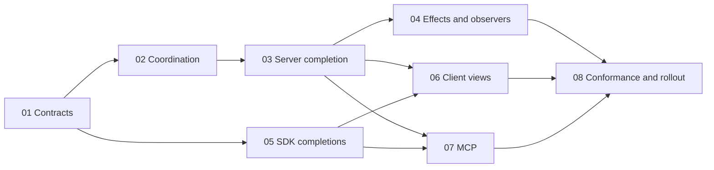

# Asynchronous request dispatch slices

Status: source implemented; verification and rollout are tracked in the
[validation record](../async-request-dispatch-validation.md). These slices expand the
[architecture plan](../async-request-dispatch-plan.md) into bounded units of
work. The validation record distinguishes passing source checks from deployment acceptance. Read each slice's
prerequisites, source boundaries and acceptance gate before changing code.

The implementation belongs inside Plowshare. Ciotola and Pasta are design/source
references: copy useful source and adapt it where appropriate, preserving
attribution, but add no external build/runtime dependency or compatibility
adapter. Keep existing local query/cache, schedule pagination and deployment
follow-up work intact.

## Work breakdown

| Slice | Purpose | Prerequisites and integration gate |
| --- | --- | --- |
| [01 Contract and ownership](01-contract-and-ownership.md) | Freeze request lifecycle, dispatch negotiation, typed ownership and effect policies. | Starting point; resolves contracts shared by all lanes. |
| [02 Bounded coordination](02-bounded-coordination.md) | Internal mailboxes, admission, resource ordering, completion reservations and drain. | 01. |
| [03 Server completion](03-server-completion.md) | Async routing, authority/disclosure checks and reply ownership on both encodings. | 02; end-to-end proof joins 05. |
| [04 Resource effects and observers](04-resource-effects-and-observers.md) | Search, long waits, durable leases, subscriptions and acting-context contention. | 03; broaden only audited operation categories. |
| [05 SDK completions](05-sdk-completions.md) | Genuine Java async APIs and bounded lifecycle parity across SDKs/Console transport. | Starts after 01 contracts; uses 02/03 for integrated server proof. |
| [06 Independent client views](06-independent-client-views.md) | Independent panel rendering with current account/scope/view fences. | 03 and 05 for the end-to-end acceptance gate. |
| [07 Concurrent MCP](07-concurrent-mcp.md) | Bounded concurrent JSON-RPC calls, per-call cancellation and serialized stdout. | 03 and 05 for the end-to-end acceptance gate. |
| [08 Conformance and rollout](08-conformance-and-rollout.md) | Cross-language, server, visible workflow, capacity and recovery evidence. | Integrates 01 through 07; fixture work can start after 01. |

## Parallel work and handoffs

After slice 01, server coordination and SDK exchange ownership can progress in
parallel against the same contract. Client-view and MCP changes are distinct
owners once their transport assumptions are fixed. SDK languages may land in
separate reviewable changes within slice 05, retaining one shared state machine
and conformance gate. A milestone is not a requirement to combine every owner
into one large pull request.

Start with a vertical proof: slices 01 through 03 and the Java/TypeScript exchange
portion of 05. Hold request A, complete independent B on the same authenticated
connection, and verify B's own typed completion while A is still pending. Add
resource conflicts and queued authority revocation before broadening effects.
The remaining SDK implementations and UI/MCP consumers follow that contract.

Slice 05 owns pending/admission/deadline behavior in SDK transports and Console's
event transport. Slice 06 owns screen/controller state and rendering. Slice 07
owns JSON-RPC request tasks, workspace/session sequencing and stdout. Slice 08
owns shared integration fixtures and release evidence. Coordinate shared fixtures
through one owner; serialize generators and repository-wide builds.

## Shared acceptance boundaries

- Preserve existing request IDs and typed DTOs. Correlation is separate from
  segmented transfer IDs and durable mutation receipts.
- Keep the packet reader and credit path live while operations execute; preserve
  serialized physical writes. Packet interleaving is a separate protocol change.
- Keep actor turns short and external I/O bounded. Only an owning role changes
  its coordination state; current authority and PostgreSQL versions still fence
  effects and disclosure across actors, connections and server instances.
- Bound waiting, running, completing and reply-delivery ownership by count and
  bytes. Timeout/close races release once; owed completions are not dropped.
- Preserve required mutation/read and subscription/submission dependencies,
  explicit cancellation and unknown-delivery recovery. No automatic replay.
- Reuse authorized DTO snapshots and the tracked cache; execution keys must not
  add permission N+1 queries or coalesce accounted/leased mutations.
- Default to mocks/fakes and real WebSocket fixtures without a database. Only
  changed PostgreSQL behavior justifies selected `full-db` cases.

Implementation changes update their slice with actual checks and remaining work.
The detailed [conformance and rollout gate](08-conformance-and-rollout.md) separates
source verification, live workflow evidence and deployment status.
