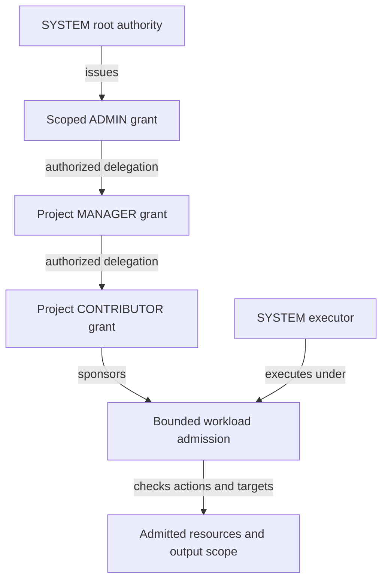

# ADR 0030: Authority substrate and explicit scopes

Status: proposed architecture, 17 October 2026. Documentation only; no runtime,
schema, permission or client behavior is changed by this proposal.

## Problem and direction

Plowshare needs authority to be a platform substrate shared by admission,
persistence, agents and background work. Global currently combines an absent
project, server configuration, shared knowledge, inherited definitions and
unscoped work. These meanings cannot safely stand in for one another in a system
with multiple accounts and tenants. Renaming Global to SYSTEM would retain the
ambiguity.

Establish a locked SYSTEM account and a distinct SYSTEM root role. SYSTEM is the
ultimate owner and source of delegated authority. Other accounts act as
themselves under grants traceable to that root. ADMIN, MANAGER, CONTRIBUTOR and
READER describe permission bundles exercised within explicit scopes. Every
execution, including a SYSTEM execution, is bounded by its admitted scope and
capabilities.

Separate `GLOBAL_ACCOUNT`, which owns administrator-managed knowledge, from
`GLOBAL_READ`, the general read role held by every authenticated principal. A
resource authorizes that role independently of its owner; SDK readers participate
under the same read policy. Deployment configuration is a separate layer again.

An administrator represents delegated authority in the same sense that an
ambassador represents a sovereign. This is grant provenance, not role inheritance
or impersonation. Administrative authority does not make the administrator SYSTEM.

The [current implementation and Global migration map](../global-scope-migration-map.md)
records the source baseline, reusable contracts, gaps and proposed work sequence.
The [role and scope permission matrices](../role-scope-permissions-proposal.md)
map current enforcement to proposed ADMIN, MANAGER, CONTRIBUTOR and READER actions,
including owner-only controls and agent ceilings.
The [impact report](../authority-substrate-impact-report.md) records a segmented
server scan, compatibility consequences and unresolved implementation decisions.
This decision extends the authority model of [ADR 0026](0026-service-execution-on-behalf-of-an-account.md)
and must preserve the independent accounting concerns of
[ADR 0025](0025-service-account-attribution-and-spending-pools.md).

## Separate identities and policy dimensions

| Concept | Responsibility | Does not establish |
| --- | --- | --- |
| Account or principal | Identifies a human, Application or internal executor | Permission merely from its name or identifier |
| Root ownership | Establishes SYSTEM as the ultimate authority over the platform | Everyday body-read access for an administrator or worker |
| Tenant | Identifies an administrative isolation boundary containing explicitly associated scopes | Membership in every project or access to Personal data |
| Resource scope | Identifies where a resource belongs: server administration, a tenant, Personal or a project | Permission to read all resources in that scope |
| Resource control | Identifies who may administer a resource within parent constraints | Permission to widen its audience arbitrarily |
| Role | Names a defined bundle of actions | Authority without a scoped grant |
| Grant | Authorizes a principal or supported group, records its issuer, scope, actions and delegation ceiling | Authority greater than its issuing grant |
| Resource ACL | Holds explicit grants over a particular resource | A bypass of tenant, execution or mandatory policy restrictions |
| Definition classification | Records trusted provenance and availability of an agent definition | Account identity, data ownership or execution authority |
| Execution authority | Retains the executor, subject, sponsoring admission, scope and capability ceilings for one work lineage | An ambient union of every permission the executor possesses |
| Read audience | Identifies who may discover/read a resource, including through `GLOBAL_READ` | Ownership transfer, finalisation, a change to executor identity or implicit import into every run |
| Accounting attribution | Records usage, sponsorship, billing and historical provenance | Authorization or permission to repeat an effect |

SYSTEM owns everything at the authority root. Resources still retain an immediate
scope, controller, creator and provenance. A Personal document remains controlled
by its account under the Personal policy. A project's resources remain controlled
under that project's grants. Ultimate ownership must not erase those distinctions
or rewrite authored attribution to SYSTEM.

Tenant identity is explicit in the target architecture. Existing project and
Personal membership do not constitute a first-class tenant model in the audited
contracts. Tenant boundaries must be specified before implementation; project
names, account names and deployment hosts cannot be used to infer them.

## Explicit UUID identities

Give SYSTEM's account, root role and server scope separate stable UUID identities.
A reserved UUID such as `00000000-0000-0000-0000-000000000001` can identify the
root account. Exact reserved values belong in a reviewed identity registry; that
example does not assign the same UUID to its role or scope. UUID lookup identifies
a record. No permission evaluator treats equality with a reserved UUID as an allow.

Every governed resource and admitted unit of work has an explicit, non-null scope
identity. Scope kinds and their relationships are explicit data. A project name
is a locator or label, not an authority identity. A resource's identity is separate
from its scope and survives an authorized relocation with retained provenance.

Do not encode server scope, shared visibility, unknown scope or omitted request
selection using the same null value. Optional request fields may express absence
at the transport boundary, but admission must resolve an authorized explicit
scope or refuse before effects. Blank, unknown, deleted and unavailable selections
are failures, never alternate names for server scope.

The storage design may add UUID identities alongside existing surrogate keys.
It need not replace every numeric project key in one operation. Existing durable
resource IDs, foreign keys, receipt identities and historical references must be
preserved through explicit mappings.

## SYSTEM account and SYSTEM role

The SYSTEM account is locked against interactive login, passwords, normal bearer
credentials, user selection, impersonation and ordinary acting-context admission.
The SYSTEM role contains the root action vocabulary and grant-issuing authority.
It is intrinsic to the locked SYSTEM account and is never an assignable role.
No administrator, operator, grant issuer, agent definition or internal API may
assign SYSTEM to another account or agent. It cannot be acquired by delegation,
role inheritance, copying a role or selecting an execution profile. Bootstrap
establishes the root account's intrinsic authority; recovery does not make that
authority assignable. Account, role and delegation policy enforce these
restrictions through generic authentication and admission boundaries.

Agents cannot receive ADMIN or SYSTEM. CONTRIBUTOR is their default maximum;
MANAGER requires the explicit exception described below. Being SYSTEM-owned,
having trusted `is-system` classification, or running as an internal worker does
not assign the agent the SYSTEM role. A worker executed by the SYSTEM account receives bounded task
authority, not its own copy of the root role.

Internal executors obtain workload authority through trusted server admission.
A request for internal processing cannot select an unrestricted SYSTEM execution.
The server derives a bounded task grant from the sponsoring admission and the
worker's permitted operations. An unattended maintenance task needs its own
explicit operator-authorized policy, targets and limits.

An authenticated administrator holds its own account and an ADMIN grant issued
under root authority. The grant can permit management of identities, grants or
platform policy without granting arbitrary tenant or Personal body reads. The
permission to administer a policy and the permission to read its protected data
remain distinct. Audience-widening policy changes require their own authority and
audit; they cannot be used to disguise publication as routine configuration.

A small trusted bootstrap creates the root identities, policies and initial
administrative grants. Recovery requires an explicit operator procedure. The
root trust anchor is unavoidable, but normal resource access must use the same
permission evaluator for every principal. Do not scatter SYSTEM-name checks,
reserved-ID allow branches or null-owner exemptions through services and tools.

## Roles, ACLs and delegation

The substrate authorizes an authenticated account/principal to perform an action
on an explicit scope/resource under a live grant. Roles are named, reviewable
bundles over those primitives. ADMIN, MANAGER, CONTRIBUTOR, READER, GLOBAL_READ and
Application-facing roles are policy helpers, not independent authorization engines.
An Application role maps to the same scoped action evaluator used for humans and
SYSTEM work; it cannot authorize an action by a separate role-name shortcut.

For ordinary knowledge resources, replace actor-equals-owner authorization with
explicit READ, WRITE and relevant control/release grants. Ownership remains a
resource fact and can seed ordinary owner grants; it is not an additional equality
guard that prevents an authorized administrator from writing another account's
resource. The acting account, owning account, author and grant issuer remain
distinct. Credential subjects, private sessions, consent and retained input rules
continue to impose their own explicit restrictions.

Retain the familiar role model, with explicit action sets:

| Role | Proposed purpose |
| --- | --- |
| SYSTEM | Intrinsic root authority of the locked SYSTEM account; never assignable or delegable |
| ADMIN | Delegated administration for human users within the scope and actions of their grants; never granted to an agent |
| MANAGER | Manage a scope's membership and permitted local configuration |
| CONTRIBUTOR | Perform permitted work and modify resources within a scope |
| READER | Read permitted resources within a scope |
| GLOBAL_READ | Read resources whose policy explicitly authorizes this role; every authenticated principal holds it, independently of resource ownership |

The current project role name is VIEWER. READER is proposed vocabulary, not an
implemented rename. ADMIN is currently represented by server-admin state rather
than a member of `ProjectRole`. Define the action mapping explicitly before
changing contracts. Never place SYSTEM above MANAGER in the current ordinal enum
and allow that ordering to become a general permission hierarchy.

### Agent grant ceiling

Human users can receive scoped ADMIN authority where the issuer may grant it.
For agents, Plowshare applies CONTRIBUTOR as the default maximum, retaining any
lower requested role. A MANAGER request is narrowed to CONTRIBUTOR unless an
authorized human explicitly forces MANAGER for the particular agent and scope.
ADMIN is rejected rather than narrowed, even when force is requested. SYSTEM is
always rejected as non-assignable.

| Recipient and requested role | Result |
| --- | --- |
| Human user requests ADMIN | Permit only through valid scoped issuing authority |
| Agent requests READER or CONTRIBUTOR | Retain the requested role if otherwise authorized |
| Agent requests MANAGER without force | Descope to CONTRIBUTOR, subject to all other ceilings |
| Agent requests MANAGER with an authorized explicit force | Permit scoped MANAGER within the issuing authority and retained execution limits |
| Agent requests ADMIN, with or without force | Reject the grant request |
| Any recipient requests SYSTEM | Reject; root authority is intrinsic to the locked SYSTEM account |

Force is an authorized grant-issuance decision, never an agent instruction,
self-selected flag or general override. It names the recipient, scope and MANAGER
exception; the issuer must have permission to grant those actions and authorize
the exception. Record the issuer, requested/effective roles and exception in the
grant and audit. Report descoping to the caller before executing dependent work;
do not silently claim that MANAGER was granted. Rejected ADMIN/SYSTEM requests
create no grant or partial grant effects.

Apply the ceiling to semantic actions, including ACL entries, tools and delegated
work, so individual grants cannot reconstruct prohibited ADMIN authority under
another role name. SYSTEM-owned/classified agents and agents acting for ADMIN
users follow the same ceiling. Human sponsorship does not lend an agent the
human's ADMIN role, and internal execution does not give the agent root authority.
This proposal does not impose the agent ceiling on every direct non-agent
Application operation merely because it uses a service account.

A forced MANAGER exception does not widen scope, consent, issuer authority or
other execution restrictions. It is specific to the admitted recipient and scope;
children do not acquire it automatically. Each child remains at most CONTRIBUTOR
unless covered by its own explicit authorized MANAGER exception. Recheck the
exception's live grant provenance alongside the retained admission ceiling.

A grant records its subject, issuer, issuing authority reference, target scope or
resource, actions or versioned role binding, permitted delegation, expiry and
revocation state. A child grant can narrow targets, actions, time and delegation
rights; it cannot enlarge them. Grant chains must be bounded, acyclic and rooted
in valid authority. Removing an issuing grant makes dependent authority ineffective
while preserving the records and their audit.

Role grants supply the ordinary access path. ACLs supply resource-specific grants,
such as granting one reader access to a document without making that reader a
project member. Their combination grants only explicitly supported actions and
never overrides mandatory resource restrictions. Cross-tenant sharing needs an
explicitly permitted publication/sharing boundary; an arbitrary ACL row cannot
cross it on its own. General deny-entry precedence and arbitrary group nesting
are deferred rather than assumed.



The graph illustrates grant provenance and one sponsored execution. Actual grant
issuance requires explicit delegation rights; each arrow is not an automatic
consequence of holding the role above it.

External acting authority remains an additional intersection of actor authority,
subject authority, Application manifest grants, consent/proof limits and admitted
scope. SYSTEM's root lineage does not let an Application bypass any of those
checks. Preserve the current separate Application login and acting-context flow.

## Execution authority and general checkpoints

### EXECUTION and scope workload support

Define `EXECUTION` as a permission bundle containing `CONVERSATION_CREATE` and
`RUN_MODEL`. The first authorizes creating a conversation in its destination;
the second authorizes model inference under retained scope, capability and budget
limits. Creating an empty conversation does not by itself spend model allowance.
The actions remain independently checkable even when granted together through
the bundle. Neither action grants tools, input access, output publication or
administrative control.

Admission requires both the destination's supported workload/action policy and
the executor's valid action grant. Ordinary project and Personal scopes can
support execution; granted human/Application authority determines who may use it.
Resolve a contextual default to a concrete destination before evaluating either
condition. Recheck `RUN_MODEL` for later turns, model-directed child work and
asynchronous admissions under the retained ceiling rather than relying only on
the original conversation-create check.

Global is governed by the same account/scope/action grants. This supersedes the
earlier blanket rule that Global could never support execution. SYSTEM has scoped
READ, WRITE and EXECUTION authority for bounded Global processing; a task retains
only its admitted purpose, resources, actions, tools and budget. No equality check
against SYSTEM's name/UUID supplies an authorization bypass.

| Executing principal and binding | Global knowledge authority |
| --- | --- |
| Ordinary human/Application with GLOBAL_READ | READ of resources authorizing that role; no WRITE or EXECUTION from this role |
| Human with ADMIN over Global | Scoped READ/WRITE/control actions; EXECUTION is not implied |
| SYSTEM under an admitted Global-processing grant | Required READ/WRITE, CONVERSATION_CREATE and RUN_MODEL within the task's retained limits |
| GLOBAL_ACCOUNT as resource owner | Ownership itself supplies no execution identity or grant |

The information summarizer can execute as SYSTEM within the explicit Global
scope, read an admitted document and write its permitted derived summary. The
document stays owned by GLOBAL_ACCOUNT; the executor, initiating actor, sponsor
and private log authority are recorded separately. There is no obligation to
invent another operational scope solely to avoid a blanket Global prohibition.
Private worker conversations, prompts and intermediate results do not inherit
GLOBAL_READ merely because processing occurs in the Global scope. General-read
authorization applies to the intended knowledge resources and projections.

An authorized human write may trigger a separately authorized SYSTEM processing
service. Admit that declared workflow using both the caller's permitted trigger
and SYSTEM's scoped worker grants; the caller need not acquire RUN_MODEL or
SYSTEM authority to upload a document. A denied arbitrary run must not be
silently rerouted to SYSTEM. Ordinary delegated children remain bounded by their
parent authority; independently admitted platform services have their own explicit
purpose, input/output and spending contracts. Exact service sponsorship remains
to be specified before implementation.

### General authorization checkpoints

Conceptually, an operation is allowed only when all of these conditions hold:

```text
valid live grant provenance
AND the destination supports the requested workload/action
AND the required action is granted
AND the actual resource and destination are within admitted scope
AND actor and subject restrictions permit the operation
AND the agent role/action ceiling and any explicit MANAGER exception permit it
AND tool, filesystem, network and budget ceilings permit the operation
AND resource policy and lifecycle permit the operation
```

Scope is a mandatory restriction for work executed by the locked SYSTEM account.
That execution does not assign the SYSTEM role to the agent performing the task.
An account's other grants are not implicitly added to an already admitted run.
Scope ancestry describes containment; it does not imply universal descendant
access. A scope grant must state any permitted descendant coverage. A worker
assigned the server-administration scope cannot thereby read every tenant.

A resource's owning scope and a run's permitted targets are distinct. A job has
one explicit owning scope for lifecycle, visibility and control, while its
admission can retain a bounded set of authorized input resources/scopes and output
destinations. Explicitly importing published material does not rehome the job or
grant arbitrary access to the publication's other resources. A corpus selection
chooses what to search within that authority; it cannot enlarge the authority.

Use three semantic checkpoints, implemented through shared typed contracts:

1. **Admission:** authenticate the actor; resolve any subject and actual resource
   identities; validate grant provenance and target permissions; retain explicit
   scope, inputs, output destinations and capability ceilings before enqueueing.
2. **Execution and disclosure:** recheck live authority before protected reads and
   effects, at queue consumption and child admission, and before returning content
   that could have been relocated or revoked during a read. Every independent
   consumer must retain authority; unsupported consumers refuse.
3. **Transfer and publication:** authorize both the source use and destination
   write/audience whenever data crosses scopes or reaches a new audience. Derived
   outputs retain applicable input restrictions until an authorized release.

General checkpoints do not mean a check only at the HTTP/WebSocket entry point.
Repositories constrain queries by admitted scope and protect mutation invariants;
services own semantic authorization. Resource-ID resolution must precede policy
decisions. Search, pagination, counts, events, job status and error details are
disclosures too. Filesystem and tool grants remain independent restrictions.

Persist grant references and the admission ceiling with jobs, schedules, Relay
work, orchestration, approvals and child agents. Children inherit or narrow the
parent's authority and budget. Revalidate current authority against that retained
ceiling so later grant expansion does not widen existing work. An expired or
revoked grant stops further protected work; it cannot undo a completed external
effect. Recovery reads original receipts and never resubmits uncertain effects
or manufactures replacement request identities.

Grant changes and effects need explicit transaction semantics. Recheck database
authority and expected policy versions inside the committing repository-owned
transaction; commit effect intent and audit through the existing durable lifecycle.
External effects use the owning delivery/receipt machinery without holding a
database transaction across remote work. Define the dispatch/revocation race in
each consumer's contract; a general checkpoint cannot promise remote rollback.

## SYSTEM worker example

```text
executor             SYSTEM account
worker definition    trusted document summarizer
sponsoring subject   Alice
resource scope       Alice's Personal scope
input                document C at an admitted revision
actions              read that input and write its derived summary
output destination   Alice's Personal scope
```

The worker cannot read document D or publish C's summary to another project merely
because it executes as SYSTEM. Its definition's tools cannot enlarge the task
grant. Its output and job visibility stay with the admitted resource scope. A
publication operation requires a separately authorized destination and audience.
Document processing retains its existing no-tools/no-delegation capability ceiling.

## Splitting Global

### Deployment definitions and SYSTEM worker resolution

Deployment is the installation's administrator-controlled configuration layer,
separate from Global account-owned knowledge. Bundled resources supply release
defaults; deployment definitions supply validated additions and permitted
overrides. Their presence in the server data directory does not select an
execution account. Ordinary bots resolved from either source run under the
admitted user's account and authority, just as project bots do.

A SYSTEM worker is an agent executing a trusted internal workload under the locked
SYSTEM account. Its task retains that account's exclusive execution identity and
bounded workload authority; the agent never receives an assignable SYSTEM role.
The server's admitted worker purpose selects the executor and scope independently
of the selected definition's filesystem location, name or authored metadata.

For an internal purpose such as conversation summarization, resolve the worker
only within the deployment-plus-bundle definition context:

1. Use an authorized, valid deployment override for the worker purpose when present.
2. Otherwise use its bundled definition.
3. Never search project, Personal, connected-client, Application or Global-knowledge
   sources to satisfy that internal worker lookup. A missing worker or invalid
   authoritative override refuses the task; it does not broaden the search or
   silently substitute the bundled definition after an override failure.

For example, overriding the summarizer in deployment configuration changes its
permitted definition, not the identity of the already admitted internal task:
the summarizer still executes under SYSTEM with the same scope and input limits.
A project namesake cannot replace that worker. Conversely, an ordinary deployment
bot executes under the user and cannot obtain SYSTEM execution by naming itself
after the summarizer or declaring a role. SYSTEM worker discovery and selection
use this internal resolution context; user catalogue lookup never selects a
SYSTEM executor. Authorized administration can inspect/manage worker configuration
without making the worker user-invocable.

Keep two facts distinct when accepting an override: the replacement remains
deployment-authored, and the trusted worker binding continues to identify a SYSTEM
workload. Editing a file does not acquire bundled provenance or make authored
`is-system` metadata trustworthy. Override management is a privileged
server-administration action because it can change server-directed SYSTEM work.
The bundle/deployment context is a definition-resolution boundary, not permission
to read the entire server data directory. These are proposal requirements; current
bundled-only classification and worker lookup do not yet implement this full
identity/admission model.

### GLOBAL_ACCOUNT and GLOBAL_READ

Global now separates ownership from general read access. This replaces the earlier
memory-only Global proposal and the blanket exclusion of external SDK readers.
Library remains a view over permitted knowledge, not another owning account or
permission scope.

| Concept | Meaning | Does not grant |
| --- | --- | --- |
| `GLOBAL_ACCOUNT` | Built-in account owning administrator-managed knowledge, including the installed manual | SYSTEM execution, root authority or an identity callers impersonate to read |
| Account knowledge scope | Explicit non-project home for `GLOBAL_ACCOUNT` memories, documents and derived retrieval views | A project identity, conversations, agent-run homes, workspaces or provider-tool bindings |
| `GLOBAL_READ` | Defined read role held by every authenticated principal; a resource authorizes that role to make itself generally readable | Ownership, editing, administration, publication or unrestricted execution |

`GLOBAL_ACCOUNT` is distinct from SYSTEM. SYSTEM remains the authority root;
`GLOBAL_ACCOUNT` is the immediate owner of this administered knowledge. Its
resources retain their actual author, reviser and provenance. Ordinary bots and
Application agents continue running under their admitted accounts, never by
logging in or switching executor to `GLOBAL_ACCOUNT` to read its material.

Global is an account, not a built-in project. This supersedes the earlier Global
project proposal. Keep the account, its knowledge scope and `GLOBAL_READ` role as
separate fixed reserved UUID identities; no identity is generated at runtime or
replaced on startup. The earlier proposed Global project identity is withdrawn;
there is no placeholder project row to preserve the old null-project meaning.

| Entity | Reserved UUID |
| --- | --- |
| `GLOBAL_ACCOUNT` | Separate fixed registry value to be assigned |
| `GLOBAL_READ` role | Separate fixed registry value to be assigned |
| Global account knowledge scope | `00000000-0000-0000-0000-000000000005` |

Bootstrap materializes the account, role, account-knowledge scope and ordinary
policy bindings idempotently. Lookup by reserved identity identifies a record;
it never bypasses permission evaluation. Existing ordinary projects named
`global` retain their identities and ordinary project behavior. Missing built-in
records refuse rather than manufacturing a null project, replacement UUID or
alternate scope. The same reserved UUID on another installation does not transfer
grants or trust.

Every authenticated human, Application and service principal holds `GLOBAL_READ`.
Authentication must remain current and the principal active; role membership
never bypasses account disable, token expiry/revocation or credential rotation.
Agents use the roles of their retained execution authority; a definition cannot
mint an independent identity or acquire ADMIN. Holding this read role does not
make every resource readable: the resource's policy must authorize `GLOBAL_READ`.
The Global account knowledge scope supplies that read authorization for its admitted
resources through explicit descendant coverage and mandatory policy checks.
Resources owned by other accounts can authorize the same role without changing
owner or moving into Global. No per-reader ownership transfer is involved.

For example:

| Resource | Immediate owner/home | Read authorization | Management |
| --- | --- | --- | --- |
| Installed manual | `GLOBAL_ACCOUNT` / account knowledge scope | `GLOBAL_READ` | Human ADMIN with authority over Global |
| Generally readable project document | Its existing account / project | Resource authorizes `GLOBAL_READ` | Existing owner/controller grants |
| Private project document | Its existing account / project | Ordinary project/resource grants; no `GLOBAL_READ` authorization | Existing owner/controller grants |

The human Global ADMIN helper supplies scoped READ/WRITE and the named control
actions for creating, editing, moving, retiring and managing Global knowledge.
ADMIN held elsewhere is insufficient. These actions authorize the administrator
without requiring actor equality with GLOBAL_ACCOUNT. SYSTEM processing uses its
own scoped WRITE grant for admitted derived outputs; it does not need a human role
or impersonate the resource owner. Moving/copying private material or changing
its audience additionally requires source release and retained input permissions.
Curator or another worker cannot approve a release/ownership transfer merely by
having WRITE or a forced MANAGER exception. The administrative and processing
role helpers must map those distinct actions explicitly.

Granting `GLOBAL_READ` access to an otherwise private resource changes its
audience. It requires the existing controller's authorized audience/release action
and compliance with mandatory policy, not merely possession of `GLOBAL_READ`.
It does not transfer the resource to `GLOBAL_ACCOUNT` or grant that account
control over the original. The detailed issuer matrix for non-Global audience
changes remains a separate decision. Draft/final, excluded, withdrawn, deleted
and processing readiness remain independent lifecycle properties; a Global home
is not a finalisation or processing command.

### Library, SDK reads and admitted search

CLI, TUI, GUI, SDK Applications and service principals can discover/read
Global-owned and other `GLOBAL_READ`-authorized knowledge through supported public
read operations. This supersedes the earlier SDK/first-party-only read boundary.
Human ADMIN management remains available through CLI/TUI/GUI under administrative
grants. An SDK Application or agent does not gain Global write authority from its
read role, from acting for a human, or by proxying an internal worker.

The role and resource read grant supply authority; a request/task's admitted read
selection and token/acting ceilings can further restrict it. A librarian Application
can be admitted to read its project plus Global/general-read knowledge while its
write authority remains confined to its project. It does not need a human account
or `GLOBAL_ACCOUNT` impersonation. Consumers must support and retain those read
targets explicitly; unsupported acting/tool consumers continue to refuse rather
than downgrade to account-only checks.

Project-scoped search searches the admitted project selection. An unscoped
Library search is proposed to search all readable knowledge within the caller's
admitted ceiling, including authorized projects, Personal and Global/general-read
resources. Selection can narrow the readable set; it cannot add permissions.
Omission at a read/search boundary must resolve this explicit read selection, not
a null Global home. Omitted mutation/execution scope never selects Global. Read
access does not automatically include a resource in every prompt, recall or
fallback, and an empty project search does not widen the admitted selection.

`GLOBAL_READ` authorizes only the defined discovery/read projections and body
access allowed by current resource policy. It grants no tool invocation,
credentials, filesystem access, processing jobs, curation, execution or management.
Read counters and derived index maintenance follow bounded read/maintenance
contracts without granting content mutation. Lifecycle, mandatory tenant policy,
consumed-input and reference restrictions still apply: a generally readable
output cannot release its private dependencies. Deployment-wide general reading
is an explicit audience policy, not evidence that tenant fences may be ignored;
its exact mapping to future tenant entities remains to be specified.

The Global account owns knowledge; it does not become a login/executor or gain a
Personal workspace. Its scope can host SYSTEM processing authorized through
ordinary scoped grants. Processing logs remain private unless their own policy
authorizes disclosure. Deployment definitions and internal SYSTEM worker lookup
remain separate from knowledge ownership.

### Conversation context routing

An omitted/null conversation target is permitted as a request for context routing,
not a Global execution home. Resolve an explicit, authorized, conversation-capable
project before creating the durable conversation or admitting work:

| Request context | Omitted/null target resolves to |
| --- | --- |
| Admitted Application or project context | That Application/project itself |
| Human user without an admitted Application/project context | That user's Personal project |
| No usable context, or ambiguous Application/project binding | Refuse and require an explicit supported target |

An explicit target still requires current work authority, supported workload kind
and all token/acting ceilings. Invalid explicit targets do not fall back to
Personal. Context routing uses authenticated/admitted bindings, never account-name
inference, a client-supplied Application label or the first project in a list.
Retained acting authority preserves its admitted target; applying a default must
not switch the actor, subject, project or existing scope ceiling.

Accordingly, `conversation_start(null, "HELLO")` can route a direct human request
to Personal, or an Application/project-bound request to itself. A service identity
with several permitted projects but no admitted default cannot guess one. This
preserves the current direct-human Personal convenience rather than removing it.
`ConversationOpenHandler` and `PersonalSpaces.home` currently implement that human
default; Application/project-relative routing still requires an explicit source
and coordinated server/SDK/client contract before claiming implementation.

`GLOBAL_ACCOUNT` is an account identifier, not a project reference or executor.
Ordinary user/Application context defaults never select its scope. GLOBAL_READ
supplies no conversation creation or model-run action there; ADMIN management
supplies no implicit execution either. An explicitly admitted SYSTEM worker can
select Global as an internal processing scope with the required scoped action
grants, including CONVERSATION_CREATE for its private worker log where needed.
An account UUID in a project-only API parameter remains invalid; typed internal
and public contracts must distinguish scope and account identifiers. An ordinary
project named global retains its own project identity and policy.

Knowledge lookup uses an explicit account-knowledge or project-resource target,
while ordinary user/Application conversation creation resolves its authorized
project target. Internal SYSTEM log creation uses its explicitly granted scope.
The current project-only `Home`/memory contracts need a typed replacement or
extension so account-owned memories do not recreate Global through a null project.
Existing resource identities, scopes, provenance and receipts survive migration.

Current Information `shared` is an owner-controlled per-revision visibility flag,
not either proposed built-in identity. Review proven shared audiences for
`GLOBAL_READ` authorization without transferring ownership. Applications and
service readers were excluded by the old Shared contract, so their inclusion is
an explicit audience expansion requiring authorized migration decisions rather
than a mechanically equivalent rename. A manual intended for
`GLOBAL_ACCOUNT` additionally needs an authorized ownership/home migration with
resource/revision IDs and provenance preserved. Never relabel every shared or
null-project document as Global-owned. All of this remains proposal-only.

### Tools available across projects

For MCP and client-provided tools, reuse the existing provider scopes, catalogue
and Relay invocation mechanism. This proposal introduces no replacement tool
catalogue, global provider runtime or new common tool-grant bundle. A tool
configuration intended for broad reuse is separate from Global account-owned knowledge
and does not become SYSTEM-owned credential material.

Interactive providers attach through `tool.scope.connect/list/disconnect` and
`SessionToolScopes`; server-hosted providers retain bindings through
`tool.scope.host.*` and `OwnedHostedToolScopes`. `CombinedToolScopeConnections`
projects both through the existing `ApplicationToolRegistry`. Account, project,
provider, selected agents, grants, dynamic opt-in, catalogue freshness and
invocation identity remain explicit. Interactive bindings additionally retain the
authenticated socket/session; hosted bindings use their distinct durable owner,
credential-subject and executor lifecycle. Applications retain manifest assignments.

Current connection/binding contracts require a concrete project; they do not
provide a project-less server-wide wildcard grant. If a client calls reusable
configuration global, that describes configuration breadth rather than authority
over every project. Materialize only authorized assignments in the intended scopes.
A future convenience for selecting multiple projects must reuse these bindings
and checks, not attach provider tools to the Global account knowledge scope.

The [provider scope contract](../tool-scopes.md),
[hosted scope contract](../hosted-tool-scopes.md) and
[MCP authority contract](../mcp-tool-authority.md) own this behavior. This separates
the existing external-tool mechanism from built-in registration below.

Built-in platform tools belong to the SYSTEM-controlled installed capability catalogue,
administered under the server configuration scope. They do not belong to the
Global account knowledge scope and are not imported from it. Tool installation/availability,
agent capability grants and invocation authority are separate decisions:

| Layer | Meaning |
| --- | --- |
| Installed tool definition | The server has the implementation, schema and declared action/target contract |
| Availability policy | Eligible project/scope kinds may discover or select the capability |
| Agent or workflow assignment | Declared built-in grants or authorized external provider-scope assignments make the tool offerable; dynamic opt-in alone grants nothing |
| Invocation authority | The actual caller/run may perform the action on the resolved targets, within all retained ceilings and resource policies |

Available everywhere means available for selection in each eligible project,
not automatically granted to every agent or permitted to access every resource.
Any existing configuration that supplies defaults must keep its assignments
visible and cannot bypass role/scope restrictions.

For example, `get_date` needs no private data target but still needs an admitted
capability. `memory_read` can be an installed platform capability while each call
resolves the requested memory's typed knowledge target and checks live read
authority. A memory owned by `GLOBAL_ACCOUNT` can authorize `GLOBAL_READ`, including
for an SDK/Application reader within its admitted targets. Tool availability
supplies neither that read grant nor a broader recall selection.

Current built-ins are registered through `AgentsConfig` and collected in
`JobRuntime`; `knownTools` validates installed names, while `offeredTo` builds a
run's offered tools from declared grants and explicit per-run mechanisms. External
tools use the existing live provider catalogue, `ScopedTools`, `ToolGrants` and
Application/owner/project assignments. Preserve those distinct boundaries rather
than adding a second catalogue or applying external-provider grant lookup to every
declared internal tool. General scope/action checks still protect actual data and
effects. Existing hidden Global recall expansion remains migration work.

An external tool can be made available to multiple projects only through explicit
provider/connection assignments and grants in those scopes. Moving its declaration
into Global, using a wildcard over unrelated projects, or reusing another owner's
credential does not establish authority. Reuse existing provider/Relay lifecycle,
leases, schemas and uncertain-effect receipts.

### Destinations for existing meanings

| Existing Global meaning | Proposed destination |
| --- | --- |
| Server/internal execution context conflated with scope | Locked SYSTEM account, SYSTEM role and explicit workload grants |
| Server configuration and internal Relay topics | Explicit server-administration scope and scoped administration grants |
| Operator-authored deployment defaults and overrides | Deployment configuration over bundled resources, managed through server-administration scope; no automatic SYSTEM execution |
| Internal worker definitions | Trusted worker-purpose binding resolved only from deployment overrides and bundled resources; SYSTEM execution remains bounded by task admission |
| Ordinary shipped bots, skills and orchestrations | Installed catalogue with explicit availability/import/default policy |
| Administrator-managed memories and documents | `GLOBAL_ACCOUNT` owning resources in an explicit account knowledge scope; human ADMIN manages, `GLOBAL_READ` permits reads |
| MCP/client tools configured for broad reuse | Existing provider scopes, owner/project/agent assignments and Relay lifecycle; no new Global tool registry |
| Built-in tools available across eligible projects | Installed capability catalogue plus admitted definition/workflow grants; invocation remains scoped |
| Generally readable resources owned elsewhere, including legacy Shared documents | Authorize `GLOBAL_READ` while preserving immediate ownership/home and retained input policy |
| A user's work with no selected project | Explicit Personal scope selected at admission where the operation permits that default |
| Account-owned outgoing work | Explicit owning scope plus account ownership and original receipt lifecycle |
| Historic null-project rows | Explicit migration classification, with legacy shared data separated from server configuration |
| SYSTEM model accounting | Independent usage/sponsorship records retaining historical attribution |

SYSTEM's registry and published knowledge must not share a scope merely because
both were called Global. Definition availability is separate from data sharing.
Selecting a shipped bot never authorizes cross-scope data reads. Operator worker
overrides remain explicit and validated; installing an authored definition does
not confer trusted bundled classification or root execution authority.

Remove automatic Global recall/navigation, shared-corpus inclusion and prompt
inheritance. Intentional access uses an explicit selection, import or configured
default policy admitted within the caller's authority. Missing or broken project
configuration refuses rather than recovering to a different registry. Internal
worker lookup remains available independently of user catalogue resolution.

Curation continues to assess project knowledge and may propose release. A model's
judgment that a claim is generally useful is not publication permission. Promoting
a Personal or project memory to a broader audience requires authorized source
release and destination publication, with provenance and retained input policies.
For resources entering `GLOBAL_ACCOUNT`, the destination action requires human ADMIN
authority. Authorizing `GLOBAL_READ` elsewhere preserves ownership and requires
its own authorized audience change.

## Consequences and boundaries

This is general platform architecture, not permission plumbing for one adapter.
Future implementation must use typed capability/repository boundaries and update
the shared public operations and affected SDKs/clients together. Adapters remain
external consumers under [ADR 0001](0001-integration-boundary.md).

Do not replace existing access predicates with an unfinished generic evaluator.
Introduce the common authority contract behind existing owners, prove parity and
intentional restrictions, then migrate each independent consumer. A shared
contract need not imply one monolithic service, policy language or SQL escape hatch.

Existing Global data must not become private SYSTEM data or tenant data by a blind
null-to-UUID update. Preserve stable identities, job lineage, authored ownership,
historical usage and uncertain-effect receipts. Ambiguous rows need restricted
classification and operator resolution, with no guessed tenant or new audience.
All schema changes belong in new Flyway migrations after separate authorization.

## Decisions required before implementation

1. Define first-class tenant membership, Personal tenancy and cross-tenant sharing,
   including the mapping for existing accounts/projects and server administrators.
2. Assign the reserved identity registry and decide UUID introduction alongside
   existing keys; specify the minimum durable grant and execution records.
3. Approve action sets and delegation rights for ADMIN/MANAGER/CONTRIBUTOR/READER,
   including policy administration versus data access, authorized issuance of
   forced MANAGER exceptions for agents, and emergency recovery. Agent ADMIN
   rejection and the default CONTRIBUTOR ceiling are fixed proposal requirements.
4. Define publication audiences and release authority, especially for Personal
   content, derived outputs and existing server-shared material. `GLOBAL_ACCOUNT`
   management requires human ADMIN; define who may authorize `GLOBAL_READ` on
   resources owned elsewhere without changing their owner or home.
5. Specify explicit catalogue availability, instruction imports and operation
   defaults; keep shipped ordinary bots usable without implicit authority.
6. Review legacy classification and the coordinated server/SDK/client cutover.

The migration map proposes implementation slices and acceptance criteria. Each
slice needs its own authorized implementation task; this proposal authorizes none.
