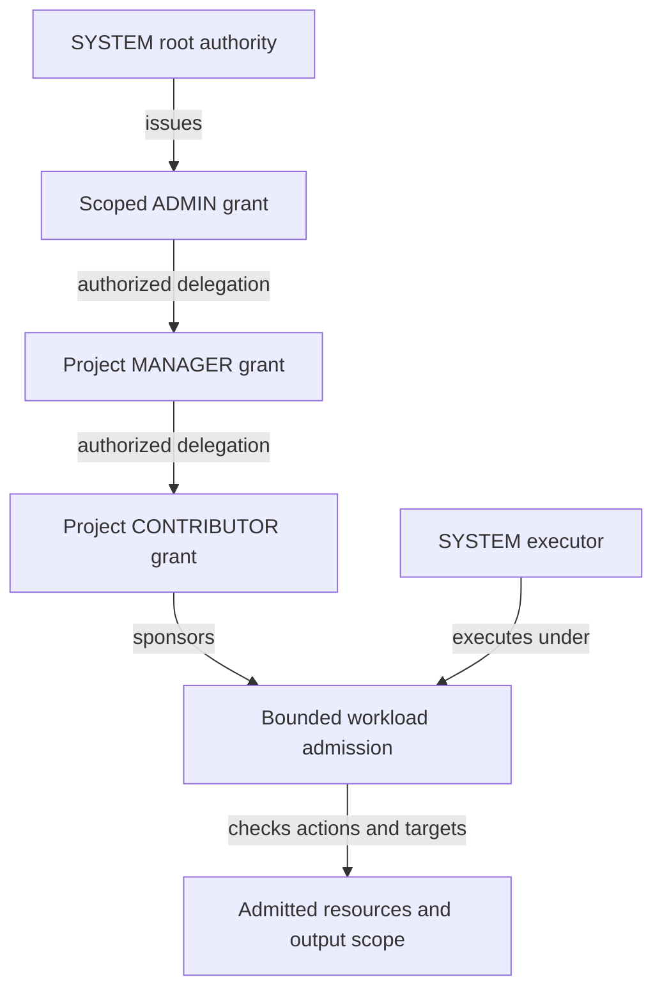

# ADR 0030: Authority substrate and explicit scopes

Status: proposed architecture, 17 October 2026. Documentation only; no runtime,
schema, permission or client behavior is changed by this proposal.

## Problem and direction

Plowshare needs authority to be a platform substrate shared by admission,
persistence, agents and background work. Global currently combines an absent
project, server configuration, shared knowledge, inherited definitions and
unscoped work. These meanings cannot safely stand in for one another in a system
with multiple accounts and tenants. Renaming Global to SYSTEM would retain the
ambiguity.

Establish a locked SYSTEM account and a distinct SYSTEM root role. SYSTEM is the
ultimate owner and source of delegated authority. Other accounts act as
themselves under grants traceable to that root. ADMIN, MANAGER, CONTRIBUTOR and
READER describe permission bundles exercised within explicit scopes. Every
execution, including a SYSTEM execution, is bounded by its admitted scope and
capabilities.

Separate `GLOBAL_ACCOUNT`, which owns administrator-managed knowledge, from
`GLOBAL_READ`, the general read role held by every authenticated principal. A
resource authorizes that role independently of its owner; SDK readers participate
under the same read policy. Deployment configuration is a separate layer again.

An administrator represents delegated authority in the same sense that an
ambassador represents a sovereign. This is grant provenance, not role inheritance
or impersonation. Administrative authority does not make the administrator SYSTEM.

The [current implementation and Global migration map](../global-scope-migration-map.md)
records the source baseline, reusable contracts, gaps and proposed work sequence.
The [role and scope permission matrices](../role-scope-permissions-proposal.md)
map current enforcement to proposed ADMIN, MANAGER, CONTRIBUTOR and READER actions,
including owner-only controls and agent ceilings.
The [impact report](../authority-substrate-impact-report.md) records a segmented
server scan, compatibility consequences and unresolved implementation decisions.
This decision extends the authority model of [ADR 0026](0026-service-execution-on-behalf-of-an-account.md)
and must preserve the independent accounting concerns of
[ADR 0025](0025-service-account-attribution-and-spending-pools.md).

## Settled decisions

The core policy below is settled for this proposal. "Settled" does not mean
implemented, deployed or supported by every existing API/SDK. Detailed sections
explain these rules; the closing sections separate migration work, reusable
mechanisms and deferred gaps.

| Concern | Settled rule |
| --- | --- |
| Normal management | Scoped RBAC with sensible standard role helpers is the primary path. Resource ACLs support finer exceptions through the same substrate; routine setup should not require custom ACLs. |
| SYSTEM | Locked root account with an intrinsic, non-assignable role. Platform operations use its existing authority inside an operation sandbox, not fresh per-task account grants. |
| Ordinary roles | ADMIN manages its administrative scope; MANAGER is the resource DRI and manages access; CONTRIBUTOR does permitted task work without managing permissions; READER reads. ADMIN alone does not imply arbitrary private data access or execution. |
| Agents | Default maximum CONTRIBUTOR; retain a lower requested role. MANAGER requires an explicit authorized human exception; ADMIN/SYSTEM cannot be assigned. |
| Provenance | created_by records original creation and confers no rights. Account home, creator, reviser, executor and controller remain distinct. |
| Global | GLOBAL_ACCOUNT is the admin-managed knowledge account/home, not a project, executor or login. Deployment configuration and SYSTEM worker definitions are separate. |
| Audience | All authenticated active principal types hold GLOBAL_READ. A resource authorizing it has no individual audience exclusions; restricted readership uses project/group permissions. |
| Document policy | Publication state and audience are separate. Current root-document permissions govern all revisions, including historical/pinned reads, subject to lifecycle and input/reference restrictions. |
| Resource DRI | MANAGER can grant/remove GLOBAL_READ on managed resources without extra expansion authority or ADMIN approval. This does not transfer the resource into Global or release others' private dependencies. |
| Actions | EXECUTION bundles CONVERSATION_CREATE and RUN_MODEL, checked independently. RUN_MODEL covers all inference. Non-model work checks its actual actions, with no EXECUTE_JOB permission. |
| SYSTEM services | A declared service uses its own SYSTEM authority and bounded capabilities; callers need permission for the requested operation. Valid independent processing continues despite creator access removal. |
| Operation costs | The operation pays through its configured budget. Retain the budget binding through queues/recovery; SYSTEM and created_by are not implicit payers. |
| Existing controls | Supported lifecycle controls use WRITE plus existing eligibility/state rules. No CONTROL_EXECUTION, missing control API or generic operation ACL is inferred. |
| Routing and delegation | Human omission can resolve Personal; an admitted Application/project resolves itself. Ambiguous targets refuse. Acting authority retains separate actor/subject proof and ceilings. |
| Clients and tools | Account/role/policy determine authority through existing supported APIs. SDK parity is not required. Tools, providers, Relay, files and budgets retain their existing independent bounds. |

Use [migration requirements](#migration-requirements) for concrete compatibility
work, [reuse](#what-can-be-reused) for existing mechanisms and
[deferred gaps](#deferred-gaps) for topics outside the settled core.

## Separate identities and policy dimensions

| Concept | Responsibility | Does not establish |
| --- | --- | --- |
| Account or principal | Identifies a human, Application or internal executor | Permission merely from its name or identifier |
| Root ownership | Establishes SYSTEM as the ultimate authority over the platform | Everyday body-read access for an administrator or worker |
| Tenant | Identifies an administrative isolation boundary containing explicitly associated scopes | Membership in every project or access to Personal data |
| Resource scope | Identifies where a resource belongs: server administration, a tenant, Personal or a project | Permission to read all resources in that scope |
| Resource control | Identifies who manages a resource's permissions, including choosing GLOBAL_READ, within mandatory constraints | Authority over unrelated resources or private dependencies |
| Role | Names a defined bundle of actions | Authority without a scoped grant |
| Grant | Authorizes a principal or supported group, records its issuer, scope, actions and delegation ceiling | Authority greater than its issuing grant |
| Resource ACL | Holds explicit grants over a particular resource | A bypass of tenant, execution or mandatory policy restrictions |
| Definition classification | Records trusted provenance and availability of an agent definition | Account identity, data ownership or execution authority |
| Execution authority | Retains the executor, subject, sponsoring admission, scope and capability ceilings for one work lineage | An ambient union of every permission the executor possesses |
| Read audience | Identifies who may discover/read a resource, including through `GLOBAL_READ` | Ownership transfer, finalisation, a change to executor identity or implicit import into every run |
| Accounting attribution | Records usage, sponsorship, billing and historical provenance | Authorization or permission to repeat an effect |

SYSTEM owns everything at the authority root. Resources still retain an immediate
scope, controller, creator and provenance. A Personal document remains controlled
by its account under the Personal policy. A project's resources remain controlled
under that project's grants. Ultimate ownership must not erase those distinctions
or rewrite authored attribution to SYSTEM.

### Created-by provenance and scoped control

For ordinary documents/knowledge, use `created_by` for the initial creating
account's historical provenance. It is not an owner permission or an entitlement
to READ, WRITE, delete, execute or manage access. Revision authorship and retained
actor/subject attribution remain separate facts; an Application acting for a
human must not collapse those identities into a misleading single author field.

Control comes from scoped grants and the root document's current policy. A human
creating content in an Application's area is recorded as its creator under the
applicable attribution contract, but exercises that area's WRITE grant. Losing
the grant can remove access even though `created_by` remains unchanged. A new
revision, move or audience change does not rewrite original creation provenance.

References in this proposal to knowledge's owning account/home describe its
account association and administrative scope, not another authorization shortcut.
`GLOBAL_ACCOUNT` identifies the administered knowledge home; it is not substituted
for the account that actually created a document. SYSTEM's root authority remains
grant provenance. Neither relationship supplies an implicit creator privilege.
Existing Personal isolation, credential subjects, sessions, consent, receipts and
other specialized account-bound contracts retain their own explicit boundaries.

Legacy `owner_handle` fields mix namespace/control and authorization in current
code. Do not blindly rename them to `created_by` or infer original authorship from
the current home. Preserve available creation/audit evidence and explicitly map
the resource scope and grants independently; unresolved provenance must not be
invented or used to grant access.

Existing project and Personal membership do not constitute a first-class tenant
model in the audited contracts. If tenant entities are introduced, define their
boundaries explicitly; project names, account names and deployment hosts cannot
be used to infer them. This separate work does not reopen Global's settled
deployment-wide audience or require a tenant model for every migration slice.

## Explicit UUID identities

Give SYSTEM's account, root role and server scope separate stable UUID identities.
A reserved UUID such as `00000000-0000-0000-0000-000000000001` can identify the
root account. Exact reserved values belong in a reviewed identity registry; that
example does not assign the same UUID to its role or scope. UUID lookup identifies
a record. No permission evaluator treats equality with a reserved UUID as an allow.

Every governed resource and admitted unit of work has an explicit, non-null scope
identity. Scope kinds and their relationships are explicit data. A project name
is a locator or label, not an authority identity. A resource's identity is separate
from its scope and survives an authorized relocation with retained provenance.

Do not encode server scope, shared visibility, unknown scope or omitted request
selection using the same null value. Optional request fields may express absence
at the transport boundary, but admission must resolve an authorized explicit
scope or refuse before effects. Blank, unknown, deleted and unavailable selections
are failures, never alternate names for server scope.

The storage design may add UUID identities alongside existing surrogate keys.
It need not replace every numeric project key in one operation. Existing durable
resource IDs, foreign keys, receipt identities and historical references must be
preserved through explicit mappings.

## SYSTEM account and SYSTEM role

The SYSTEM account is locked against interactive login, passwords, normal bearer
credentials, user selection, impersonation and ordinary acting-context admission.
The SYSTEM role contains the root action vocabulary and grant-issuing authority.
It is intrinsic to the locked SYSTEM account and is never an assignable role.
No administrator, operator, grant issuer, agent definition or internal API may
assign SYSTEM to another account or agent. It cannot be acquired by delegation,
role inheritance, copying a role or selecting an execution profile. Bootstrap
establishes the root account's intrinsic authority; recovery does not make that
authority assignable. Account, role and delegation policy enforce these
restrictions through generic authentication and admission boundaries.

Agents cannot receive ADMIN or SYSTEM. CONTRIBUTOR is their default maximum;
MANAGER requires the explicit exception described below. Being SYSTEM-owned,
having trusted `is-system` classification, or running as an internal worker does
not assign the agent the SYSTEM role. A worker executes under the SYSTEM account's
existing authority through an operation sandbox, not its own copy of the root role.

Internal executors enter an operation sandbox through trusted server admission.
A request for internal processing cannot select an unrestricted SYSTEM execution.
The server retains operation limits from the sponsoring admission and the
worker's permitted operations; it does not need to issue fresh account grants to
SYSTEM for each task. An unattended maintenance task needs its own
explicit operator-authorized policy, targets and limits.

SYSTEM execution is reserved for platform functions, such as the memory system.
SYSTEM already has the underlying authority as the root account. The executor
remains SYSTEM; the operation sandbox restricts how that authority can be used
while running, without removing the account's underlying permissions. For
example, a memory worker admitted to write one project's designated memory area
can write there, but cannot write another project's memories, Global knowledge
or access-policy records without separately authorized admission. Its reads and
other effects also need their own admitted scope/actions. The task cannot use
SYSTEM's root grant-issuing authority to enlarge its own sandbox. Permission and
sandbox checks are separate requirements, enforced at protected effects:

```text
effective operation authority = account authority INTERSECT operation sandbox
```

Resource/lifecycle and other mandatory restrictions still apply. A sandbox
narrows authority; it never supplies a permission the account lacks. SYSTEM's
authority is represented by root policy/grants through the common evaluator,
not an identity-name/UUID bypass. Ordinary executions use the same distinction
between account permissions and retained operation limits.

For conversation compaction, the memory summariser executes as SYSTEM, whose
account authority permits reading any conversation and writing the relevant
memory/summary records. This task does not need a fresh READ or WRITE grant.
The task's supplied conversation inputs and bound tools restrict which content
it can actually obtain and where it can persist its result. Tool implementations
enforce those task bindings, including any caller-supplied resource identifiers;
the summariser cannot use a general read/write route to reach other resources.
Thus a broad account permission and a narrow scope of work coexist. Scope here
describes the operation sandbox established through inputs and capabilities,
not a new account-permission area that must be granted before each compaction.
Tools and input fences retain their existing capability mechanisms; this does
not extend account RBAC into a new tool-permission hierarchy.

An authenticated administrator holds its own account and an ADMIN grant issued
under root authority. The grant can permit management of identities, grants or
platform policy without granting arbitrary tenant or Personal body reads. The
permission to administer a policy and the permission to read its protected data
remain distinct. Audience-widening policy changes require their own authority and
audit; they cannot be used to disguise publication as routine configuration.

A small trusted bootstrap creates the root identities, policies and initial
administrative grants. Recovery requires an explicit operator procedure. The
root trust anchor is unavoidable, but normal resource access must use the same
permission evaluator for every principal. Do not scatter SYSTEM-name checks,
reserved-ID allow branches or null-owner exemptions through services and tools.

## Roles, ACLs and delegation

The substrate authorizes an authenticated account/principal to perform an action
on an explicit scope/resource under a live grant. Roles are named, reviewable
bundles over those primitives. ADMIN, MANAGER, CONTRIBUTOR, READER, GLOBAL_READ and
Application-facing roles are policy helpers, not independent authorization engines.
An Application role maps to the same scoped action evaluator used for humans and
SYSTEM work; it cannot authorize an action by a separate role-name shortcut.

### Standard role helpers and ACL exceptions

RBAC is the normal means of managing the system. Give routine administrators,
resource managers and members sensible named role helpers over explicit scopes,
rather than requiring them to assemble per-action ACLs for ordinary work.
Application-facing helpers use the same role/action mapping.

| Authorized setup need | Standard helper/profile |
| --- | --- |
| Human platform/Global administration | ADMIN over the intended administrative scope; Global knowledge management includes its scoped READ/WRITE/control, without implicit EXECUTION |
| Project/Application or document DRI | MANAGER over the resources managed, including their access/audience management |
| Ordinary task contributor or permitted Application worker | CONTRIBUTOR within its required scope; no permission management |
| Read-only member, librarian or integration | READER within its required scope |
| General-read knowledge | GLOBAL_READ held by all authenticated active principals; the resource must authorize that audience |
| Ordinary agent | Requested READER/CONTRIBUTOR, with CONTRIBUTOR the default maximum; MANAGER only through the explicit exception below |

These are role profiles for authorized setup, not automatic membership or a
requirement to add provisioning/UI capabilities. Retain narrower existing
manifest/token/acting limits. ADMIN is a scoped control helper, not the top of a
data-access ladder; add a separate data/execution role only when authorized.
Ordinary content uses the area's scoped role/root-policy contract; creating a
document does not automatically make its creator a MANAGER.

Complex resource ACLs remain an available design option for specific needs, such
as a document reader who is not a project member. They express finer grants over
the same actions and scopes, with the same audit, issuer limits and mandatory
policy. They are not a second permission engine or the default management burden.
No arbitrary deny precedence, nested-group engine or new ACL editor is introduced
by this proposal. GLOBAL_READ's no-individual-exclusions rule remains fixed.

For ordinary knowledge resources, replace actor-equals-owner authorization with
explicit READ, WRITE and relevant control/release grants. `created_by` records
provenance and never seeds permission merely because it matches the caller.
Creation-time grants must come from the explicit scope/root-policy contract.
The acting account, account home, creator, reviser and grant issuer remain
distinct. Credential subjects, private sessions, consent and retained input rules
continue to impose their own explicit restrictions.

Retain the familiar role model, with explicit action sets:

| Role | Proposed purpose |
| --- | --- |
| SYSTEM | Intrinsic root authority of the locked SYSTEM account; never assignable or delegable |
| ADMIN | Delegated administration for human users within the scope and actions of their grants; never granted to an agent |
| MANAGER | Manage a scope's membership, permitted local configuration and managed resources' permissions/audiences, including GLOBAL_READ |
| CONTRIBUTOR | Perform permitted work and modify resources within a scope |
| READER | Read permitted resources within a scope |
| GLOBAL_READ | Read resources whose policy explicitly authorizes this role; every authenticated principal holds it, independently of resource ownership |

The current project role name is VIEWER. READER is proposed vocabulary, not an
implemented rename. ADMIN is currently represented by server-admin state rather
than a member of `ProjectRole`. Define the action mapping explicitly before
changing contracts. Never place SYSTEM above MANAGER in the current ordinal enum
and allow that ordering to become a general permission hierarchy.

### Agent grant ceiling

Human users can receive scoped ADMIN authority where the issuer may grant it.
For agents, Plowshare applies CONTRIBUTOR as the default maximum, retaining any
lower requested role. A MANAGER request is narrowed to CONTRIBUTOR unless an
authorized human explicitly forces MANAGER for the particular agent and scope.
ADMIN is rejected rather than narrowed, even when force is requested. SYSTEM is
always rejected as non-assignable.

| Recipient and requested role | Result |
| --- | --- |
| Human user requests ADMIN | Permit only through valid scoped issuing authority |
| Agent requests READER or CONTRIBUTOR | Retain the requested role if otherwise authorized |
| Agent requests MANAGER without force | Descope to CONTRIBUTOR, subject to all other ceilings |
| Agent requests MANAGER with an authorized explicit force | Permit scoped MANAGER within the issuing authority and retained execution limits |
| Agent requests ADMIN, with or without force | Reject the grant request |
| Any recipient requests SYSTEM | Reject; root authority is intrinsic to the locked SYSTEM account |

Force is an authorized grant-issuance decision, never an agent instruction,
self-selected flag or general override. It names the recipient, scope and MANAGER
exception; the issuer must have permission to grant those actions and authorize
the exception. Record the issuer, requested/effective roles and exception in the
grant and audit. Report descoping to the caller before executing dependent work;
do not silently claim that MANAGER was granted. Rejected ADMIN/SYSTEM requests
create no grant or partial grant effects.

Apply the ceiling to semantic actions, including ACL entries, tools and delegated
work, so individual grants cannot reconstruct prohibited ADMIN authority under
another role name. SYSTEM-owned/classified agents and agents acting for ADMIN
users follow the same ceiling. Human sponsorship does not lend an agent the
human's ADMIN role, and internal execution does not give the agent root authority.
This proposal does not impose the agent ceiling on every direct non-agent
Application operation merely because it uses a service account.

A forced MANAGER exception does not widen scope, consent, issuer authority or
other execution restrictions. It is specific to the admitted recipient and scope;
children do not acquire it automatically. Each child remains at most CONTRIBUTOR
unless covered by its own explicit authorized MANAGER exception. Recheck the
exception's live grant provenance alongside the retained admission ceiling.

A grant records its subject, issuer, issuing authority reference, target scope or
resource, actions or versioned role binding, permitted delegation, expiry and
revocation state. A child grant can narrow targets, actions, time and delegation
rights; it cannot enlarge them. Grant chains must be bounded, acyclic and rooted
in valid authority. Removing an issuing grant makes dependent authority ineffective
while preserving the records and their audit.

Role grants supply the ordinary access path. ACLs supply resource-specific grants,
such as granting one reader access to a document without making that reader a
project member. Their combination grants only explicitly supported actions and
never overrides mandatory resource restrictions. Cross-tenant sharing needs an
explicitly permitted publication/sharing boundary; an arbitrary ACL row cannot
cross it on its own. General deny-entry precedence and arbitrary group nesting
are deferred rather than assumed.



The graph illustrates grant provenance and one sponsored execution. Actual grant
issuance requires explicit delegation rights; each arrow is not an automatic
consequence of holding the role above it.

External acting authority remains an additional intersection of actor authority,
subject authority, Application manifest grants, consent/proof limits and admitted
scope. SYSTEM's root lineage does not let an Application bypass any of those
checks. Preserve the current separate Application login and acting-context flow.

### Account delegation: Application acting for a user

Account delegation is the service-account/Application acting-context flow from
[ADR 0026](0026-service-execution-on-behalf-of-an-account.md), not an agent calling
a child through `calls:`. Reuse that existing proof and admission mechanism;
express its current coarse role ceilings as scoped action ceilings in the common
substrate. No global DELEGATE role or copy of the user's roles is required.

| Existing acting concept | Mapping to the proposed substrate |
| --- | --- |
| Actor | Authenticated Application/service principal making the request; remains distinct in audit |
| Subject | User whose permitted authority is exercised; not an identity the actor acquires |
| Application binding and manifest grant | Establish that this active Application may request this class of delegated work, within its declared ceiling |
| Subject proof/consent | Authorizes this actor to act for this subject within specified scopes/actions and expiry; revocation stays live |
| Acting-token and context ceilings | Narrow the current subject authority and Application capability; never expand either or widen an already admitted task |
| Project target | Requires the subject's scoped actions and the actor's applicable project authority, within proof/manifest/admission limits |
| Subject Personal target | Requires explicit Personal delegation plus the subject's own actions. Do not give the Application ordinary Personal membership or require it as a workaround |
| Retained execution admission | Records actor, subject, proof/grant references, concrete target, actions and supported read inputs; rechecks them at protected effects/disclosure |

For Discord, the actor is the Discord Application and the subject is the user
talking to their bot. The selected Personal/project target remains explicit in the
acting context. A proposed new conversational turn may require READ/WRITE on its
permitted conversation/input resources, CONVERSATION_CREATE if opening a new
conversation, and RUN_MODEL for inference. The admitted action set is only what
that operation needs and all live ceilings permit. The service does not acquire
the user's ADMIN role, arbitrary Personal resources or authority over every
project the user can access.

The current implementation distinguishes ActingPermission.READ (VIEWER) and WORK
(CONTRIBUTOR); other semantic categories refuse. The proposed mapping is:

| Current gate | Target action treatment |
| --- | --- |
| READ | Required resource/receipt READ within the selected, supported acting target |
| WORK opening a conversation and starting a turn | Check the required conversation WRITE, CONVERSATION_CREATE and RUN_MODEL independently; EXECUTION bundles the latter two |
| WORK on an existing conversation | Check the required conversation WRITE and RUN_MODEL; creating the conversation is not repeated merely to append a turn |
| Cancellation/status/receipt recovery | Apply their supported control/read contract to the original admitted work; preserve original request/receipt identities |
| Owner/admin/grant/credential/membership and unclassified categories | Remain refused until individually classified and explicitly supported; a new action mapping does not expose them automatically |

This mapping describes the target, not a claim that the current API accepts new
action lists or arbitrary delegated WRITE. The existing transport only admits
conversation turns, acting turn start/receipt and job status/cancel. Its retained
turn implementation is currently Personal-scoped; Project/Personal policy targets
exist, but general delegated project work and Global read sources are not thereby
implemented. New operations/read sources need an explicit supported contract.

Consent to use the subject's bounded authority is not a resource ACL change.
Using an acting context does not require MANAGE_ACCESS on every request or make
the actor a permanent role recipient. Issuing/revoking proof stays within its
existing subject-consent lifecycle; changing resource roles/ACLs remains separate
access management. A Global read role still needs supported admitted read targets;
it must not silently widen an existing Personal-only acting admission.

Preserve separate Application authentication and subject proof, active-account
checks, live narrowing, expiry/revocation, exact Personal isolation and durable
admission recovery. Invalid/unsupported acting authority refuses; never strip the
acting context and retry as the service account or SYSTEM. Agent tool definitions,
`calls:`, provider bindings, budgets and file fences remain their existing bounded
capability mechanisms, not new account-role permissions.

## Execution authority and general checkpoints

### EXECUTION and scope workload support

Define `EXECUTION` as a permission bundle containing `CONVERSATION_CREATE` and
`RUN_MODEL`. The first authorizes creating a conversation in its destination;
the second authorizes model inference under retained scope, capability and budget
limits. Creating an empty conversation does not by itself spend model allowance.
The actions remain independently checkable even when granted together through
the bundle. Neither action grants tools, input access, output publication or
administrative control.

### Non-model work and action-based authorization

Authorize an operation by the actions it actually performs. There is no separate
`EXECUTE_JOB` permission. Scripts, tool-only jobs, CPU stages, scheduled maintenance
and Relay-triggered processing use the executor's applicable account authority,
restricted by the retained operation sandbox and existing domain controls.

Resource reads require READ; resource changes require WRITE or the applicable
management/control action. Creating a conversation requires CONVERSATION_CREATE;
any inference requires RUN_MODEL. Merely queueing work, running CPU computation
or invoking a permitted non-model tool does not require RUN_MODEL or the entire
EXECUTION bundle. An operation that later creates a conversation or calls a model
must check that action at its owning boundary; earlier admission is not a bypass.

EXECUTION remains the convenience bundle of CONVERSATION_CREATE and RUN_MODEL,
not a blanket prerequisite for every background task. Tools, filesystem/provider
access, Relay routes, schedule controls, lifecycle and cancellation retain their
existing capability mechanisms. A timer/message or job record supplies no new
account authority. Operations retain their configured budgets and effect receipts
where applicable; non-model work does not acquire model-spending authority merely
because it is a job. This introduces neither tool-level account RBAC nor a new
general execution permission.

### Existing operation controls and WRITE

Where an operation already exposes a lifecycle control, authorization follows
WRITE on its applicable scoped target plus that control's existing eligibility
and lifecycle rules. There is no additional `CONTROL_EXECUTION` permission.
CONTRIBUTOR/MANAGER can use supported controls covered by their scoped WRITE;
`created_by` supplies no special control entitlement. READER may inspect permitted
status through READ, but receives no mutation authority from that role.

This is a permission mapping, not authorization to create missing capabilities.
It introduces no generic operation ACL/registry, cancellation service, job
pause/resume API, SDK operation or durable resume machinery. Audit each existing
control against its owning resource/scope; if the control is absent, record that
fact rather than infer or implement it. Domain-specific subject/receipt checks,
Application bindings, state transitions and uncertainty handling remain intact.

Verified examples illustrate the limits of the mapping:

| Existing control | Capability to preserve |
| --- | --- |
| [job.cancel](../../plowshare-server/src/main/java/io/aeyer/plowshare/server/ws/JobCancelHandler.java) | Requests that an eligible job stop at a boundary; it does not promise an immediate kill or completed cancellation |
| [schedule.pause](../../plowshare-server/src/main/java/io/aeyer/plowshare/server/ws/SchedulePauseHandler.java) | Pauses/resumes a schedule through its existing authority rules; it does not establish pause/resume of an already running job |

Changing permissions or schedule definitions remains access/configuration
management. Resuming supported work that performs new protected actions still
requires those actions and current operation validity; WRITE control alone does
not supply RUN_MODEL or other execution authority. For independent SYSTEM work,
explicit cancellation/invalidation applies only through supported lifecycle
controls; loss of the creator's access remains insufficient to stop valid work.

### Inference and service authority

`RUN_MODEL` covers all model inference, including chat/generation, summarisation,
embeddings, reranking, model-based validation and inference performed by hooks,
preparation stages or other side calls. The same action applies whether the
inference is synchronous, queued or background work; there is no separate
account permission for each inference type.

The account actually performing inference must have RUN_MODEL authority. A
user/Application directly running a model needs its own applicable authority.
A declared SYSTEM service uses SYSTEM's existing authority, bounded by that
operation's inputs, tools, outputs and other retained limits. Its caller needs
permission for the requested operation, not the service's internal RUN_MODEL
authority. A READER can therefore request an authorized semantic search whose
declared SYSTEM service performs query embedding/reranking within the search
sandbox, without the reader receiving arbitrary model-execution permission.
Compaction and document preparation follow the same service-authority rule.

The declared service contract must validate the trigger, retain bounded targets,
enforce inference limits and check the recipient's current result access. Caller
text cannot turn that operation into arbitrary SYSTEM inference or enlarge its
read/write reach. This reuses operation admission and capability fences rather
than adding tool-level RBAC. Executor authority and operation validity are
checked at dispatch/effect boundaries, including after queueing. Accounting
attribution and budget sponsorship remain separate from permission, under the
operation-specific budget policy below. Neither READ nor SYSTEM identity supplies
an unlimited spending allowance.

Admission requires both the destination's supported workload/action policy and
the executor's valid action grant. Ordinary project and Personal scopes can
support execution; granted human/Application authority determines who may use it.
Resolve a contextual default to a concrete destination before evaluating either
condition. Recheck `RUN_MODEL` for later turns, model-directed child work and
asynchronous admissions under the retained ceiling rather than relying only on
the original conversation-create check.

Global is governed by the same account/scope/action grants. SYSTEM's existing
root authority covers READ, WRITE and EXECUTION there; the operation sandbox
retains only its admitted purpose, resources, actions, tools and budget. No equality check
against SYSTEM's name/UUID supplies an authorization bypass.

| Executing principal and binding | Global knowledge authority |
| --- | --- |
| Ordinary human/Application with GLOBAL_READ | READ of resources authorizing that role; no WRITE or EXECUTION from this role |
| Human with ADMIN over Global | Scoped READ/WRITE/control actions; EXECUTION is not implied |
| SYSTEM within an admitted Global-processing sandbox | Existing SYSTEM authority for READ/WRITE, CONVERSATION_CREATE and RUN_MODEL, restricted by the operation's retained limits |
| GLOBAL_ACCOUNT as resource owner | Ownership itself supplies no execution identity or grant |

The information summarizer can execute as SYSTEM within the explicit Global
scope, read an admitted document and write its permitted derived summary. The
document stays owned by GLOBAL_ACCOUNT; the executor, initiating actor, sponsor
and private log authority are recorded separately. There is no obligation to
invent another operational scope solely to avoid a blanket Global prohibition.
Private worker conversations, prompts and intermediate results do not inherit
GLOBAL_READ merely because processing occurs in the Global scope. General-read
authorization applies to the intended knowledge resources and projections.

An authorized human write may trigger a separately authorized SYSTEM processing
service. Admit that declared workflow using both the caller's permitted trigger
and SYSTEM's existing account authority plus the worker's operation sandbox;
the caller need not acquire RUN_MODEL or
SYSTEM authority to upload a document. A denied arbitrary run must not be
silently rerouted to SYSTEM. Ordinary delegated children remain bounded by their
parent authority; independently admitted platform services have their own explicit
purpose, input/output and spending contracts. The operation budget supplies the
spending authority independently of the executor account.

### Operation-specific budgets and accounting

The operation pays through its explicitly admitted budget. SYSTEM is the executor,
not an implicit payer, and `created_by`/the initiating user is not a default debit
target. The server resolves the operation's configured budget source at admission
and retains its identity and applicable limits with that operation.

| Operation | Configured budget source |
| --- | --- |
| Conversation compaction | The conversation's configured budget |
| Project/Application document processing | That scope's configured processing budget |
| Global knowledge preparation or deployment maintenance | A configured deployment budget for the operation |
| Read-side inference, including query embedding/reranking | The search service's configured operation budget |

Different operations can use explicitly configured shared budget sources; this
does not require a new spending pool or ledger for every task. Budget assignment
uses the authorized operation contract, not an arbitrary caller-supplied payer.
Queueing, continuation and recovery retain that budget binding and recorded usage;
they do not silently switch to SYSTEM, the creator or another available pool.
Any budget change needs an explicit authorized lifecycle action. Missing,
exhausted or invalid spending authority prevents additional inference under the
budget policy; existing receipts/checkpoints and incurred costs remain recorded.
Creator access removal alone does not change the operation's budget binding.

Keep executor, initiator/subject, creator provenance, operation identity, budget
source and accounting attribution distinct. Retain inference attempt/cost records
without replaying uncertain work or assigning unknown costs a fabricated value.
Existing model-call allowance, inference capacity pools and monetary spending
reservations remain distinct controls, as described by [ADR 0025](0025-service-account-attribution-and-spending-pools.md).
This decision assigns operation sponsorship; detailed pool configuration,
reservation mechanics and migration still require separately authorized design
and implementation. Historical SYSTEM/owner accounting is preserved, not relabeled
as a new budget or creator charge.

### SYSTEM processing validity and creator access changes

Once an authorized trigger has admitted an independent SYSTEM processing
operation, its continuation depends on the document and operation remaining
valid, not on the creator or initiating user retaining access. Removing that
user's project membership, WRITE or READ permission does not by itself cancel
the operation, invalidate its checkpoints or prevent its queued/recovered work.
`created_by` remains provenance and is not a continuing authorization dependency.

Execution still checks SYSTEM's authority, the retained operation sandbox, the
applicable document/revision generation and availability, required inputs,
lifecycle policy, cancellation and resource/budget limits. Withdrawal/deletion,
generation invalidation, cancellation through a supported lifecycle control or other invalidation
must fence affected work and obsolete output commits through the owning lifecycle.
The worker cannot bypass those conditions merely because it runs as SYSTEM.
Source permissions are evaluated for the actual SYSTEM operation and its policy,
not by impersonating the creator or renewing the creator's former access.

Persist the authorized trigger and bounded operation identity for queueing and
recovery. Continuing work retains its input/output limits; it neither replays
completed effects nor silently expands the sandbox. Results are stored only in
the permitted destination under its current policy. Continued processing grants
no result, status, log or notification access to a user who has lost the required
read authority; disclosure checks the actual recipient's current permissions.

This independence applies to declared SYSTEM services, not ordinary work acting
on behalf of a user. Delegated user work continues to require its live acting
authority. Existing document processing instead checks legacy owner membership
and input eligibility at claim/renew/checkpoint boundaries; replacing that creator/
owner dependency with SYSTEM-operation validity is required migration work, not
current runtime behavior.

### General authorization checkpoints

Conceptually, an operation is allowed only when all of these conditions hold:

```text
valid live grant provenance
AND the destination supports the requested workload/action
AND the required action is granted
AND the actual resource and destination are within admitted scope
AND actor and subject restrictions permit the operation
AND the agent role/action ceiling and any explicit MANAGER exception permit it
AND tool, filesystem, network and budget ceilings permit the operation
AND resource policy and lifecycle permit the operation
```

Scope is a mandatory restriction for work executed by the locked SYSTEM account.
That execution does not assign the SYSTEM role to the agent performing the task.
An account's other grants are not implicitly added to an already admitted run.
Scope ancestry describes containment; it does not imply universal descendant
access. A scope grant must state any permitted descendant coverage. A worker
assigned the server-administration scope cannot thereby read every tenant.

A resource's owning scope and a run's permitted targets are distinct. A job has
one explicit owning scope for lifecycle, visibility and control, while its
admission can retain a bounded set of authorized input resources/scopes and output
destinations. Explicitly importing published material does not rehome the job or
grant arbitrary access to the publication's other resources. A corpus selection
chooses what to search within that authority; it cannot enlarge the authority.

Use three semantic checkpoints, implemented through shared typed contracts:

1. **Admission:** authenticate the actor; resolve any subject and actual resource
   identities; validate grant provenance and target permissions; retain explicit
   scope, inputs, output destinations and capability ceilings before enqueueing.
2. **Execution and disclosure:** recheck live authority before protected reads and
   effects, at queue consumption and child admission, and before returning content
   that could have been relocated or revoked during a read. Every independent
   consumer must retain authority; unsupported consumers refuse.
3. **Transfer and publication:** authorize both the source use and destination
   write/audience whenever data crosses scopes or reaches a new audience. Derived
   outputs retain applicable input restrictions until an authorized release.

General checkpoints do not mean a check only at the HTTP/WebSocket entry point.
Repositories constrain queries by admitted scope and protect mutation invariants;
services own semantic authorization. Resource-ID resolution must precede policy
decisions. Search, pagination, counts, events, job status and error details are
disclosures too. Filesystem and tool grants remain independent restrictions.

Persist grant references and the admission ceiling with jobs, schedules, Relay
work, orchestration, approvals and child agents. Children inherit or narrow the
parent's authority and budget. Revalidate current authority against that retained
ceiling so later grant expansion does not widen existing work. An expired or
revoked grant stops further protected work; it cannot undo a completed external
effect. Recovery reads original receipts and never resubmits uncertain effects
or manufactures replacement request identities.

Grant changes and effects need explicit transaction semantics. Recheck database
authority and expected policy versions inside the committing repository-owned
transaction; commit effect intent and audit through the existing durable lifecycle.
External effects use the owning delivery/receipt machinery without holding a
database transaction across remote work. Define the dispatch/revocation race in
each consumer's contract; a general checkpoint cannot promise remote rollback.

## SYSTEM worker example

```text
executor             SYSTEM account
worker definition    trusted document summarizer
initiating actor     Alice
resource scope       Alice's Personal scope
input                document C at an admitted revision
actions              read that input and write its derived summary
output destination   Alice's Personal scope
```

The worker cannot read document D or publish C's summary to another project merely
because it executes as SYSTEM. Its definition's tools cannot enlarge the operation
sandbox. Its output and job visibility stay with the admitted resource scope. A
publication operation requires a separately authorized destination and audience.
Document processing retains its existing no-tools/no-delegation capability ceiling.

## Splitting Global

### Deployment definitions and SYSTEM worker resolution

Deployment is the installation's administrator-controlled configuration layer,
separate from Global account-owned knowledge. Bundled resources supply release
defaults; deployment definitions supply validated additions and permitted
overrides. Their presence in the server data directory does not select an
execution account. Ordinary bots resolved from either source run under the
admitted user's account and authority, just as project bots do.

A SYSTEM worker is an agent executing a trusted internal workload under the locked
SYSTEM account. Its task retains that account's exclusive execution identity and
bounded workload authority; the agent never receives an assignable SYSTEM role.
The server's admitted worker purpose selects the executor and scope independently
of the selected definition's filesystem location, name or authored metadata.

For an internal purpose such as conversation summarization, resolve the worker
only within the deployment-plus-bundle definition context:

1. Use an authorized, valid deployment override for the worker purpose when present.
2. Otherwise use its bundled definition.
3. Never search project, Personal, connected-client, Application or Global-knowledge
   sources to satisfy that internal worker lookup. A missing worker or invalid
   authoritative override refuses the task; it does not broaden the search or
   silently substitute the bundled definition after an override failure.

For example, overriding the summarizer in deployment configuration changes its
permitted definition, not the identity of the already admitted internal task:
the summarizer still executes under SYSTEM with the same scope and input limits.
A project namesake cannot replace that worker. Conversely, an ordinary deployment
bot executes under the user and cannot obtain SYSTEM execution by naming itself
after the summarizer or declaring a role. SYSTEM worker discovery and selection
use this internal resolution context; user catalogue lookup never selects a
SYSTEM executor. Authorized administration can inspect/manage worker configuration
without making the worker user-invocable.

Keep two facts distinct when accepting an override: the replacement remains
deployment-authored, and the trusted worker binding continues to identify a SYSTEM
workload. Editing a file does not acquire bundled provenance or make authored
`is-system` metadata trustworthy. Override management is a privileged
server-administration action because it can change server-directed SYSTEM work.
The bundle/deployment context is a definition-resolution boundary, not permission
to read the entire server data directory. These are proposal requirements; current
bundled-only classification and worker lookup do not yet implement this full
identity/admission model.

### GLOBAL_ACCOUNT and GLOBAL_READ

Global separates the administered knowledge home from general read access.
Library remains a view over permitted knowledge, not another owning account or
permission scope.

| Concept | Meaning | Does not grant |
| --- | --- | --- |
| `GLOBAL_ACCOUNT` | Built-in account owning administrator-managed knowledge, including the installed manual | SYSTEM execution, root authority or an identity callers impersonate to read |
| Account knowledge scope | Explicit non-project home for `GLOBAL_ACCOUNT` memories, documents and derived retrieval views | A project identity, caller execution merely through ownership/readability, a workspace or provider-tool binding; SYSTEM processing uses its authority within an operation sandbox |
| `GLOBAL_READ` | Defined read role held by every authenticated principal; a resource authorizes that role to make itself generally readable | Ownership, editing, administration, publication or unrestricted execution |

`GLOBAL_ACCOUNT` is distinct from SYSTEM. SYSTEM remains the authority root;
`GLOBAL_ACCOUNT` is the account home for this administered knowledge. Its
resources retain their actual `created_by`, author, reviser and provenance; the
Global home is not a replacement creator or an implicit permission. Ordinary bots and
Application agents continue running under their admitted accounts, never by
logging in or switching executor to `GLOBAL_ACCOUNT` to read its material.

Global is an account, not a built-in project. Keep the account, its knowledge
scope and `GLOBAL_READ` role as separate fixed reserved UUID identities; no
identity is generated at runtime or replaced on startup. There is no placeholder
Global project row to preserve the old null-project meaning.

| Entity | Reserved UUID |
| --- | --- |
| `GLOBAL_ACCOUNT` | Separate fixed registry value to be assigned |
| `GLOBAL_READ` role | Separate fixed registry value to be assigned |
| Global account knowledge scope | `00000000-0000-0000-0000-000000000005` |

Bootstrap materializes the account, role, account-knowledge scope and ordinary
policy bindings idempotently. Lookup by reserved identity identifies a record;
it never bypasses permission evaluation. Existing ordinary projects named
`global` retain their identities and ordinary project behavior. Missing built-in
records refuse rather than manufacturing a null project, replacement UUID or
alternate scope. The same reserved UUID on another installation does not transfer
grants or trust.

Every authenticated human, Application and service principal holds `GLOBAL_READ`.
Authentication must remain current and the principal active; role membership
never bypasses account disable, token expiry/revocation or credential rotation.
Agents use the roles of their retained execution authority; a definition cannot
mint an independent identity or acquire ADMIN. Holding this read role does not
make every resource readable: the resource's policy must authorize `GLOBAL_READ`.
The Global account knowledge scope supplies that read authorization for its admitted
resources through explicit descendant coverage and mandatory policy checks.
Resources owned by other accounts can authorize the same role without changing
owner or moving into Global. No per-reader ownership transfer is involved.

### GLOBAL_READ has no individual exclusions

Authorizing `GLOBAL_READ` means the deployment-wide authenticated audience, with
no resource-specific individual exclusions. A manager cannot combine that grant
with an "everyone except account X" audience or remove the universal role from
one principal to create such an exception. To choose a restricted audience,
remove `GLOBAL_READ` authorization and use the appropriate project/group
permissions under the root document's current policy. Creator provenance,
publication state and account home remain independent of that audience choice.

Current authentication/account validity, token/acting ceilings, operation
sandboxes, document lifecycle and mandatory input/reference restrictions still
apply. Those existing eligibility and execution boundaries are not per-account
exceptions to the GLOBAL_READ audience. This decision introduces no deny-entry
mechanism, per-reader blocklist or new group-management capability. Restricted
interface/capability coverage remains subject to the existing supported contracts.

### Deployment-wide audience and isolation

Global's audience is deployment-wide. Every currently authenticated, active
principal in the deployment holds `GLOBAL_READ`, including humans, Applications
and service accounts associated with different projects or future tenants.
Authorizing that role on a resource deliberately permits this cross-boundary
read audience. Global is not a tenant-local library. The same reserved identities
on another deployment establish no cross-deployment access or trust.

This audience does not expand project/Application membership, Personal access,
write/control grants or execution scope. Projects and Applications retain their
own scoped permissions. A generally readable project document does not make its
project's conversations, other documents, members or configuration readable.
Retained task selections and token/acting ceilings can still narrow supported
reads; role membership does not silently widen an existing admission.

The remaining isolation boundary is release into that audience. Moving/copying
private content into Global, authorizing `GLOBAL_READ` elsewhere, or publishing a
derived summary requires the relevant source-release and audience authority.
SYSTEM's ability to read or process an input is not authority to disclose it.
Consumed-input and reference restrictions remain effective, including across
search snippets, counts, metadata, exports and related-resource traversal.
Private processing logs and credentials do not inherit the knowledge audience.

Future tenant policy must represent deployment-wide knowledge as an explicitly
supported audience while keeping tenant-private resources isolated. A tenant
that requires its resources never to reach that audience needs an enforced
release restriction or a separate deployment. The managed resource's DRI chooses
its audience under the permission-management rule below; deployment-wide read
role membership alone supplies no audience-change authority.

For example:

| Resource | Immediate owner/home | Read authorization | Management |
| --- | --- | --- | --- |
| Installed manual | `GLOBAL_ACCOUNT` / account knowledge scope | `GLOBAL_READ` | Human ADMIN with authority over Global |
| Generally readable project document | Its existing account / project | Resource authorizes `GLOBAL_READ` | Existing owner/controller grants |
| Private project document | Its existing account / project | Ordinary project/resource grants; no `GLOBAL_READ` authorization | Existing owner/controller grants |

The human Global ADMIN helper supplies scoped READ/WRITE and the named control
actions for creating, editing, moving, retiring and managing Global knowledge.
ADMIN held elsewhere is insufficient. These actions authorize the administrator
without requiring actor equality with GLOBAL_ACCOUNT. SYSTEM processing uses its
existing authority within its operation sandbox for derived outputs; it does not need a human role
or impersonate the resource owner. Moving/copying private material or changing
its audience additionally requires source release and retained input permissions.
WRITE alone does not authorize audience changes or transfers. A worker with valid
resource MANAGER/control authority may manage that resource's audience within its
retained sandbox and applicable agent ceilings. A move/transfer into Global still
needs the human Global ADMIN destination authority; audience management does not
supply that separate operation.

Granting `GLOBAL_READ` access to an otherwise private resource changes its
audience. It requires the existing controller's authorized audience/release action
and compliance with mandatory policy, not merely possession of `GLOBAL_READ`.
It does not transfer the resource to `GLOBAL_ACCOUNT` or grant that account
control over the original. The managed resource's MANAGER/DRI has this audience
authority as part of resource management, as specified below. Draft/final, excluded, withdrawn, deleted
and processing readiness remain independent lifecycle properties; a Global home
is not a finalisation or processing command.

### Resource manager responsibility for audience changes

A resource's MANAGER is its directly responsible individual (DRI) for permission
management. The MANAGER role helper supplies scoped access-management authority
over managed documents, including adding/removing group readers and granting or
removing `GLOBAL_READ`. Choosing deployment-wide reading does not require a
separate audience-expansion grant, human ADMIN approval or ownership/home transfer.
Scope identifies which resources the manager controls; it does not confine the
read audience they can select to existing project members.

CONTRIBUTOR and READER do not receive this permission-management authority from
their roles. ADMIN uses its explicit administrative scope; management of existing
`GLOBAL_ACCOUNT` knowledge remains the human Global ADMIN operation. A project
manager can therefore make a project document generally readable while its
home and creator provenance remain unchanged, without gaining control of Global
or other projects.

Current manager authority, root-document policy version, retained execution
limits and mandatory/input/reference restrictions still apply. Managing one
document does not authorize releasing private source documents controlled by
others or overriding mandatory policy. Audit the manager, target and audience
change through the common access-management action; content WRITE and changing
publication state do not substitute for that action.

### Publication, audience and root-document permissions

Publishing does not imply `GLOBAL_READ`. A document can be published to an
authorized group or project audience and remain unreadable to other authenticated
principals. Deployment-wide reading requires the document's policy to authorize
`GLOBAL_READ` explicitly or through its explicit Global knowledge-scope coverage.
Finalising/publishing content and changing its permitted audience are separate
effects; publication within an existing audience does not itself widen access.
This specifies audience semantics, not a new arbitrary-group management engine.

The logical root document is the authority for its document permissions. Its
current authoritative policy, as represented by its most current revision,
governs access to its revisions. Revisions inherit that live policy; they do not
retain independent historical audience grants. A new content revision inherits
the document's permissions unless an independently authorized policy change is
also made. Ordinary content WRITE must not change access simply by writing a new
revision that includes different permission fields.

An explicit historical/pinned revision read still checks the root document's
current permissions, current group/role eligibility and mandatory restrictions.
Removing a reader/group or `GLOBAL_READ` therefore stops subsequent reads of old
revisions too. Granting root access makes revisions eligible under that policy,
but does not bypass their lifecycle, retained-input or reference restrictions.
Revision selection and publication state remain separate from permission
inheritance; an old revision is not an authorization fallback. A referenced
document is a separate root with its own policy, not a revision inheriting the
source document's permissions.

Existing per-revision Shared visibility is a compatibility gap against this
root-policy model. Migration must reconcile inconsistent revision audiences
explicitly rather than union old grants or choose an older permissive policy.
The current root policy must be resolved consistently before disclosure and
audited independently of immutable historical content/provenance.

### Library, SDK reads and admitted search

CLI, TUI, GUI, SDK Applications and service principals can discover/read
Global-owned and other `GLOBAL_READ`-authorized knowledge through supported public
read operations.
Human ADMIN management uses existing APIs under administrative grants, independent
of the client used. An SDK Application or agent does not gain Global write authority from its
read role, from acting for a human, or by proxying an internal worker.

### Account authorization and client coverage

Authorization depends on the authenticated account, scoped role/actions and
applicable policy, not whether a request comes from CLI, TUI, GUI, an SDK or a
client-name string. A human with ADMIN over Global can perform an existing Global
management operation through an existing API that supports it, subject to its
domain controls. CLI/TUI/GUI are interfaces, not a security allowlist. A human
using an SDK does not become an Application/service principal merely by using
that library, and using a first-party client does not confer ADMIN on a service.

Authorization eligibility and interface coverage are separate. This decision
does not assert that any SDK exposes every client operation, require SDK/client
feature parity, add new APIs/SDK methods, or create a first-party attestation
mechanism. SDK coverage of management operations remains unverified unless
specifically inspected. An unavailable SDK/client convenience or missing API
remains a capability gap, not an implementation requirement inferred from this
permission policy. Shared-contract compatibility updates apply only to affected
existing supported surfaces; they do not mandate expanding feature coverage.

### Supported read selection and retained limits

The role and resource read grant supply authority; a request/task's admitted read
selection and token/acting ceilings can further restrict it. A librarian Application
can be admitted to read its project plus Global/general-read knowledge while its
write authority remains confined to its project. It does not need a human account
or `GLOBAL_ACCOUNT` impersonation. Consumers must support and retain those read
targets explicitly; unsupported acting/tool consumers continue to refuse rather
than downgrade to account-only checks.

Project-scoped search searches the admitted project selection. An unscoped
Library search is proposed to search all readable knowledge within the caller's
admitted ceiling, including authorized projects, Personal and Global/general-read
resources. Selection can narrow the readable set; it cannot add permissions.
Omission at a read/search boundary must resolve this explicit read selection, not
a null Global home. Omitted mutation/execution scope never selects Global. Read
access does not automatically include a resource in every prompt, recall or
fallback, and an empty project search does not widen the admitted selection.

`GLOBAL_READ` authorizes only the defined discovery/read projections and body
access allowed by current resource policy. It grants no tool invocation,
credentials, filesystem access, processing jobs, curation, execution or management.
Read counters and derived index maintenance follow bounded read/maintenance
contracts without granting content mutation. Lifecycle, mandatory tenant policy,
consumed-input and reference restrictions still apply: a generally readable
output cannot release its private dependencies. Deployment-wide general reading
is the explicit cross-boundary audience defined above; it does not expose other
tenant/project resources or replace source-release restrictions. Future tenant
entities must preserve this distinction.

The Global account is the knowledge home; it does not become a login/executor or
gain a Personal workspace. Its scope can host processing using SYSTEM's existing
account authority restricted by the operation sandbox. Processing logs remain
private unless their own policy authorizes disclosure. Deployment definitions and
internal SYSTEM worker lookup remain separate from knowledge ownership.

### Conversation context routing

An omitted/null conversation target is permitted as a request for context routing,
not a Global execution home. Resolve an explicit, authorized, conversation-capable
project before creating the durable conversation or admitting work:

| Request context | Omitted/null target resolves to |
| --- | --- |
| Admitted Application or project context | That Application/project itself |
| Human user without an admitted Application/project context | That user's Personal project |
| No usable context, or ambiguous Application/project binding | Refuse and require an explicit supported target |

An explicit target still requires current work authority, supported workload kind
and all token/acting ceilings. Invalid explicit targets do not fall back to
Personal. Context routing uses authenticated/admitted bindings, never account-name
inference, a client-supplied Application label or the first project in a list.
Retained acting authority preserves its admitted target; applying a default must
not switch the actor, subject, project or existing scope ceiling.

Accordingly, `conversation_start(null, "HELLO")` can route a direct human request
to Personal, or an Application/project-bound request to itself. A service identity
with several permitted projects but no admitted default cannot guess one. This
preserves the current direct-human Personal convenience rather than removing it.
`ConversationOpenHandler` and `PersonalSpaces.home` currently implement that human
default; Application/project-relative routing still requires an explicit source
and coordinated server/SDK/client contract before claiming implementation.

`GLOBAL_ACCOUNT` is an account identifier, not a project reference or executor.
Ordinary user/Application context defaults never select its scope. GLOBAL_READ
supplies no conversation creation or model-run action there; ADMIN management
supplies no implicit execution either. An explicitly admitted SYSTEM worker can
select Global as an internal processing scope with the required scoped action
grants, including CONVERSATION_CREATE for its private worker log where needed.
An account UUID in a project-only API parameter remains invalid; typed internal
and public contracts must distinguish scope and account identifiers. An ordinary
project named global retains its own project identity and policy.

Knowledge lookup uses an explicit account-knowledge or project-resource target,
while ordinary user/Application conversation creation resolves its authorized
project target. Internal SYSTEM log creation uses its explicitly granted scope.
The current project-only `Home`/memory contracts need a typed replacement or
extension so account-owned memories do not recreate Global through a null project.
Existing resource identities, scopes, provenance and receipts survive migration.

Current Information `shared` is an owner-controlled per-revision visibility flag,
not either proposed built-in identity. Review proven shared audiences for
`GLOBAL_READ` authorization without transferring ownership. Applications and
service readers were excluded by the old Shared contract, so their inclusion is
an explicit audience expansion requiring authorized migration decisions rather
than a mechanically equivalent rename. A manual intended for
`GLOBAL_ACCOUNT` additionally needs an authorized ownership/home migration with
resource/revision IDs and provenance preserved. Never relabel every shared or
null-project document as Global-owned. All of this remains proposal-only.

### Tools available across projects

For MCP and client-provided tools, reuse the existing provider scopes, catalogue
and Relay invocation mechanism. This proposal introduces no replacement tool
catalogue, global provider runtime or new common tool-grant bundle. A tool
configuration intended for broad reuse is separate from Global account-owned knowledge
and does not become SYSTEM-owned credential material.

Interactive providers attach through `tool.scope.connect/list/disconnect` and
`SessionToolScopes`; server-hosted providers retain bindings through
`tool.scope.host.*` and `OwnedHostedToolScopes`. `CombinedToolScopeConnections`
projects both through the existing `ApplicationToolRegistry`. Account, project,
provider, selected agents, grants, dynamic opt-in, catalogue freshness and
invocation identity remain explicit. Interactive bindings additionally retain the
authenticated socket/session; hosted bindings use their distinct durable owner,
credential-subject and executor lifecycle. Applications retain manifest assignments.

Current connection/binding contracts require a concrete project; they do not
provide a project-less server-wide wildcard grant. If a client calls reusable
configuration global, that describes configuration breadth rather than authority
over every project. Materialize only authorized assignments in the intended scopes.
A future convenience for selecting multiple projects must reuse these bindings
and checks, not attach provider tools to the Global account knowledge scope.

The [provider scope contract](../tool-scopes.md),
[hosted scope contract](../hosted-tool-scopes.md) and
[MCP authority contract](../mcp-tool-authority.md) own this behavior. This separates
the existing external-tool mechanism from built-in registration below.

Built-in platform tools belong to the SYSTEM-controlled installed capability catalogue,
administered under the server configuration scope. They do not belong to the
Global account knowledge scope and are not imported from it. Tool installation/availability,
agent capability grants and invocation authority are separate decisions:

| Layer | Meaning |
| --- | --- |
| Installed tool definition | The server has the implementation, schema and declared action/target contract |
| Availability policy | Eligible project/scope kinds may discover or select the capability |
| Agent or workflow assignment | Declared built-in grants or authorized external provider-scope assignments make the tool offerable; dynamic opt-in alone grants nothing |
| Invocation authority | The actual caller/run may perform the action on the resolved targets, within all retained ceilings and resource policies |

Available everywhere means available for selection in each eligible project,
not automatically granted to every agent or permitted to access every resource.
Any existing configuration that supplies defaults must keep its assignments
visible and cannot bypass role/scope restrictions.

For example, `get_date` needs no private data target but still needs an admitted
capability. `memory_read` can be an installed platform capability while each call
resolves the requested memory's typed knowledge target and checks live read
authority. A memory owned by `GLOBAL_ACCOUNT` can authorize `GLOBAL_READ`, including
for an SDK/Application reader within its admitted targets. Tool availability
supplies neither that read grant nor a broader recall selection.

Current built-ins are registered through `AgentsConfig` and collected in
`JobRuntime`; `knownTools` validates installed names, while `offeredTo` builds a
run's offered tools from declared grants and explicit per-run mechanisms. External
tools use the existing live provider catalogue, `ScopedTools`, `ToolGrants` and
Application/owner/project assignments. Preserve those distinct boundaries rather
than adding a second catalogue or applying external-provider grant lookup to every
declared internal tool. General scope/action checks still protect actual data and
effects. Existing hidden Global recall expansion remains migration work.

An external tool can be made available to multiple projects only through explicit
provider/connection assignments and grants in those scopes. Moving its declaration
into Global, using a wildcard over unrelated projects, or reusing another owner's
credential does not establish authority. Reuse existing provider/Relay lifecycle,
leases, schemas and uncertain-effect receipts.

## Migration requirements

These requirements apply when a migration slice is separately authorized. They
map settled policy to existing contracts; they do not reopen the role model or
authorize implementation, new endpoints, SDK parity or missing lifecycle controls.

The [first implementation slice plan](../authority-substrate-first-slice-plan.md)
proposes a behavior-compatible project READ/WRITE contract used by the existing
information gate. It does not introduce the built-in identities or enable Global
cutover; later rows apply only when their affected behavior is separately scoped.

| Migration work | Required treatment |
| --- | --- |
| Identity and scope mapping | Assign remaining reserved identities; map account knowledge, project and Personal targets explicitly alongside existing keys. Specify bootstrap/recovery without login, accidental Personal provisioning or UUID replacement. |
| RBAC compatibility | Map existing VIEWER/CONTRIBUTOR/MANAGER, server-admin state, Application manifests and token scopes to the standard role/action helpers. Review effective existing access; do not bulk-reissue credentials or introduce default bespoke ACLs. |
| Knowledge/provenance | Replace ordinary owner-equality gates with scope/root-policy authorization. Reconcile legacy owner_handle and ownerOnly without fabricating created_by or dropping mandatory restrictions. |
| Audience and revision policy | Reconcile per-revision Shared flags into current root policy; review audience expansion to services. Keep resource IDs, retained inputs/references and current disclosure checks. Manual adoption into Global is a separate audited home/control transition. |
| Internal operations | Carry actual executor authority, operation sandbox, supported lifecycle and configured budget through queue/dispatch/effects/recovery. Replace creator-access processing dependencies with document/operation validity. |
| Existing consumers | Classify supported APIs, retained tools, schedules, Relay and model side calls by their actual actions. Coordinate only affected supported contracts; keep absent capabilities explicit. |
| Durable cutover | Classify null-Global data, job scopes, private logs, deployment files and historical usage. Preserve receipts and stable identities; specify mixed-version refusal, rollback and new Flyway migrations before constraints change. |

Exact role/action tables, grant-version race semantics, UUID assignments and
bootstrap procedures are technical specifications for the affected slice. They
must be reviewable before code changes, while preserving the settled policy.
The [impact report](../authority-substrate-impact-report.md#migration-requirements)
provides the source evidence and first-slice checklist.

### Destinations for existing meanings

| Existing Global meaning | Proposed destination |
| --- | --- |
| Server/internal execution context conflated with scope | Locked SYSTEM account, intrinsic SYSTEM role and existing root authority constrained by an operation sandbox |
| Server configuration and internal Relay topics | Explicit server-administration scope and scoped administration grants |
| Operator-authored deployment defaults and overrides | Deployment configuration over bundled resources, managed through server-administration scope; no automatic SYSTEM execution |
| Internal worker definitions | Trusted worker-purpose binding resolved only from deployment overrides and bundled resources; SYSTEM execution remains bounded by task admission |
| Ordinary shipped bots, skills and orchestrations | Installed catalogue with explicit availability/import/default policy |
| Administrator-managed memories and documents | `GLOBAL_ACCOUNT` owning resources in an explicit account knowledge scope; human ADMIN manages, `GLOBAL_READ` permits reads |
| MCP/client tools configured for broad reuse | Existing provider scopes, owner/project/agent assignments and Relay lifecycle; no new Global tool registry |
| Built-in tools available across eligible projects | Installed capability catalogue plus admitted definition/workflow grants; invocation remains scoped |
| Generally readable resources owned elsewhere, including legacy Shared documents | Authorize `GLOBAL_READ` while preserving immediate ownership/home and retained input policy |
| A user's work with no selected project | Explicit Personal scope selected at admission where the operation permits that default |
| Account-owned outgoing work | Explicit owning scope plus account ownership and original receipt lifecycle |
| Historic null-project rows | Explicit migration classification, with legacy shared data separated from server configuration |
| SYSTEM model accounting | Independent usage/sponsorship records retaining historical attribution |

SYSTEM's registry and published knowledge must not share a scope merely because
both were called Global. Definition availability is separate from data sharing.
Selecting a shipped bot never authorizes cross-scope data reads. Operator worker
overrides remain explicit and validated; installing an authored definition does
not confer trusted bundled classification or root execution authority.

Remove automatic Global recall/navigation, shared-corpus inclusion and prompt
inheritance. Intentional access uses an explicit selection, import or configured
default policy admitted within the caller's authority. Missing or broken project
configuration refuses rather than recovering to a different registry. Internal
worker lookup remains available independently of user catalogue resolution.

Curation continues to assess project knowledge and may propose release. A model's
judgment that a claim is generally useful is not publication permission. Promoting
a Personal or project memory to a broader audience requires authorized source
release and destination publication, with provenance and retained input policies.
Initial human admission/ownership transfer into `GLOBAL_ACCOUNT` uses the Global
ADMIN helper's destination control actions plus source release. Authorized SYSTEM
summary/index maintenance uses existing SYSTEM authority and its bounded output targets;
it does not require fresh human approval for each derived write. Curation must
declare whether it proposes audience change, copy or ownership transfer, with
the appropriate control/release policy. Authorizing `GLOBAL_READ` elsewhere
preserves ownership and requires its own authorized audience change.

The current configurable `ownerOnly` read predicate is a distinct migration
decision: existing ordinary reads already support project/shared audiences, while
that explicit privacy setting uses owner equality. Map it deliberately to the
new grant/policy model without silently removing mandatory restrictions or
assuming scoped ADMIN/SYSTEM READ automatically passes the old SQL predicate.
The target must not translate it into `caller == created_by`: creator provenance
supplies no read entitlement. Any required restricted audience must be represented
by explicit grants/policy, with legacy eligibility deliberately reconciled.

## Consequences and boundaries

This is general platform architecture, not permission plumbing for one adapter.
Future implementation must use typed capability/repository boundaries and update
the shared public operations and affected SDKs/clients together. Adapters remain
external consumers under [ADR 0001](0001-integration-boundary.md).

Do not replace existing access predicates with an unfinished generic evaluator.
Introduce the common authority contract behind existing owners, prove parity and
intentional restrictions, then migrate each independent consumer. A shared
contract need not imply one monolithic service, policy language or SQL escape hatch.

Existing Global data must not become private SYSTEM data or tenant data by a blind
null-to-UUID update. Preserve stable identities, job lineage, authored ownership,
historical usage and uncertain-effect receipts. Ambiguous rows need restricted
classification and operator resolution, with no guessed tenant or new audience.
All schema changes belong in new Flyway migrations after separate authorization.

## What can be reused

Reuse existing role membership, Application project/manifest/token bindings,
acting proofs, retained turn admissions and chat-dispatch checks. Preserve
information leases/generation fences, input/reference filtering, metadata-only
processing, curation receipts, accounting attempts and Relay/provider recovery.
Tool catalogues, capability assignments and file/provider fences remain their
own mechanisms. None is evidence that the complete target substrate or complex
ACL management already exists. The [reuse inventory](../authority-substrate-impact-report.md#what-can-be-reused)
links each mechanism to its verified implementation and limits.

## Deferred gaps

These topics remain explicit gaps or separately scoped design. They are not
new capabilities required by accepting the core architecture.

| Deferred topic | Boundary until separately scoped |
| --- | --- |
| First-class tenant entities | Define tenant/Personal membership and existing scope mappings if introduced. Global's deployment-wide authenticated audience is already settled. |
| Generic multi-project defaults | Define trusted Application binding/precedence for any new omitted-target convenience. Existing explicit targets remain valid; ambiguous omission refuses. |
| Search aggregation details | The proposed unscoped selection is all admitted readable knowledge. Ranking, paging, duplicate/current-revision handling and optional project-plus-general-read convenience need their own contract before behavior changes. |
| Global schema/type registry | Existing type authoring is Personal/Project-scoped. Do not invent a Global registry/API or assume SDK support. |
| General curation outcomes | Distinguish audience grant, copy and home/control transfer before changing promotion. MANAGER audience authority and human Global ADMIN destination control are settled. |
| Broader acting consumers/read targets | Current retained turns are Personal-scoped and operation-whitelisted. General project work or new Global read sources need an explicit supported contract; never drop acting proof to make them work. |
| Public continuation of SYSTEM work | Existing public Global conversation refusal may remain. Internal processing does not require a new public create/resume API. |
| Missing interfaces and advanced ACL facilities | No SDK/client parity, missing pause/resume/cancel control, generic operation registry, arbitrary deny engine, nested-group feature or new ACL editor is implied. Record concrete gaps; implement only through separately authorized scope. |
| Detailed spending-pool mechanics | Operation sponsorship is settled. Pool configuration, reservation/race handling and accounting migration remain separate technical work under ADR 0025. |

The [migration map](../global-scope-migration-map.md) proposes review slices and
acceptance criteria. The core policy is sufficiently defined for that planning;
each implementation slice still needs its own explicit authorization.
