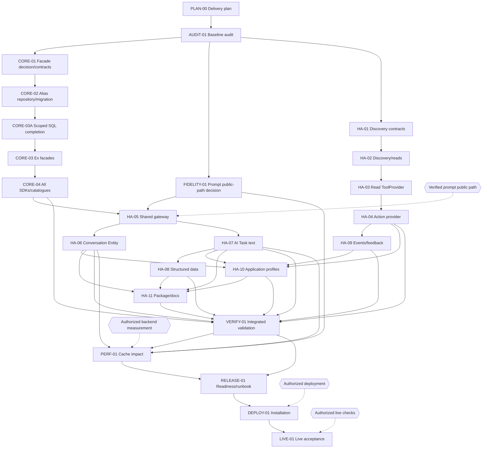

# Home Assistant package delivery graph

Created: 17 November 2026. Coordinator: `/root` (this chat's primary agent).
Approval and current delivery progress are recorded in the linked ledger.
The node table below is the initial planning snapshot, not a live status board.
Baseline commit: `2d95d9ce4fb75e906b61e8f2afa940d04cf9bf2e` **plus the existing dirty working tree**. A commit ID alone
is insufficient to identify the current prototype or any review candidate.

The [design document](home-assistant-integration-design-and-plan.md) owns intended
behavior. This file owns the executable deliverable graph and review protocol;
[home-assistant-delivery-state.json](home-assistant-delivery-state.json) is the
coordinator-owned progress ledger. The older HA-01–HA-08 outline in the design is
a coarse roadmap; this graph is the scheduling/closure authority and gives finer
node IDs. Preserve existing unrelated work.

## Scope and controlling decisions

The user requested a graph whose deliverables have independent implementer and
reviewer agents, with reviewer approval required before completion, and appointed
`/root` to coordinate delivery. This turn creates that plan; it does not dispatch
runtime implementation. The user separately proposed the generic core
conversation-map and `ConversationOpenRequestEx` / `AgentRunRequestEx` facades.
Their general platform decision/contract is a prerequisite node under
[ADR 0001](decisions/0001-integration-boundary.md); HA-only convenience does not
justify unrelated core changes.

Faithful HA system prompt/context preservation is required for both Conversation
and AI Task. The public task-text API does not itself preserve a native system
message role. FIDELITY-01 must resolve that semantic gap through a verified public
path or identify a separately authorized platform follow-up. Approval of the gap
investigation never makes downstream fidelity requirements satisfied. No current
core facade proposal authorizes a new arbitrary prompt/message-role API.

Prefix work is **impact assessment of HA's original prompt**, not a proposal to
correct HA's prefix behavior. Preserve its rendering, ordering and freshness.
Attachments, image generation, evaluation and HA configuration editing remain
outside this delivery graph until separately scoped.

Merge, push/publication, production installation, HA restart, live model calls and
device mutations are not authorized by this plan-only task. The operational nodes
remain gated until their exact target/action scope is explicitly authorized.

Implementation amendment: the user subsequently instructed “Start it”; the
coordinator-owned ledger records that authorization and the later decision to
leave prompt-dependent features gated. During CORE-03 implementation, owning
source inspection found unbounded identity/authority SQL outside CORE-02's
private alias transaction. The proposed CORE-03A below is a necessary internal
SQL-budget dependency of the authorized Ex facades and the repository's existing
completion policy. It adds no public capability or prompt transformation.
Its [scoped design](reviews/home-assistant-ex-sql-budget-design.md) and this graph
amendment require independent plan approval before code dispatch. This amendment
does not claim a universal deadline fix or change unrelated unscoped operations.

## Independence and closure protocol

1. Root dispatches a ready node to its named implementer role only after its
   predecessor nodes are accepted and any external gate is satisfied. Each
   dispatch records actual agent ID, file ownership and the candidate base.
2. The implementer owns only its assigned files, implements and verifies the
   contract, then reports **READY FOR REVIEW** with artifact hashes, changed files,
   tests actually run, failures/limits and remaining findings. It cannot close
   its own node or write its own approval.
3. Root freezes an exact candidate manifest: base commit, working-tree diff and
   SHA-256 of every authored file (including untracked files), dependency candidate
   manifests and relevant artifact/package hashes. Freeze a pre-review copy of the
   ledger and hash that snapshot in the external review manifest; do not hash the
   active ledger into itself. Do not review HEAD alone when the tree is dirty.
   Mutable ledger bookkeeping is separate from reviewed implementation artifacts;
   the frozen snapshot preserves the exact plan/assignment state the reviewer saw.
4. Root dispatches a **different actual agent** in the dedicated reviewer pool.
   The reviewer reads the owning sources, actual diff and evidence independently;
   the implementer's narrative is not proof. The reviewer must not have authored
   any implementation being approved. Review roles never rotate into implementation
   of the same reviewed material, and reciprocal approvals are not a substitute
   for independence. Root assigns a fresh reviewer if authorship overlaps.
5. The reviewer issues `APPROVE` or `CHANGES_REQUIRED`, bound to that candidate
   manifest. Approval requires acceptance cases and checks to pass, blocking
   findings to be resolved, and all limitations to match the node's explicit goal.
   Each finding has an ID, severity, location, correction/evidence and reviewer
   disposition. The reviewer proposes changes; the implementer authors fixes.
6. Root checks the verdict, candidate hashes, predecessor approvals, gate state
   and evidence completeness before changing node status to `accepted`. Root
   cannot waive reviewer rejection or supply reviewer approval on its own. A node
   may be marked finished **only after independent reviewer APPROVE**.
7. Any substantive source, generated contract, packaging or dependency integration
   change invalidates the affected approval and reopens review on the new
   candidate. Pure ledger progress bookkeeping does not alter an implementation
   candidate. Re-run only checks whose evidence changed or remains unresolved.
8. Root alone updates the ledger after receiving agent reports. This Markdown
   graph and initial node table are the reviewed plan specification; current
   progress changes only in the JSON ledger. Preserve history instead of replacing
   an old verdict with a new claim. A plan/graph change is a new review candidate.
   Keep merge, deployment and live validation evidence separate from `accepted`.

Implementer responsibility persists after review. A reviewer pass does not mean
merged, deployed or live validated. Prototype files, prior tests and an installed
component are starting evidence, not automatic closure of any feature node.

### Status and evidence fields

Node status moves `planned → implementing → ready_for_review → in_review →
accepted`, with `changes_required` returning to implementation. `awaiting_gate`
records a concrete external prerequisite; `reopened` records invalidated approval.
The ledger also retains separate implementation (`not_started`, `ready`), review
(`not_started`, `in_review`, `APPROVE`, `CHANGES_REQUIRED`), merge, deployment and
live-validation states. Only root records changes and timestamps.

Every review report records node ID, actual reviewer agent ID, implementation
agent ID, candidate manifest/digest, scope reviewed, checks actually run, results,
findings and explicit verdict. Review report paths are assigned on dispatch under
`docs/reviews/`; reports contain no credentials, private addresses, prompts or
runtime dumps. Root records report path and digest in the ledger.

### Gate registry

| Gate | Required proof before consuming nodes can start/close |
| --- | --- |
| `prompt_public_path_verified` | FIDELITY-01 reviewer approves a verified public path satisfying the agreed HA system-role/content semantics; a gap report alone leaves this false |
| `cache_backend_measurement_authorized` | Explicitly authorized non-side-effecting backend access, finite workload and protected evidence handling; local prompt-variation fixtures alone do not establish real cache impact |
| `deployment_authorized` | Exact target/artifact scope, configuration/backup/rollback plan and any required restart authorization |
| `live_acceptance_authorized` | Exact live model/device/voice/restart checks and permitted reversible target actions |

All gates start `not_satisfied`. If prompt fidelity needs additional platform
work, root records an explicit change request, user authorization and independent
reviewed successor nodes before wiring them into this DAG. Do not mark a fake
capability as available merely to unblock the graph. Independent HA discovery
work can continue while prompt-dependent nodes await that gate.

## Graph

An arrow means the predecessor must be accepted before implementation/acceptance
of the successor. Dashed external-gate edges add prerequisites; they are not
completed tasks. All nodes are deliverables, including investigation/decision
nodes with explicit evidence goals.

## Initial node/role snapshot

Roles in the next table are planned assignments, not a claim that those agents
are already running. Root records actual IDs at dispatch. The role pools ending
`_implementer` and `_reviewer` are separate; a reviewer agent must be independent
of authorship in the reviewed candidate. PLAN-00 has the actual implementer shown
and a reviewer reserved for independent dispatch.

| Node | Deliverable | Dependencies | Implementer agent role | Independent reviewer agent role | Initial status |
| --- | --- | --- | --- | --- | --- |
| PLAN-00 | Delivery graph and review protocol | — | `/root/ha_plan_implementer` | `/root/ha_plan_reviewer` | `ready_for_review` |
| AUDIT-01 | Baseline and capability audit | PLAN-00 | `ha_audit_implementer` | `ha_audit_reviewer` | `planned` |
| CORE-01 | Generic facade decision and contracts | AUDIT-01 | `ha_core_contract_implementer` | `ha_core_contract_reviewer` | `planned` |
| CORE-02 | Conversation alias repository and migration | CORE-01 | `ha_core_storage_implementer` | `ha_core_storage_reviewer` | `planned` |
| CORE-03A | Scoped SQL completion for Ex admission | CORE-02 | `ha_sql_budget_implementer` | `ha_sql_budget_reviewer` | `planned` |
| CORE-03 | Thin Ex operation facades | CORE-03A | `ha_core_facade_implementer` | `ha_core_facade_reviewer` | `planned` |
| CORE-04 | Shared catalogues and every SDK | CORE-03 | `ha_sdk_implementer` | `ha_sdk_reviewer` | `planned` |
| FIDELITY-01 | Prompt-role fidelity and public capability decision | AUDIT-01 | `ha_fidelity_implementer` | `ha_fidelity_reviewer` | `planned` |
| HA-01 | Discovery and read contracts | AUDIT-01 | `ha_discovery_implementer` | `ha_discovery_reviewer` | `planned` |
| HA-02 | Discovery and batched reads | HA-01 | `ha_read_implementer` | `ha_read_reviewer` | `planned` |
| HA-03 | Named read tool provider | HA-02 | `ha_read_provider_implementer` | `ha_read_provider_reviewer` | `planned` |
| HA-04 | Action provider and receipts | HA-03 | `ha_action_implementer` | `ha_action_reviewer` | `planned` |
| HA-05 | Shared typed request gateway | CORE-04, FIDELITY-01 | `ha_gateway_implementer` | `ha_gateway_reviewer` | `planned` |
| HA-06 | Conversation Entity lifecycle | HA-05 | `ha_conversation_implementer` | `ha_conversation_reviewer` | `planned` |
| HA-07 | AI Task text provider | HA-05 | `ha_ai_task_implementer` | `ha_ai_task_reviewer` | `planned` |
| HA-08 | Structured AI Task subset | HA-07 | `ha_structured_implementer` | `ha_structured_reviewer` | `planned` |
| HA-09 | Observation routing and feedback | HA-04 | `ha_events_implementer` | `ha_events_reviewer` | `planned` |
| HA-10 | Reusable Application profiles | HA-04, HA-06, HA-07, HA-09 | `ha_profiles_implementer` | `ha_profiles_reviewer` | `planned` |
| HA-11 | Installable package and operator docs | HA-06, HA-07, HA-08, HA-10 | `ha_package_implementer` | `ha_package_reviewer` | `planned` |
| VERIFY-01 | Integrated independent contract validation | CORE-04, HA-04, HA-06, HA-07, HA-08, HA-09, HA-10, HA-11 | `ha_verification_implementer` | `ha_verification_reviewer` | `planned` |
| PERF-01 | Faithful HA prefix-cache impact report | FIDELITY-01, HA-06, HA-07, VERIFY-01 | `ha_performance_implementer` | `ha_performance_reviewer` | `planned` |
| RELEASE-01 | Release readiness and rollout runbook | VERIFY-01, PERF-01 | `ha_release_implementer` | `ha_release_reviewer` | `planned` |
| DEPLOY-01 | Separately authorized installation | RELEASE-01 | `ha_deployment_implementer` | `ha_deployment_reviewer` | `planned` |
| LIVE-01 | Separately authorized live acceptance | DEPLOY-01 | `ha_live_implementer` | `ha_live_reviewer` | `planned` |

## Deliverable contracts

Paths with angle-bracket components are proposed files/directories to be finalized
at dispatch, not claims that those files already exist. Directory ownership is
exclusive while the node is active; root splits or serializes overlapping paths.

### PLAN-00 — Delivery graph and review protocol

Produce this acyclic graph, ownership assignments, ledger schema, gates and independent-review closure protocol.

**Owned outputs:** `docs/home-assistant-delivery-plan.md`; `docs/home-assistant-delivery-state.json`.

**Acceptance evidence:** Parse JSON, validate dependency references/acyclicity, check local links and ensure every node has different implementer/reviewer roles. Independent reviewer checks the actual plan and ledger snapshot; root records APPROVE before closing PLAN-00.

### AUDIT-01 — Baseline and capability audit

Inventory the dirty starting tree, existing Assist prototype, adapter/runtime, public SDKs and HA 2026.9.4 contracts. Record exact artifact hashes and existing test evidence, remaining gaps, supported action/selector subset and MCP-versus-native transport decision.

**Owned outputs:** `docs/reviews/home-assistant-baseline-audit.md`.

**Acceptance evidence:** Source pointers for every current-behavior claim; compare existing tests to actual files; identify every unimplemented capability and dependency. Do not import earlier test counts as current acceptance. No live mutation, model call or database suite needed.

### CORE-01 — Generic facade decision and contracts

Record the general platform need and exact Ex wire/DTO contract before code: authenticated project/source/owner key, external ID grammar, authorization, lifecycle, atomic get-or-open, existing-limit semantics, resolve-only Run-Ex, ordinary result shapes and normal API compatibility.

**Owned outputs:** `docs/decisions/<new-conversation-alias-decision>.md`; `docs/home-assistant-integration-design-and-plan.md`; `docs/sdks.md`.

**Acceptance evidence:** Independent review approves ADR 0001 rationale using this conversation’s explicit generic core proposal. Resolve on-miss and namespace/ownership choices. Explain why no pre-selection hook or adapter database access is used, and that alias lookup does not deduplicate utterances.

### CORE-02 — Conversation alias repository and migration

Implement a narrow typed resolver/repository and a new migration enforcing the approved full alias key and target integrity. Coordinate ordinary conversation creation and alias binding transactionally; serialize conflicting opens without orphan conversations or duplicate open notifications.

**Owned outputs:** `plowshare-server/src/main/java/io/aeyer/plowshare/server/archive/<new-alias-contract-and-repository>`; `plowshare-server/src/main/resources/db/migration/<new-version>`; `plowshare-server/src/test/java/<selected-alias-tests>`.

**Acceptance evidence:** Mock service tests cover scope/ownership denial, deleted/archived targets and explicit retention/reset policy. Selected @Tag("full-db") / -PfullDb tests prove uniqueness, concurrent first-open races, rollback and migration constraints. State the database-specific reason before each selected run. Verify shared 2-second default SQL completion deadline, normal <=500 ms queries and <=1-second worst-case ceiling including waits/materialization; inspect real enforcement and report gaps.

### CORE-03A — Scoped SQL completion for Ex admission

Implement the independently approved [internal scoped SQL-budget design](reviews/home-assistant-ex-sql-budget-design.md) so all Ex-owned identity/authority, alias, post-target and ordinary run-admission SQL shares one finite completion budget. Keep repositories responsible for SQL and keep ordinary transaction/lifecycle owners intact. The scope starts before admission; it does not open a transaction across the facade, hooks or scheduling. Decorate the repository connection holder and caller-thread authoritative projection leases while preserving the raw primary Hikari source and unscoped compatibility, including pool-admission-disabled composition.

**Owned outputs:** `plowshare-server/src/main/java/io/aeyer/plowshare/server/pool/<scoped-sql-budget-interface-infrastructure-and-composition>`; `plowshare-server/src/main/java/io/aeyer/plowshare/server/cache/ProjectionCacheConfiguration.java` (only necessary lease composition); `plowshare-server/src/main/java/io/aeyer/plowshare/server/cache/<Ex-private-miss-mode-and-atomic-existing-read>`; `plowshare-server/src/test/java/<scoped-budget-and-selected-PostgreSQL-tests>`; `docs/reviews/home-assistant-ex-sql-budget-design.md`; `docs/reviews/<scoped-sql-budget-implementation-evidence>`. CORE-03 owns wiring the accepted interface into its facade and its facade fixtures; coordinate that handoff instead of concurrent edits.

**Acceptance evidence:** Mock/barrier tests prove two-second default shared operation budget, earlier nested deadlines, one-second query ceiling through materialization, admission/acquisition interruption, transaction and independent lease coverage, bounded physical occupancy, cancellation/close/reuse fencing, preserved caller interrupts, unavailable/uncertain outcomes without replay and bounded shutdown. Verify fixed-label duration/breach/cancellation metrics and no raw SQL/identifiers. Selected tagged PostgreSQL cases prove actual lock/stream cancellation, rollback, acquisition and safe pool reuse only where mocks cannot. Confirm raw primary/pool metrics, shared template/transaction source identity, enabled/disabled admission and unchanged unscoped behavior. Preserve warm authorized hits and existing-fill coalescing; Ex-only private misses use existing uncached loaders so a scoped cancellation never aborts an ordinary shared fill/joiner. Verify current authority and query-count cost without claiming better cache performance. Record driver assumptions and gaps honestly; a logical timeout or SQL-only scope cannot establish whole-call completion for hooks/file loading.

This node is a prerequisite discovered during implementation. Existing CORE-03 semantic work was dispatched against accepted CORE-02; its completion and new scoped-budget wiring now require accepted CORE-03A. Root records that transition in the ledger, not as an implicit approval or a finished facade.

### CORE-03 — Thin Ex operation facades

Deliver the canonical wire/request/schema definitions, FrameTypes/dispatch registration and owning generated outputs required by the Ex handlers, then implement both server facades over the resolver and existing conversation/run owners. This node must compile and test without a later SDK node. Translate the external locator correctly and preserve ordinary post-commit/lifecycle ownership; avoid server self-RPC.

**Owned outputs:** `plowshare-server/src/main/java/io/aeyer/plowshare/server/ws/<Ex-handlers-FrameTypes-and-routing>`; `plowshare-server/src/main/java/io/aeyer/plowshare/server/agents/<owning-admission-seams>`; `plowshare-server/src/main/java/io/aeyer/plowshare/server/api/<Ex-request-contracts>`; `plowshare-protocol/<required-shared-contracts>`; `sdk/typescript/src/operations/<canonical-Ex-contracts>`; `scripts/generate-sdk-contracts.mjs`; `sdk/<owning-generated-contract-outputs>`; `plowshare-server/src/test/java/<facade-tests>`.

**Acceptance evidence:** Prove one client request reaches the ordinary lifecycle; include authorization before disclosure, actual target scope validation, incompatible routing, run-on-miss refusal, existing allowance preservation, no repeated log.open, concurrent opens, run exclusion, cancellation and uncertain submission. Assert useful resolved snapshots are reused; repeated reads require an authority freshness/concurrency reason. Integrate accepted CORE-03A before the first admission SQL and through final synchronous checks without an outer Spring transaction. Verify remaining non-SQL phase budgets, including hook loading/execution; SQL-only enforcement must not become a whole-call deadline claim. Existing non-Ex API tests remain passing.

### CORE-04 — Shared catalogues and every SDK

Consume the canonical, compiling Ex wire contract from CORE-03 and complete all public SDK/client conveniences, command surfaces, documentation and cross-language conformance. Ex requests use explicit external selectors, typed replies and compatible old operations in Java, TypeScript/Node, Python, Go and .NET. Regenerate through owning scripts for any approved upstream correction; canonical changes reopen CORE-03 review.

**Owned outputs:** `sdk/typescript/<client-command-surfaces-and-tests>`; `sdk/java/<public-helpers-and-tests>`; `sdk/node/<public-helpers-and-tests>`; `sdk/python/<public-helpers-and-tests>`; `sdk/go/<public-helpers-and-tests>`; `sdk/dotnet/<public-helpers-and-tests>`; `test-support/contracts/<owning-fixtures>`; `docs/sdks.md`.

**Acceptance evidence:** Generator drift check, malformed/missing/conflicting selectors, refusal and unknown-delivery conformance, actual transport facade round trips and old-request compatibility. Run check, sdkCheck and required installed-consumer sdkPackageCheck when package surfaces change; missing toolchains are unresolved evidence, not a PASS. Verify generated files are not hand-edited.

### FIDELITY-01 — Prompt-role fidelity and public capability decision

Specify exact Conversation and AI Task prompt/context semantics and inspect available public routes. Decide whether a documented task-envelope adaptation satisfies the requirement or native system-role fidelity is necessary. Identify the existing SDK limitation explicitly; do not silently demote HA system content.

**Owned outputs:** `docs/reviews/home-assistant-prompt-fidelity-decision.md`; `docs/home-assistant-integration-design-and-plan.md`.

**Acceptance evidence:** Review actual request fields and prompt assembly, versioned HA behavior, trust/precedence, compaction and resume. Publish a supported public-path decision or an exact capability-gap report. APPROVE of this investigation is not approval of an unimplemented capability. Set prompt_public_path_verified only when a real acceptable public path is verified; otherwise prompt-consuming nodes remain gated pending an explicitly authorized platform follow-up.

### HA-01 — Discovery and read contracts

Define adapter-owned typed resource/action descriptions, policy filters, references, revision/freshness and bounded paging. Establish the reviewed executable action/selector subset and per-credential/binding snapshot identity. Existing explicit aliases remain compatible.

**Owned outputs:** `integrations/home-assistant/src/main/java/io/aeyer/plowshare/integrations/ha/<typed-discovery-reader-contracts>`; `integrations/home-assistant/src/test/java/<discovery-contract-tests>`.

**Acceptance evidence:** Fixtures cover denied metadata/counts, duplicate names, renamed/deleted entities, missing registries, unavailable states, primitive versus unsupported nested attributes, credential/policy isolation and input bounds. Confirm no new shared IntegrationPayload variant or generic object domain contract is required.

### HA-02 — Discovery and batched reads

Implement policy-filtered search/descriptions and batched reads using the configured HA connection and supported registries/services. Reuse authorized typed snapshots with explicit freshness/version reasons for refresh; bound cache size, IO and connection maintenance.

**Owned outputs:** `integrations/home-assistant/src/main/java/io/aeyer/plowshare/integrations/ha/<discovery-and-read-implementation>`; `integrations/home-assistant/src/test/java/<discovery-read-tests>`.

**Acceptance evidence:** Fake HA transport cases verify paging consistency, read batching/no N+1, stale-on-disconnect, registry/policy invalidation, reconnect epochs, slow peers and shared finite deadlines. Discovery does not grant actions and leaks no denied identifiers or counts. No live device mutation or database test.

### HA-03 — Named read tool provider

Publish and serve search/describe/read/list-action tools through the existing SDK ToolProvider and explicit Application/provider scopes. Use configured prefixes for multiple HA bindings and current catalogue lease/revision rules.

**Owned outputs:** `integrations/home-assistant/<SDK-provider-composition-and-journal>`; `integrations/home-assistant/<provider-config-and-tests>`.

**Acceptance evidence:** Test catalogue expiry/withdrawal, schema changes, granted/denied agent visibility, source/credential separation, bounded catalogue size, reconnect and receipt reconciliation. Public SDK only; no server dependency in production classpath. Existing manual alias runtime remains working.

### HA-04 — Action provider and receipts

Implement reviewed action schemas and ha_execute_action over explicit targets/parameters with deterministic authorization checks. Keep delivery, actual effect and observed verification separate; preserve existing causal context and unknown-effect journal semantics.

**Owned outputs:** `integrations/home-assistant/src/main/java/io/aeyer/plowshare/integrations/ha/<typed-action-profiles-and-execution>`; `integrations/home-assistant/<action-provider-and-tests>`.

**Acceptance evidence:** Exercise malformed parameters, unauthorized targets, stale offered schemas, revoked policy, queue/timeout/cancellation before and after possible effects, restart and lost acknowledgement. A fake reversible action executes once, an UNKNOWN action is never automatically resent, and selected observation verifies separately. Unsupported selectors remain non-executable.

### HA-05 — Shared typed request gateway

Refactor the current bridge into separate conversation/task request and result contracts sharing SDK transport and recovery. Carry complete admitted HA system/context content and provenance through the verified public path. Use Ex APIs for durable external conversation mapping; retain accepted-job/uncertain-send correlation locally.

**Owned outputs:** `integrations/home-assistant/assist/custom_components/plowshare/agent.py`; `integrations/home-assistant/assist/custom_components/plowshare/models.py`; `integrations/home-assistant/assist/tests/<gateway-tests>`.

**Acceptance evidence:** Prove exact source preservation and role semantics of the approved route, no discarded extra prompt, profile/caller/task isolation, bounded admission/storage/cleanup, restart reconciliation and no replay. Demonstrate a facade call removes the client resolve round trip. Native role fidelity must not be claimed when only text preservation exists.

**Additional gates:** `prompt_public_path_verified`.

### HA-06 — Conversation Entity lifecycle

Complete Conversation Entity adaptation for Assist/frontend/API calls, preserving language, effective system/extra prompts and supported context. Bind returned HA session IDs through core aliases and configure profile-specific control reporting and anonymous-source policy.

**Owned outputs:** `integrations/home-assistant/assist/custom_components/plowshare/conversation.py`; `integrations/home-assistant/assist/custom_components/plowshare/config.py`; `integrations/home-assistant/assist/custom_components/plowshare/config_flow.py`; `integrations/home-assistant/assist/tests/<conversation-tests>`.

**Acceptance evidence:** Actual isolated HA Conversation API tests cover first turn/follow-up, session expiry/new returned ID, caller and source partitioning, control-disabled routing, chat-log updates, refusal, unsupported inputs and no duplicate tool execution. Expiring HA session state never cancels accepted durable jobs or erases pending/uncertain effect records.

**Additional gates:** `prompt_public_path_verified`.

### HA-07 — AI Task text provider

Add an independent AI Task entity/profile for supplied-data generation and optional explicit read-only evidence. Preserve HA-prepared task system/context and use an isolated request/conversation per invocation. Expose standard HA action/helper selection without requiring Assist.

**Owned outputs:** `integrations/home-assistant/assist/custom_components/plowshare/<ai_task-platform>`; `integrations/home-assistant/assist/custom_components/plowshare/__init__.py`; `integrations/home-assistant/assist/custom_components/plowshare/manifest.json`; `integrations/home-assistant/assist/tests/<ai-task-tests>`.

**Acceptance evidence:** Real isolated HA generate_data action and async_generate_data helper return completed text; distinct callers and concurrent identical instructions remain isolated. Timeout, failed/capped run, unsupported llm_api or attachment, invalid context, cancellation and lost acknowledgement yield explicit errors, never pending prose as data. No implicit device-changing permission.

**Additional gates:** `prompt_public_path_verified`.

### HA-08 — Structured AI Task subset

Implement the approved limited HA selector/type profile and strict generated-data validation. Preserve required/optional distinctions and closed field sets. Retain invalid completed work; use a public shared output-recovery path only if supported and admitted, otherwise return a truthful error.

**Owned outputs:** `integrations/home-assistant/assist/custom_components/plowshare/<typed-output-spec-and-validator>`; `integrations/home-assistant/assist/tests/<structured-output-tests>`.

**Acceptance evidence:** Exercise unsupported schemas before submission, invalid JSON, wrong types, extra/missing fields, parser/byte limits, modest prose overruns, retained failed results and original allowance. No re-running research or actions to fix presentation; no direct inference/internal recovery call. Return only validated completed data.

**Additional gates:** `prompt_public_path_verified`.

### HA-09 — Observation routing and feedback

Generalize configured selected observations/workflow routes while preserving threshold holds, startup/reconnect suppression, cooldowns, bounded retention and causal feedback. Prevent own Plowshare-backed conversation/AI Task endpoints from recursively invoking themselves.

**Owned outputs:** `integrations/home-assistant/<observation-and-route-contracts>`; `integrations/runtime/<only-required-compatible-local-routing-seams>`; `integrations/home-assistant/src/test/java/<event-and-feedback-tests>`.

**Acceptance evidence:** Fake events prove continuity gaps cancel holds, startup is not historical crossing, retained events are not lost at bounds, causal acknowledgements do not cause loops and UNKNOWN actions are not replayed. Existing captured-input orchestration restriction remains explicit; do not promise unsupported fresh remote waits.

### HA-10 — Reusable Application profiles

Provide optional reusable house-agent, supplied-data generation and read-only task profiles with explicit dynamic-tool assignments, scopes, credential references, workflow notification routing and installation instructions. Keep connection policy out of agent prose and real deployment values out of source.

**Owned outputs:** `integrations/home-assistant/examples/application/`; `integrations/home-assistant/examples/config.json`; `integrations/home-assistant/src/test/java/<example-loader-tests>`.

**Acceptance evidence:** Current loaders validate complete examples. Agents can share provider capabilities without shared private histories; plain generation works without outbound device provider; control and read-only profiles remain separate; no grants arise from discovery or prompt metadata. Templates are not asserted deployed.

**Additional gates:** `prompt_public_path_verified`.

### HA-11 — Installable package and operator docs

Package the reviewed external adapter and HA component with correct public SDK dependencies/resources, separate feature flags and configuration entry/profile lifecycle. Document transition from local alias maps to core ownership without replay or competing map owners.

**Owned outputs:** `integrations/home-assistant/assist/scripts/package.py`; `integrations/home-assistant/assist/README.md`; `integrations/home-assistant/README.md`; `integrations/home-assistant/assist/custom_components/plowshare/translations/`; `integrations/home-assistant/assist/tests/<install-and-migration-tests>`.

**Acceptance evidence:** Fresh artifact install, SDK byte/resource/dependency integrity, baseline HA config flow, token rotation, reconfigure/unload/restart, old-state migration and pending-job preservation pass. Unsupported evaluation, image and attachment flags stay off. No restart or deployment of live HA is performed by this node.

**Additional gates:** `prompt_public_path_verified`.

### VERIFY-01 — Integrated independent contract validation

Assemble the exact candidate revision and independently validate core facades, SDKs, provider, both HA entry points, templates and distributions together. Review the earlier prototype against current requirements; prior passes are evidence to recheck, not automatic completion.

**Owned outputs:** `docs/reviews/home-assistant-integrated-validation.md`; `integrations/home-assistant/<only-new-cross-boundary-fixtures>`; `test-support/<only-required-contract-fixtures>`.

**Acceptance evidence:** Run appropriate check/formatCheck/integrationBoundaryCheck, sdkCheck, package checks and HA explicit gate on the exact source. Actual SDK transport fixtures prove one-request alias facade, state/action flow, task completion, isolation, prompt preservation and no replay. Select only justified full-db constraint/race tests. Reviewer must not have authored any feature implementation being validated.

**Additional gates:** `prompt_public_path_verified`.

### PERF-01 — Faithful HA prefix-cache impact report

Investigate the original HA prompts as supplied: how often they change, earliest divergence, following history size, chosen public handoff roles, and backend reuse/latency implications. Use the earlier six-case source probe only as initial evidence. Do not rewrite/split/reorder/freeze/relocate HA prompt content to improve caching.

**Owned outputs:** `docs/reviews/home-assistant-prefix-cache-impact.md`; `integrations/home-assistant/assist/<bounded-investigation-fixtures-if-needed>`.

**Acceptance evidence:** Repeat isolated source/helper probes with recorded version/hash and show actual model-request layout for the approved route. Finite, non-side-effecting measurement on an explicitly authorized backend records model/template/configuration, actual cache observations or unknown, cold/warm TTFT/prefill/end-to-end distributions and load. Character common prefixes and count previews are not cache-hit metrics. If backend access is unavailable, report the remaining external prerequisite; no fabricated live report.

**Additional gates:** `prompt_public_path_verified`, `cache_backend_measurement_authorized`.

### RELEASE-01 — Release readiness and rollout runbook

Produce the exact source/artifact manifest, all reviewer approvals, compatibility/known-limit report, target preflight, backup/rollback procedure and proposed reversible live acceptance actions. Separate implementation approval from merge, deployment and live-validation states.

**Owned outputs:** `docs/reviews/home-assistant-release-readiness.md`; `integrations/home-assistant/<rollout-and-rollback-runbook>`.

**Acceptance evidence:** Confirm accepted dependencies and exact revision/artifact hashes; no unresolved blocking findings or unimplemented required fidelity path. Review backup validation versus restore rehearsal honestly, target versions, active-work handling and rollback without deleting uncertain receipts. This node prepares a reviewable rollout and does not merge, publish, deploy, restart HA or act on devices.

**Additional gates:** `prompt_public_path_verified`.

### DEPLOY-01 — Separately authorized installation

After explicit target-specific authorization, install the approved server/SDK/provider/HA artifacts and configured Application through supported operator paths. Preserve durable data, configuration, resource settings and pending/uncertain work. Restart HA only within the authorized rollout scope.

**Owned outputs:** `docs/reviews/home-assistant-deployment-receipt.md`; `<private operator config and deployment receipt outside source>`.

**Acceptance evidence:** Record actual deployed source/artifact/schema/HA identities and compatibility, private backup evidence and bounded readiness results. No raw secrets/addresses/config dumps in source. Do not cancel active work for convenience, replay uncertain effects or mark live validation from health alone. Capture rollback state and unresolved failure precisely.

**Additional gates:** `deployment_authorized`.

### LIVE-01 — Separately authorized live acceptance

Exercise the public deployed package with the agreed permitted targets: scoped discovery/read, one reversible action with observation, Conversation API follow-up/session handling, standard AI Task action/helper and supported structured result. Validate configured voice providers if voice deployment is in scope.

**Owned outputs:** `docs/reviews/home-assistant-live-acceptance.md`.

**Acceptance evidence:** Record exact artifact identity and actual public results; confirm caller isolation, faithful prompt/context, feedback protection and status after timeout/restart without replacement work. Device changes/model calls/restarts require the explicit live-acceptance scope. Distinguish unavailable test equipment or missing STT/TTS from a passing check.

**Additional gates:** `live_acceptance_authorized`.

## Coordinator scheduling and tracking

There are four concurrent agent slots: root plus at most three workers. The safe
normal schedule is one implementer/reviewer pair and one optional implementer on
a disjoint ready branch. Reviewer slots are reserved before opening more work;
root never leaves reviews starved behind unreviewed implementation batches.
Roles are reused sequentially only where independence and file ownership hold.

Initial waves after PLAN-00 approval:

1. AUDIT-01 establishes the exact baseline. No feature node inherits an assumed
   completion from the existing dirty prototype.
2. CORE-01, FIDELITY-01 and HA-01 can be queued as independent branches, but root
   schedules only what fits the worker/reviewer slots. Ready nodes wait for review
   capacity rather than claiming progress by opening unlimited agents.
3. CORE-01 approves the platform contract. CORE-02 supplies storage; CORE-03A
   supplies the scoped physical SQL completion boundary discovered during
   implementation and must be accepted before CORE-03 closure. CORE-03
   owns the canonical wire definitions/registration and generated types needed
   to compile its server facades. CORE-04 follows with complete SDK/client usage
   and cross-language evidence; it is not a prerequisite hidden inside CORE-03.
   Upstream canonical fixes reopen the affected approval. HA discovery/read/
   provider/action work proceeds independently. Prompt-dependent gateway work waits
   for both core SDK delivery and verified fidelity semantics.
4. Once HA-05 is accepted, Conversation and AI Task can be assigned to separate
   implementers with disjoint files. Shared configuration/setup files are owned
   by one node at a time and handed off explicitly. Each node gets its own reviewer.
5. Root assembles one integration candidate for VERIFY-01, then permits the faithful
   cache-impact investigation and release preparation. Operational nodes wait for
   their independent authorization gates.

Root serializes Gradle runs and shared generated-catalog/migration allocation
work. Pause overlapping Java edits during a compiled candidate's checks. Assign
the next migration version against current source at dispatch; never edit a shipped
migration or reserve a version from stale history. Separate SDK generated outputs
from handwritten owning contracts and review the generator diff.

At each dispatch root records task ID, goal, exact baseline, files, dependencies,
gates, actual agent IDs, required checks and stop conditions. During work root
tracks findings and blockers, routes reviewer feedback to the implementer, and
keeps the user informed of meaningful changes. On completion root records the
exact evidence and reviewer verdict, then schedules newly ready successors.

The machine ledger contains dependency IDs, roles, actual agent IDs, candidate
revision/evidence, finding records, reviewer verdict/report and distinct delivery
milestones. Empty/null fields mean no evidence has been supplied, never implicit
approval. PLAN-00 starts ready for review; every feature node starts planned.

## Verification policy

Follow [delivery/review](../.agents/delivery-and-review.md),
[coding standards](coding-standards.md),
[native SDK standards](native-sdk-standards.md) and the owning subsystem guides.
Tests use mocks/fakes by default. Real PostgreSQL tests are justified only for
CORE-02 assertions requiring actual migration/constraint/locking/rollback behavior,
CORE-03A assertions requiring actual scoped cancellation/transaction/pool behavior,
or a later separately stated database-specific reason; select the smallest set
with `-PfullDb --tests` and keep `@Tag("full-db")`. Never run the entire database
suite or dockerSmoke for general confidence.

Java edits require format and formatCheck; repository-wide delivery requires
check. Core contract/SDK edits require the owning generator plus check and
sdkCheck; package-surface changes require fresh installed-consumer sdkPackageCheck.
The HA package has its explicit Python runtime gate at
`integrations/home-assistant/assist/scripts/check.py`. Confirm target HA versions
and native toolchains at dispatch; a missing .NET/Go/HA toolchain is an unresolved
check, not permission to weaken coverage. Scope-specific commands and exact
fully qualified tests are recorded by each implementer and verified by its reviewer.

Do not broaden/repeat passing checks without a changed candidate, failure or
unresolved concern. Documentation-only PLAN-00 validates links, JSON, graph,
role independence and status invariants; it does not run Gradle or database tests.

## Completion definition

The requested package is implementation-complete only when all required feature,
integration, fidelity and faithful cache-impact nodes have independent approval
on the integrated candidate. RELEASE-01 makes that candidate reviewable for a
separately authorized rollout. A gate or optional future feature cannot be
silently dropped from a completion claim. Native role fidelity remains a required
semantic decision, not an optional future convenience.

Deployment-complete and live-validated are later explicit milestones with their
own agents, approvals, target/artifact receipts and user authorization. Root keeps
coordinating until the authorized scope is complete, preserving the ledger across
handoffs rather than resetting incomplete tasks.
