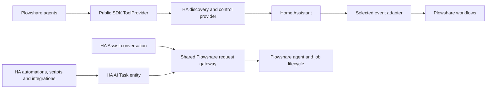

# Home Assistant integration package: design and implementation plan

Status: design and delivery plan. Scope corrected 22 November 2026; generic
read-discovery amendment authorized 24 November 2026.

Current scope: the caching/fidelity concern does not justify adapting Plowshare
to upstream prompt behavior. The only core extension is external conversation-ID
mapping via the existing Ex SDK calls. Preserve supplied HA text using existing
SDK task semantics; document native-role limitations without a delivery gate.
No prompt rewriting/cache optimization or additional core capability is planned.
Optional backend cache measurements do not block supported integration release.
This correction supersedes the earlier native-fidelity gate and proposed
externalContext successor; historical reports retain their original scope.
See the current delivery graph and SCOPE-01 independent review for closure.

Native Assist lifecycle clarification (23 November 2026, HA-FIX-01): HA can open
its session/chat log and supply a generated ID before the first entity call.
Admit that first turn only with matching active native contexts and an otherwise
empty current-input log; a supplied ID alone grants no ownership. Direct unknown
IDs and retained foreign history remain refused. Native upstream expiry can mint
a new ID before the adapter sees the request, so no continuity from the hidden
old ID can be inferred; old SDK receipts remain independent and are not replayed.
The adapter fences its own context preparation and SDK handoff, not HA's prior
pipeline work. See the follow-up's reviewed evidence in the delivery ledger.

The [delivery graph](home-assistant-delivery-plan.md) defines executable nodes,
independent implementer/reviewer assignments and the approval gate for finishing
each deliverable. The coordinator tracks actual progress in the
[delivery ledger](home-assistant-delivery-state.json). This document owns the
design; the detailed graph and ledger own scheduling and completion status.

The existing selected-resource tools, Assist/AI Task companion and read diagnostics
are implemented and independently reviewed; the ledger owns their exact source
and operational evidence. The generic read-discovery amendment below extends that
source. Historical proposed names and tables describe the original plan and do
not establish current deployment or live validation.

## 1. Outcome and scope

Provide one reusable integration package with two directions:

1. **Plowshare uses Home Assistant.** Authorized agents discover selected home
   resources, inspect capabilities, read state, perform permitted actions and
   react to selected observations.
2. **Home Assistant uses Plowshare.** Assist conversations, automations, scripts
   and other integrations request work from configured Plowshare agents.

The package supplies capabilities independently of a particular house agent.
An optional Application template supplies useful agent/workflow definitions;
existing Applications can instead attach the provider to their own eligible
agents. HA's standard Conversation Entity and AI Task Entity are independent,
first-class entry points into Plowshare.

| HA entry point | Caller intent | Plowshare mapping |
| --- | --- | --- |
| Conversation Entity | Chat/voice interaction or a programmatic conversation with follow-ups | Configured agent with retained conversation history |
| AI Task Entity | One-off generation requested by an automation, script or integration | Isolated task with a completed text/structured result |

The package exposes both platforms through one HA integration, with explicit
profile assignments and a shared SDK gateway. Neither platform requires the other
to be enabled, and neither requires the outbound device provider for plain text.

AI Task is a first-class part of this design. A caller can request a summary,
classification or structured recommendation and consume the result without
starting a voice conversation. HA can then apply its own deterministic automation
rules to that result.

All Plowshare access stays on the public SDK. Follow
[ADR 0001](decisions/0001-integration-boundary.md): no server internals, direct
database access or new shared API contracts to make the adapter work. Record any
missing public capability as a gap and continue independent integration work.

## 2. Current implementation and compatibility

| Surface | Current source evidence | Capability amendment |
| --- | --- | --- |
| External HA adapter | Selected-state discovery/read tools, optional fixed action provider, observations and durable recovery | Add stable resource/field discovery and explicit selection profiles while preserving existing bindings |
| Shared integration runtime | `IntegrationAdapter`, typed reads/actions, Relay handling and workflow routing | Reuse unchanged; no new shared `IntegrationPayload` variants |
| SDK tool providers | Named tools, typed schemas, catalogue publication, scopes and reconciliation | Append adapter-owned capability tools using existing SDK |
| HA Assist companion | Conversation platform, SDK gateway, retained correlation and diagnostics download | Add optional effective-exposure endpoint; preserve gateway lifecycle |
| HA AI Task provider | Implemented text/flat-structured generation with independent review | Preserve current supported behavior and limits |
| House Application | Read-only/control/task profiles, plus older observation examples | Add exact optional capability grants and source-qualified disambiguation guidance; no automatic deployment |

Implementation references:

- [HA adapter and configuration](../integrations/home-assistant/README.md).
- [Adapter interface](../integrations/runtime/src/main/java/io/aeyer/plowshare/integrations/IntegrationAdapter.java)
  and [runtime contract](../integrations/runtime/README.md).
- [Named SDK tools](relay-tools.md), [provider scopes](tool-scopes.md),
  [tool schemas](tool-schemas.md) and
  [Python provider](../sdk/python/src/plowshare/tools.py).
- [Assist gateway](../integrations/home-assistant/assist/custom_components/plowshare/agent.py),
  [component setup](../integrations/home-assistant/assist/custom_components/plowshare/__init__.py)
  and [installation](../integrations/home-assistant/assist/README.md).

### HA version boundary

Use HA 2026.9.4 as the initial compatibility baseline, matching the version
inspected during this work. Its AI Task code provides `GENERATE_DATA`, an
`async_generate_data` helper and a task/result pair for instructions and optional
structured output. Its schema objects use Voluptuous. See the
[versioned task API](https://github.com/home-assistant/core/blob/2026.9.4/homeassistant/components/ai_task/task.py).

The [linked current AI Task entity guide](https://contributors.home-assistant.io/core/entities/ai-task/)
also describes an evaluation interface and uses Probatio schema types. These
details must not be copied into the baseline implementation without compatibility
tests. Evaluation, attachments and generated images are separately gated work;
the existence of an HA feature flag does not establish Plowshare support. The
[2026.9.4 feature declarations](https://github.com/home-assistant/core/blob/2026.9.4/homeassistant/components/ai_task/const.py)
do not include evaluation.

No HA upgrade is required merely to start the proposed data-generation provider.
Verify newer releases in a separate test environment before claiming compatibility.

## 3. Architecture and ownership



The external provider owns HA authentication, protocol translation, capability
snapshots, resource filtering and action receipts. The HA custom component owns
HA entities, caller adaptation and bounded local correlation. Plowshare owns
inference, conversation history, jobs, budgets, approvals and workflow durability.

The package can contain multiple processes. The external Java adapter and the
Python HA custom component do not need a new private RPC protocol between them:
both consume supported Plowshare SDK capabilities. The provider process runs
outside HA, while the custom component runs inside HA.

An AI Task-only installation can use a configured generation agent without the
external HA device adapter. Installing both directions must not create a loop in
which a Plowshare agent invokes its own HA AI Task entity.

### Proposed adapter-owned interfaces

Names below describe local typed contracts, not new server operations or SDK DTOs.

| Interface | Responsibility | Important result fields |
| --- | --- | --- |
| `ResourceDiscovery` | Search resources and describe their capabilities | Binding-scoped reference, entity ID, device/area references, supported actions, snapshot revision and availability |
| `ResourceReader` | Read a bounded batch of permitted resources | Typed values/attributes, units, source time, observation time, connection epoch and stale/missing state |
| `ActionExecutor` | Validate and execute one permitted action | Stable operation identity, effect outcome, acknowledgement and separate observed verification |
| `ObservationSource` | Deliver configured, sanitized observations | Source identity, resource reference, continuity/epoch and causal context |
| `PlowshareRequestGateway` | Submit and reconcile conversation or one-off work | Retained conversation/job IDs and completed, pending, refused, failed or unknown outcome |
| `TaskOutputValidator` | Convert completed generation output to its declared result contract | Validated text or typed structured fields; explicit validation failure |

Implement these narrowly within the HA package first. Extract shared integration
interfaces only after another adapter demonstrates a real reuse requirement.
Preserve HA-specific capabilities through typed variants rather than a generic
object payload. JSON and HA schema objects stay at their owning boundaries.

## 4. Discovery and agent tools

### 24 November generic read-discovery amendment

The user authorized documenting and implementing a general method for duplicate
names, fields outside an entity's primary state, renames, updates and broken
configuration. This amendment supersedes per-entity fixes as the intended method.
The [capability contract](reviews/home-assistant-capability-contract.md) defines
the adapter-local interfaces and failure cases; the delivery graph/ledger record
independent implementation and review. Existing SDK operations suffice. Core,
shared SDK contracts, shared integration runtime and database changes are excluded.
Control remains disabled and this source task does not alter a live selection.

The method is **discover → resolve → describe → read**. Resources have opaque
stable references backed by registry identity where HA supplies it. Entity IDs
are current locators, while names, aliases, device and area are lookup metadata.
Persistent adapter-owned identity anchors distinguish a verified rename from a
replacement reusing the old name or locator. Missing stable registry evidence
remains explicit; continuity is never inferred from a friendly name.

Field descriptions expose permitted typed state/attribute capabilities with a
quantity, role (current measurement, target, status or unknown), unit and schema
revision. Standard measurement profiles cover domain-supported readings without
per-entity exceptions. Explicit field selection supports additional primitives;
unknown semantics stay unknown and unsupported nested values remain unsupported.
Current and target temperatures remain distinct even on the same resource.

Resolution returns resource/field candidates and a whole-result ambiguity status
before pagination. Names are not unique keys, and availability cannot establish
identity or silently choose a winner. Reads return a fresh bounded batch with
per-field availability, source/observation times, provenance and stale status.
Schema changes invalidate prior field references; value changes alone do not.

Policy is configured once: existing frozen entity selection remains the default;
an explicit standard-measurement profile expands readable capabilities only for
selected resources. An optional follow-Assist mode follows HA's effective
conversation exposure rules, including removals, without granting control.
Selection, exclusions and field permissions apply before metadata, candidates,
counts or values are disclosed. New modes/profile choices require explicit
operator configuration; discovery itself grants no authority.

HA 2026.9.4's stock `homeassistant/expose_entity/list` is admin-only and reports
stored positive preferences, which do not establish effective exposure defaults.
The optional follow mode therefore uses an adapter-owned, versioned native HA
WebSocket command, `plowshare/discovery/selection`, supplied by the companion.
It invokes HA's canonical exposure helper rather than duplicating its rules.
That helper may materialize HA's default exposure preferences in its own store;
this normal HA behavior is documented, with no device/service/model invocation.
The command requires HA administrator authority and returns only selected entity
IDs. Unavailable/denied/incompatible capability fails honestly; no stock-list or
broader-selection fallback occurs. Frozen mode has no companion dependency.

Changes are reconciled within finite operation budgets using current policy and
connection epochs. Schema/identity state is bounded and preserved across restart,
with explicit ownership and corrupt-store failure. No accepted model/action work
or uncertain provider publication is replayed to recover discovery. All new
capability tools remain read-only and separately require exact server grants.

The following table is the historical initial naming proposal. Current tools use
the configured read-prefix suffixes `search`, `describe`, `read`, `list_actions`,
`health` and `diagnose` in legacy mode. Optional capability mode instead publishes
`health`, `resolve`, `describe_fields` and `read_fields`, preventing legacy handlers
from bypassing its current field/selection policy. The original proposal names below are not
current declarations.

Historical initial model-tool proposal:

| Tool | Purpose |
| --- | --- |
| `ha_search_entities` | Find permitted resources by text, area, domain and capability, with bounded pagination |
| `ha_describe_entity` | Explain one permitted entity's state shape, available actions and constraints |
| `ha_read_states` | Read selected entities in one bounded batch |
| `ha_list_actions` | Describe executable actions and their validated parameter schemas for selected targets |
| `ha_execute_action` | Execute an offered action against explicit permitted targets using its schema revision |

The `ha_` prefix is illustrative. Configure distinct provider identities/prefixes
for multiple HA connections according to existing provider-scope rules. Reuse
the SDK's existing invocation-status and reconciliation capabilities; do not
introduce a second durable job ledger or automatically retry an uncertain action.

Use HA's [WebSocket API](https://contributors.home-assistant.io/core/internals/websocket-api/)
for states, service-action descriptions, selected registry metadata and event
subscriptions where supported by the target version. A state listing alone does
not establish device/area relationships or whether an action applies to a target.
Probe capabilities explicitly and report unavailable metadata.

Discovery follows these rules:

- Connect only to an explicitly configured origin. Resource discovery does not
  authorize network scanning or searching for credentials.
- Filter resources, attributes and actions before returning search results,
  counts, descriptions or tool schemas. Denied resources must not leak through
  pagination or errors.
- Return stable binding-scoped references and current HA entity IDs; account for
  renamed/deleted entities. Resolve area names to explicit authorized targets
  before executing an action; do not silently broaden a target when a room changes.
- Include enough authorized metadata in each result to avoid fetching the same
  entity again solely to recover its name, units or area. Separate state freshness
  from slower-changing capability metadata.
- Bound snapshot size, pages, cache retention and concurrent reads. Caches are
  isolated by HA credential context, binding and policy revision. Reuse snapshots
  within the admitted operation; invalidate on relevant registry/policy changes
  or connection loss.

HA action descriptors include UI selectors and metadata; they are not proof that
every possible action can be safely translated into an executable JSON schema.
Initially support reviewed translators/profiles and existing explicit parameter
schemas. Describe unsupported actions as unavailable for execution. Do not turn
unknown selectors into unrestricted dictionaries.

Discovery supplies descriptions; policy supplies authority. A newly discovered
resource becomes controllable only if the configured resource/action policy
already covers it. Document whether a policy deliberately covers future devices.

### Tool-provider wiring

Use SDK `ToolProvider`/`RelayTools.Provider`, catalogue publication and existing
Application tool scopes. Eligible agents opt into dynamic tools, with separate
read and control tool assignments. The adapter also enforces target/parameter
policy on every invocation: permission to call `ha_execute_action` alone does
not grant every entity or service.

Publish bounded catalogues and renew their leases through existing SDK methods.
A stale or withdrawn catalogue must not remain executable. Validate the offered
schema revision and current target policy before an effect; changed capabilities
must not reinterpret arguments generated against an older definition.

The existing [outbound MCP connector](../integrations/mcp/README.md) is a reuse
candidate for HA installations exposing an MCP server. Evaluate it during the
capability audit, including target-version tools and event limitations. Native
WebSocket discovery/events and MCP access must use consistent explicit policies;
there is no silent protocol fallback after a failed or uncertain call.

## 5. HA entry points into Plowshare

### Conversation Entity for Assist and programmatic conversations

Use HA's [Conversation Entity contract](https://contributors.home-assistant.io/core/entities/conversation/).
It serves Assist/frontend chat and `conversation.process`. The entity handles
text through `_async_handle_message(user_input, chat_log)`; HA supplies the chat
log. Declare supported languages and return a `ConversationResult` with an
`IntentResponse`, conversation ID and follow-up indication. Keep response
streaming disabled until an end-to-end supported implementation exists.

Retain the existing custom component implementation as the starting point. HA
owns its speech pipeline and UI history; Plowshare owns agent history and durable
work. Keep only correlation state in the component. Send the new utterance to
the mapped Plowshare conversation instead of replaying HA's entire chat log.
Partition mappings by HA caller/source context, selected profile and integration
entry; caller-supplied conversation IDs do not authorize access to someone else's
Plowshare history.

Preserve and validate the input language, caller context and device/satellite
metadata at the HA boundary. Preserve the HA-rendered system prompt and extra
prompt according to the shared prompt/context contract below. Attachments must
be supported explicitly or rejected before submission.
The current companion only forwards text; broader context handling is planned,
not established behavior. Metadata cannot add tools, change the configured agent
or grant authority. Keep prior prompts from being accidentally re-applied on
every follow-up.

In HA 2026.9.4 the handler and request/result fields are already present; use the
[versioned entity implementation](https://github.com/home-assistant/core/blob/2026.9.4/homeassistant/components/conversation/entity.py)
and [input/result definitions](https://github.com/home-assistant/core/blob/2026.9.4/homeassistant/components/conversation/models.py)
as the compatibility reference. An update to HA is not required for this entry
point. Current-documentation helpers must still be checked against that baseline.

Conversation calls also have a public HA
[Conversation API](https://contributors.home-assistant.io/core/internals/conversation-api/).
Automations can call `conversation.process`; API clients can use the authenticated
`conversation/process` WebSocket command. Select the configured conversation
agent and reuse the returned conversation ID for follow-up requests. These are
conversational callers, while callers needing validated task data should use
AI Task.

Illustrative automation action for the conversation platform:

```yaml
- action: conversation.process
  data:
    agent_id: conversation.plowshare
    language: en
    text: "What can you tell me about the office temperature?"
  response_variable: house_reply
```

The conversation entity ID is an example, not a runtime default. A follow-up can
pass `house_reply.conversation_id` as `conversation_id`; keep that value within
its originating caller's conversation context.

#### Core conversation-ID mapping and Ex facade contract

The user separately proposed generic core ownership of external conversation
aliases, then authorized execution of the reviewed graph. CORE-01 records the
implementation contract in
[ADR 0077](decisions/0077-conversation-external-aliases.md). CORE-02–CORE-04 are
now accepted and merged; the initial audit predated those capabilities. The HA
gateway consumes the existing public Ex SDK operations and verifies its own
binding; no new core implementation is needed. Adapters never query the alias
table or import server internals.

```text
(resolved project ID, authenticated account UUID, source, externalConversation)
    -> Plowshare conversation ID
```

The original three-column proposal is refined with server-derived ownership and
an account-local source namespace so different clients/accounts cannot collide.
The caller chooses a source label only beneath its own authenticated account; it
cannot supply another account or infer authority from a source string. External
caller/profile identity is partitioned by the adapter inside its opaque ID and is
not independently attested by Plowshare. Token rotation within one account keeps
its namespace. Stable project/account IDs prevent reused names from reconnecting
to another retained history.

| Proposed SDK request | Wire operation | Behavior and ordinary result |
| --- | --- | --- |
| `ConversationOpenRequestEx` | `conversation.open.ex` | Required project/source/externalConversation; atomic get-or-open, returning ordinary ConversationView with real internal ID |
| `AgentRunRequestEx` | `agent.run.ex` | Required project/source/externalConversation/agent/task; resolve an existing binding then ordinary conversational admission, returning ordinary accepted StartedJob |

The ADR fixes exact grammar/fields, nullability, shared budgets, authorization,
transaction boundaries and acceptance cases. Both requests require explicit named
project scope and use current authority on the actual mapped target. Run-Ex
translates to an internal conversation selector without passing its external
project selector to the ordinary path. An absent Run-Ex alias is NOT_FOUND; it
never opens implicitly or interprets the external ID as an internal ID. No
pre-selection hook, server self-RPC or extra client resolve request is used.

Creation and alias insertion, including the canonical allowance, commit together
through a typed specialist repository and the ordinary creation owner. Database
uniqueness coordinates concurrent first opens without orphan rows. Existing
Open-Ex aliases keep their history, lifecycle, cap, total and spent usage; creation
options are validated but never applied again and log.open is not repeated.
Lifecycle is preserved internally; the unchanged ordinary ConversationView reply
has no lifecycle field. Existing lifecycle-filtered conversation listing provides
a separate read when needed, and lifecycle mutation is not an inspection API.
Run-Ex has ordinary run-level limits; explicitly supplying maxModelCalls retains
the existing absolute-total raise contract, while omission leaves the allowance
unchanged. The alias never deduplicates utterances: a lost Run-Ex reply retains an
uncertain submission fence rather than permission to resend.

Aliases have no idle expiry/reset/rebind API in this slice. Archived/ejected roots
are returned unchanged by Open-Ex and refused for work by the ordinary run owner;
missing/invalid targets are refused, never replaced. Retention keeps the mapping
while the conversation row exists. HA session expiry does not cancel durable work.
New sessions use new external IDs. A phased prototype migration preserves old
pending/uncertain correlation and legacy routes while fresh sessions select a
versioned core route; it never imports client-supplied internal IDs, replays old
work or installs competing mapping owners. Seamless binding/import of historical
local mappings is an explicit separate capability gap.

#### Existing hooks cannot select the conversation

The current hook contract has no pre-selection/pre-resolution stage. The closest
stages are:

| Existing stage | Actual timing and decision | Can resolve an external conversation ID? |
| --- | --- | --- |
| `log.open` | After the log/conversation row is committed; may add a fixed opening block | No; its context already names the created log and it cannot return another ID |
| `prompt.pre` | Inside a run after its conversation/agent have been selected; contributes prompt additions | No; it cannot retarget the conversation |

References: [hook stage and decision types](../plowshare-hooks/index.ts),
[log lifecycle contract](../plowshare-server/src/main/java/io/aeyer/plowshare/server/agents/LogStages.java),
[conversation-open handler](../plowshare-server/src/main/java/io/aeyer/plowshare/server/ws/ConversationOpenHandler.java)
and [run admission/selection](../plowshare-server/src/main/java/io/aeyer/plowshare/server/agents/Runs.java).
Hooks have no direct database/network access, and `log.open` fails open. These
are unsuitable semantics for an authoritative mapping lookup or mutation.

If the core proposal proceeds, place an explicit typed conversation resolver
after authentication and requested project/source validation, before the current
branch that builds the caller from a supplied Plowshare conversation or opens a
new one. Let existing admission enforce the resolved conversation's real scope
and agent access. A new hook for policy around resolution would be a separate
decision; it is not necessary merely to provide the durable registry. Do not
retrofit `log.open` into a pre-create or routing hook.

The control capability flag describes an available configured control path; it
is not a permission grant. In the target design, advertise it only for profiles
with a verified control binding, and test HA's local-intent routing preference.
The current companion declares this flag for its expected existing adapter
setup; profile-specific capability reporting is planned migration work.

The default Plowshare control path uses its provider grants and adapter policy.
Do not independently execute the same model tool request through HA's chat-log
tool loop. Mapping HA-provided LLM tools into Plowshare is a separately gated
capability, with one explicit effect owner and validated authority.

The existing finite wait, job correlation and uncertain-submission fences remain
part of the contract. Return pending work as a truthful conversational status,
not as a claim that a requested device action completed. Speak user-facing answer
text only; reasoning and tool previews remain excluded. Request continued
listening only when an actual follow-up is expected, not to poll background work.

Refactor the gateway before adding a second caller. Its current
`ask(key, text) -> Answer` surface is conversation-specific: a pending status
sentence is suitable for voice but cannot stand in for generated AI Task data.
Introduce distinct request/result types for conversational and one-off work,
with shared SDK connection, submission, correlation and reconciliation code.

### AI Task entity for automations and other integrations

Add an `ai_task` platform to the HA custom component, with its own stable entity
identity and configurable Plowshare Application/agent profile. The first profile
performs text generation with tools disabled. An optional read-only profile may
use explicitly granted HA evidence tools. Device-changing agent profiles remain
separate and opt-in; requesting a summary must not implicitly authorize actions.

HA prepares an AI Task chat log before the provider handler runs. The proposed
gateway must preserve its system prompt and supported task context, not just
`task.instructions`. The shared prompt/context contract below applies to both
entity platforms.

An automation can select the Plowshare AI Task entity or use HA's configured
preferred data-generation entity. Other integrations can call HA's public
`ai_task.async_generate_data` helper. Those callers do not need Plowshare SDK
credentials. HA's helper routes the request to the selected entity and returns
its result. See the [versioned caller API](https://github.com/home-assistant/core/blob/2026.9.4/homeassistant/components/ai_task/task.py).

Illustrative automation action, for the proposed provider:

```yaml
- action: ai_task.generate_data
  data:
    entity_id: ai_task.plowshare
    task_name: room_summary
    instructions: >-
      Summarize these supplied readings in two sentences and preserve uncertainty:
      {{ states('sensor.example_room_temperature') }} degrees,
      occupancy {{ states('binary_sensor.example_room_occupied') }}.
  response_variable: room_summary
```

Illustrative call inside another HA integration:

```python
from homeassistant.components import ai_task

result = await ai_task.async_generate_data(
    hass,
    task_name="house_summary",
    entity_id=configured_ai_task_entity,
    instructions=validated_summary_request,
    context=context,
)
# Consume result.data according to the requested text/structure contract.
```

The entity ID and sensor names above are examples, not runtime defaults. The
caller selects an AI Task entity through its own configuration. The standard
action is response-bearing; its HA registration is documented in the
[2026.9.4 component](https://github.com/home-assistant/core/blob/2026.9.4/homeassistant/components/ai_task/__init__.py).

### One-off task lifecycle

1. Validate instructions, output contract, caller context and supported features
   before submitting model work. Keep task names as metadata, not instructions.
2. Allocate an isolated Plowshare conversation/request per task invocation. Do not
   reuse an Assist chat or another automation's previous context.
3. Persist submission intent, then use public conversation/agent operations once.
   Retain accepted job identity before polling. Concurrent identical instructions
   are distinct tasks; a text hash is not an idempotency key.
4. Wait within the configured task deadline and reconcile accepted work through
   public job/status APIs. Return only a completed, validated result.
5. Populate HA's chat log with the final answer where required and return its HA
   conversation ID. Keep the Plowshare correlation ID in private adapter state.
6. On refusal, failure, exhausted allowance, malformed output or timeout, raise an
   appropriate HA error. Never return "still working" or an acceptance receipt
   as `GenDataTaskResult.data`.

Standard AI Task calls wait for their result. Long investigations should use a
separately documented asynchronous Application workflow and existing notification
routing. An adapter-specific async service, if later justified, must have its own
explicit acceptance/status contract; it is not a substitute result for
`ai_task.generate_data`.

On caller cancellation or timeout, keep accepted job IDs and unknown submission
fences. Closing an SDK socket does not stop remote work. Any explicit job-cancel
request must use the existing SDK operation, consume a bounded cleanup budget
and preserve uncertainty. A new HA automation invocation is new work, not a safe
retry inferred from matching instructions; do not configure automatic retries
for side-effecting tasks without a supported caller identity/receipt contract.

### Required preservation of HA system prompts and context

Preserving HA's system prompt and context is a requirement for **both Conversation
and AI Task**. Text-only forwarding in the current companion is an implementation
gap. Preserve the actual rendered content and its provenance; do not replace it
with a generic house-agent summary, drop it for cache performance, or mistake a
hash for model-visible instructions.

For conversations, use HA's prompt-preparation helper with the configured prompt,
selected supported LLM API and extra prompt before capturing the request. For
AI Task, capture the already prepared chat log. HA's helper can add a rendered
instruction template, tool guidance, date/time and extra instructions; time is
conditional on the available tools. References:
[Conversation prompt preparation](https://contributors.home-assistant.io/core/entities/conversation/),
[AI Task chat log](https://contributors.home-assistant.io/core/entities/ai-task/)
and [baseline prompt-building implementation](https://github.com/home-assistant/core/blob/2026.9.4/homeassistant/components/conversation/chat_log.py).

The adapter-owned request contract should retain:

| Component | Preservation rule |
| --- | --- |
| Rendered HA system content | Preserve complete text, order and source role, with a content digest and capture/version metadata; no arbitrary whitespace rewriting |
| Configured prompt and extra prompt | Preserve effective instructions and their source; avoid appending an extra prompt twice when HA already included it in the rendered system content |
| Current conversation/task input | Preserve the new user utterance or task instructions as input, distinct from system instructions and evidence |
| Model-relevant context | Preserve supported language, device/room context and supplied evidence with source times/availability; distinguish absent values from unknown ones |
| HA tool/schema context | Preserve supported declarations and constraints without converting them into new Plowshare grants; reject an unsupported requested tool API before model work |
| History and revisions | Correlate the latest HA prompt/context snapshot with its turn/task; reuse Plowshare history instead of submitting the entire HA chat log again |
| Private routing/identity metadata | Retain only the necessary authenticated correlation context outside model prose; never forward credentials or the entire raw HA context object |

Implement a validated typed `HaRequestContext` at the component boundary, used by
both gateway request types. The name is a proposed local contract, not a new SDK
DTO. Include the rendered HA system content, original role/provenance, supported
context values and version/digest references. Keep protocol envelopes and raw
HA schema objects out of the internal gateway contract. Enforce explicit byte,
field-count and parser budgets; an oversized required prompt is an error, not
permission to truncate instructions. Model-prose word guidance remains separate.

Each new request captures current HA context within the configured profile;
earlier snapshots remain historical evidence. An accepted run keeps the normal
platform retention/recovery behavior. Do not inject a changed prompt into an
accepted run or recreate work to refresh time/state. A retained snapshot records
what the original request saw; a genuinely necessary refresh for a new request is
new bounded work with its own provenance, not a rewrite of that old snapshot.
Verify and document ordinary compaction/recovery behavior for admitted task text.
Adapter-journal retention does not establish model retention. The adapter must
not claim special instruction persistence or require new core compaction behavior.

HA instructions remain subordinate to Plowshare's platform rules, admitted agent
capabilities, approvals and current authorization. Preserve requested behavior
without allowing prompt text to select credentials, expand grants, fabricate a
tool or bypass a refusal. Tool descriptions and sensor text remain data.

#### Public SDK limitation: content preservation versus message-role fidelity

The current [Python `AgentRunRequest`](../sdk/python/src/plowshare/contracts.py)
and [server request contract](../plowshare-server/src/main/java/io/aeyer/plowshare/server/api/RunAgentRequest.java)
expose task text, agent/conversation selection, images and lifecycle limits. They
do **not** accept arbitrary message lists or a per-request system/developer prompt.

The SDK-only candidate is a versioned, deterministic serialization of the typed
HA request context and current input inside `task`. It can preserve HA text and
source-role metadata, under a fixed agent profile explaining their interpretation.
However, the inference request still sees this content as task/user text. A field
labelled `ha_system` does not create a real system message, and model instructions
about precedence are not an authorization mechanism.

The [FIDELITY-01 investigation](reviews/home-assistant-prompt-fidelity-decision.md)
records an earlier native-role interpretation and a proposed externalContext
successor. The user clarified that the concern was caching awareness, not a
requirement to change Plowshare for upstream systems. That prerequisite is
retired, not technically satisfied. No system-context API or platform successor
is authorized or needed for the supported SDK-only adapter contract.

Use a typed, versioned adapter envelope serialized into the existing `task`
field. Preserve original supplied HA text and its provenance without rewriting
for caching. Document task/user role and the normal platform retention behavior;
do not promise native system priority or special compaction persistence. Treat
context as input, never tool grants. Explicitly refuse unsupported capabilities
before submission. Do not introduce hidden transport fields, call inference
directly, redefine agents per request or manufacture agents per rendered prompt.
There is no additional mandatory user prompt-mapping choice gate.

### Prefix caching: impact of the prompt HA actually supplies

The objective is to preserve HA's system prompt/context and assess the resulting
cache behavior. Treat HA's rendered message as authoritative input from that
boundary. **Do not rewrite, split, reorder, freeze, deduplicate or relocate HA
prompt components to make them cache-friendly.** This plan does not assume the
integration can "correct" HA's prompt construction. Adapter-owned routing
metadata must not introduce unnecessary model-visible changes either.

The SDK-only handoff has explicit task/user semantics. Preserve the supplied
content for correctness; this adaptation is not a cache optimization or a claim
of native system-role equivalence.
Investigating source variation does not require that transport decision to have
already been implemented.

Prompt quality and cache efficiency belong primarily to the integrator or
application that constructs the request. The SDK may understand and report
variation, and reusable common patterns may justify SDK support or an explicit
correction. It must not assume that changing an integrator's prompt is transparent
or safe. Preserve HA's original rendering and observe/report its cache impact.
Any future transformation requires an explicit semantic contract, compatibility
evidence and opt-in; this design authorizes no such transformation.

#### Source findings for HA 2026.9.4

The shared prompt helper renders the configured/default instructions, adds the
selected API's prompt, conditionally adds a clock/date template, then appends an
effective extra prompt. It replaces the system entry at the start of the HA chat
log on preparation. There is no guarantee that the resulting system message
stays identical between requests. See
[baseline prompt assembly](https://github.com/home-assistant/core/blob/2026.9.4/homeassistant/components/conversation/chat_log.py).

| Source of variation | Observed source behavior | Consequence to investigate |
| --- | --- | --- |
| Default clock/date | Without a tool whose name ends in `GetDateTime`, HA renders the current time to seconds and the current date into the system prompt | Requests in different seconds can diverge inside the system block before history |
| Configured instruction template | HA renders the template again; user/device context or template state lookups can change its result | Divergence can occur earlier than the clock and invalidate a longer suffix |
| Selected API prompt | The selected API contributes its own instructions/context | API selection, device inventory or integration-specific content can change the prefix |
| Extra prompt | The effective extra instructions are appended to the system block | A changed extra prompt still diverges before subsequent conversation history |
| Tools/schema | Declarations are supplied separately and serialized by the backend template | Matching HA system text alone does not prove matching model-input prefixes |

The clock template and default voice instructions are defined in
[HA's LLM helper](https://github.com/home-assistant/core/blob/2026.9.4/homeassistant/helpers/llm.py).
AI Task invokes the same preparation helper with its task-oriented default
instructions, before adding task input. A fixed task instruction template
therefore does not imply a fixed complete system message. See the
[AI Task preparation path](https://github.com/home-assistant/core/blob/2026.9.4/homeassistant/components/ai_task/entity.py).

There is also evidence against a blanket claim that HA ignores cache stability:
its built-in home context uses an entity overview without current state, with
live values available through `GetLiveContext`; a `GetDateTime` tool can avoid the
inline clock. See the [home context implementation](https://github.com/home-assistant/core/blob/2026.9.4/homeassistant/components/homeassistant/llm.py)
and [date/time tool](https://github.com/home-assistant/core/blob/2026.9.4/homeassistant/components/llm/llm.py).
These are existing HA behaviors, not changes this plan proposes to force on
callers. Custom prompts/APIs can still be highly variable. Record what each
configured profile actually supplies rather than labelling all HA requests
prefix-aware or prefix-unaware.

#### Isolated prompt-variation probe

On 17 November 2026, an isolated environment with the installed HA 2026.9.4
package invoked its real `ChatLog.async_provide_llm_data` helper. The probe used
fixture time/state, default voice/task instructions and a fixture API advertising
a date/time tool. It made no live HA, device, tool or model calls. AI Task's
instruction constant was read from its installed source; its full entity/action
pipeline was not executed. The probes below test assembly behavior, not deployed
configuration or inference performance.

| Pair of otherwise equivalent requests | System text identical? | Character common prefix / complete prompt length |
| --- | --- | --- |
| Default Conversation, no API/tools, clock advances one second | No | 161 / 191 |
| Default AI Task instructions, no API/tools, clock advances one second | No | 88 / 118 |
| Default Conversation, fixture date/time tool, clock advances one second | Yes | 164 / 164 |
| Default AI Task instructions, fixture date/time tool, clock advances one second | Yes | 91 / 91 |
| Custom state template, fixture date/time tool, temperature changes | No | 27 / 56 |
| Default Conversation, fixture date/time tool, extra prompt changes | No | 173 / 174 |

These numbers are character offsets in the synthetic HA system message only.
They are not token counts, reusable KV lengths, cache-hit percentages or latency
measurements. A deployed template, selected API, language, model and tool schema
will produce different inputs. No conclusion about the live instance's current
cache rate follows from this table.

For reproducibility, the inspected installed-source SHA-256 values were:

| File within the installed `homeassistant` package | SHA-256 |
| --- | --- |
| `components/conversation/chat_log.py` | `3b4ddba72593847227eb9ee726d6fab8f103ba51844a0145ef3ff07717dece17` |
| `helpers/llm.py` | `0220ca2cac1c26abad667fdb25a38e4480a56a90ce9fec9a8be60cc3671beb1d` |
| `components/ai_task/const.py` | `61e09538cccdd0962dc121020597c66f497c4608032c9d9c0c1880882daa790c` |

Source hashes identify the inspected package files; a matching version label
alone is not proof that another installation contains identical code. The clock
probe fixed time at two adjacent seconds and changed no other input. The state
and extra-prompt probes held time fixed and varied just that source. Repeat with
the target package and selected actual API before treating the fixture as a
representative profile.

#### Expected effect when the original HA message is preserved

For a handoff that retains HA content in an effective leading system block, the
model-input shape is conceptually:

```text
[fixed platform/profile content, where the backend places it]
[HA system content, including any rendered clock/API context/extra prompt]
[conversation history, when present]
[current user or task input]
```

A clock change near the end of that system block can still invalidate reuse of
all the history that follows it. Repetition later in the prompt does not make
that later text an identical prefix again. An earlier custom-template change
can affect an even larger suffix. Unchanged platform content and the unchanged
part before the first difference may remain reusable on a backend that supports
partial-prefix reuse; the entire cache is not necessarily lost.

The distinction between workload types matters:

- **Conversation:** growing history can be large. A small change in an earlier
  HA system message can require reprocessing that history on the next request,
  even though most of its text is unchanged. If HA supplies identical system
  content and schemas, ordinary history extension can remain cacheable.
- **One-off AI Task:** there is no inherited conversational history to lose.
  System variation can reduce sharing of the instruction/API prefix across
  independent tasks, while each task's new input still needs processing. Long
  shared context or a large tool catalogue can make the lost reuse significant.
- **A single admitted task's tool/model loop:** the captured HA prompt may remain
  constant while several model calls run. Clock changes in the outside world do
  not necessarily trigger HA preparation on every one of those model steps.
  Measure preparation boundaries and model-call boundaries separately.

The inference backend's prompt/KV cache is the relevant cache. HA discovery,
repository and token-count caches answer different questions. Plowshare's
[system-message assembly](../plowshare-server/src/main/java/io/aeyer/plowshare/server/agents/JobRuntime.java)
merges system messages at the front; its
[reminder placement](../plowshare-server/src/main/java/io/aeyer/plowshare/server/agents/Reminding.java)
protects history from other volatile additions. Those existing optimizations do
not make a changing upstream HA system message stable.

The current task-text SDK adaptation would produce a different inference layout
and must have its impact reported as that adaptation, with the role-fidelity
limitation intact. It is not evidence that HA's original system-prompt behavior
has been fixed. Do not promote the previously proposed late-envelope placement
as the solution to upstream prompt churn.

Backend behavior varies. [vLLM prefix caching](https://docs.vllm.ai/en/stable/features/automatic_prefix_caching/)
can reuse matching prefix computation subject to configuration and residency.
LM Studio's [MLX engine documentation](https://lmstudio.ai/blog/mlx-engine-agentic-workloads)
describes checkpoint/rewind behavior that depends on model architecture and
engine version. Existing Plowshare extension-only observations are historical
constraints, not a benchmark of the current deployment. A miss primarily adds
prompt-processing/prefill work; any effect on time-to-first-token, total latency,
capacity or cost must be measured for the selected backend. No fixed speedup or
slowdown is asserted.

#### Impact investigation and acceptance

HA-04 and HA-08 should measure faithful requests, without optimizing HA's content:

1. Record the HA version, actual configured template/API/tool capabilities and
   prompt-preparation boundary for each Conversation/AI Task profile. Capture
   authorized original system/context snapshots privately, with restricted
   retention; put hashes, lengths and change categories in routine diagnostics.
2. Compare consecutive original requests for exact equality, earliest changed
   character/token, common-prefix length and the size of the following history.
   Distinguish clock, template, API context, extra-prompt and schema changes.
   Use a verified backend tokenizer/template before reporting token-prefix lengths.
3. Observe unchanged ordinary traffic and representative changes. A controlled
   fixture may hold time fixed to isolate a cause, but production requests must
   retain the actual clock and context. Do not remove data or change callers'
   chosen tools to manufacture a cache-friendly baseline.
4. Capture the actual admitted model request layout and schema fingerprint through
   supported evidence. Report any role adaptation separately. A reconstructed
   context preview is not proof of the original inference payload or cache reuse.
5. Record backend/model/template/version/configuration and actual cached-token
   observations, prefill/time-to-first-token and end-to-end latency under
   comparable load. Separate warm/cold runs, history sizes, task types, routing,
   eviction, batching, compaction and resumed work. Do not replay a device action
   or real automation merely to get another latency sample.

Use [usage accounting](model-usage-accounting.md) for provider-reported cache
observations. Count-only measurements do not prove inference-cache hits. Missing
observations remain unknown; do not calculate a hit percentage from character
commonality or latency. Preserve history and caller isolation regardless of any
backend sharing. Keep measurement work finite and separately budgeted.

The deliverable is a per-profile impact report: how often HA changes the system
prompt, where it first changes, which prefix the backend can actually reuse and
what extra processing/latency follows. Any later proposal to change HA prompts or
model-role semantics is separate work, with explicit user authorization.

## 6. Structured output and feature gates

Text generation comes first. Structured data follows with an explicit supported
selector/type profile, preserving required versus optional fields, bounds and
closed field sets. Convert the HA schema at the boundary to a validated typed
output specification. Unsupported selectors or schema constructs fail before
model submission; never silently omit constraints.

The inspected Python `AgentRunRequest` accepts a task and lifecycle limits; it
does not supply a native structured-response parameter. The SDK-only initial
approach is to include a validated output description in the generation task,
parse the completed answer strictly and validate it at the HA boundary. Prompting
for JSON does not guarantee schema compliance. Return only validated data,
without coercing malformed values into success. Raw HA dictionaries/schema
objects do not become internal application contracts.

Retain invalid completed work for inspection. Do not repeat evidence collection
or tool actions to repair formatting. Model prose uses word targets with documented
tolerance. Any model-assisted correction must use an accessible, compatible
[shared output-recovery contract](decisions/0074-model-output-recovery-policy.md)
and the original allowance; do not call server internals or invent a second
unbounded repair loop. If this cannot be expressed through public capabilities,
report the gap and fail explicitly rather than silently extending core.

| Feature | Initial decision | Evidence required before enabling |
| --- | --- | --- |
| Text generation | First AI Task milestone | Completed text result, isolated jobs and truthful failures on baseline HA |
| Structured data | Next milestone | Supported selector mapping, strict validation and malformed-output tests |
| Caller-provided `llm_api` tools | Unsupported initially | Public SDK mapping of tool authority/lifecycle; reject an unsupported request explicitly |
| Attachments/camera input | Deferred | Authorized transfer, supported public SDK image references, MIME/size limits, retention and cleanup |
| Image generation | Deferred | Public end-to-end generation/download capability and valid HA image result; a vision input API is insufficient |
| Evaluation | Version-gated follow-up | HA target-version support, typed result semantics and calibrated/validated application handling |

Do not set `SUPPORT_ATTACHMENTS`, `GENERATE_IMAGE` or evaluation feature flags
until the corresponding complete path exists. Do not silently drop attachments,
HA system/task context or requested tool APIs. Translate supported context into
explicit task data/instructions with a documented trust boundary; reject features
whose meaning cannot be preserved. HA-provided tools do not become Plowshare
grants merely because they appear in a chat log.

## 7. Authorization, configuration and feedback

Keep three identities distinct: the HA connection credential, the Plowshare
provider credential, and the HA-to-Plowshare request credential. A shared HA
configuration entry can reference common connection settings, but token reuse
and agent/profile assignments must be explicit. No credential enters model
context, discovery descriptions, ordinary errors or logs.

HA users and automation contexts are provenance and conversation/task partitions;
they do not impersonate Plowshare accounts. Each request profile exercises its
configured service authority. Separate service identities/profiles when callers
require different effective permissions. Anonymous voice access remains an
explicit opt-in and does not confer permission on arbitrary HA task sources.

Configure permitted discovery resources/attributes, read resources, executable
services/targets/parameters, event subscriptions and workflow destinations
separately. Server membership, Application grants and provider assignments remain
authoritative. Discovery descriptions and external sensor strings are untrusted
data, not new instructions or approval evidence.

Current named device controls refuse `conversation.process`, `ai_task.generate_data`
and `ai_task.generate_image`, since parameters or HA defaults can select this
package's own Plowshare-backed endpoints. Read discovery may still describe an
explicitly configured profile; that description is not an execution permit. There
is no named-control override until verified destination identity and bounded
ancestry can support deliberate cross-agent composition. The separate private
manual alias path remains explicit operator policy.

Existing runtime-owned actions use bounded ancestry/context correlation for their
HA events. Named SDK control receipts retain context, but are not automatically
inserted into the legacy runtime's feedback index. The
[observation-routing contract](../integrations/home-assistant/OBSERVATION-ROUTES.md)
records this composition limit and the future shared-owner requirement. Do not
assume cross-host feedback suppression or build a second task scheduler in HA.

Endpoints, credential sources, project/agent choices, provider prefixes,
resource policies, budgets and private journal locations are validated deployment
configuration. The package contains no local network addresses or account defaults.

## 8. Budgets, results and observability

Short discovery, read, status and acceptance operations use configurable budgets
with a two-second default ceiling. Model-backed tasks and external device actions
have separate explicit finite budgets appropriate to their work. Queueing,
connection, nested calls and result processing share the earlier remaining
deadline; retries and polling do not reset it. Bound local storage, worker counts,
catalogues, response bytes, task retention and cleanup independently.

SDK transmission timers alone do not cover all admission waits. Preserve explicit
outer deadlines and test cancellation at the owning boundary. The existing
server/provider limits do not establish universal physical abort on expiry.
Track outstanding physical cleanup until it settles; never release capacity
solely because the caller stopped waiting.

Preserve the distinction between tool delivery, actual effect and physical
verification. A service acknowledgement means HA accepted it. A later state
observation can provide verification, with a finite observation budget; absent
evidence remains unverified. An uncertain action is never automatically resent.

Expose bounded diagnostics for connection/capability availability, catalogue age,
refusals, timeouts, task duration, output-validation failures, uncertain effects
and pending cleanup. Reuse supported SDK accounting/usage evidence. Do not put
prompts, raw device attributes, tokens or reasoning into routine diagnostics.

## 9. Delivery plan and acceptance

The [detailed delivery graph](home-assistant-delivery-plan.md) supersedes the
coarse HA-01–HA-08 sequence below for execution, dependencies, agent assignments
and completion tracking. These older IDs describe design slices, not accepted
tasks; use the detailed graph's IDs when dispatching implementation or review.

The initial implementation stays in `integrations/home-assistant/`, its HA custom
component and optional Application source. SDK changes, core changes and live
rollout are separately scoped work. Preserve the existing manually configured
adapter and Assist behavior throughout migration.

Each node has an integration maintainer as implementer and a separate integration
reviewer as reviewer; assign people when implementation begins. The reviewer
checks the owning source and evidence. All nodes below are **planned**. Closing
one means implemented and independently verified/reviewed, not merged, deployed
or live validated.

| Node | Depends on | Deliverable | Acceptance evidence |
| --- | --- | --- | --- |
| HA-01 | — | Capability/version audit, typed local contracts, prompt/context fidelity decision, threat/lifecycle cases and MCP reuse decision | Baseline/newer-version matrix; content versus native system-role semantics reviewed; exact public SDK gaps recorded; no core dependency |
| HA-02 | HA-01 | Policy-filtered search, entity descriptions and batched reads | Mock HA fixtures for denied/renamed/missing resources, stale snapshots, pagination and credential isolation |
| HA-03 | HA-02 | SDK named tool provider and reviewed action schemas | Dynamic catalogue/scope tests, invalid arguments, changed schema, revoked permissions, lost acknowledgement and one reversible action fixture |
| HA-04 | HA-01 | Shared request gateway, typed HA prompt/context preservation, complete Conversation Entity adaptation and separate conversation/task outcomes | Rendered prompts/extra prompts and fresh context preserved; system-role adaptation explicit; original HA prompt-variation and prefix-impact evidence; Assist and `conversation.process`, follow-ups, isolation, concurrency, deadlines and recovery tested |
| HA-05 | HA-04 | HA AI Task text provider, profile configuration and standard callers | Prepared task system prompt/context reaches the admitted model request; real baseline HA action/helper return completed text; no voice dependency; pending/failure never reported as data |
| HA-06 | HA-05 | Structured-data subset and strict result validation | Required/optional/extra fields, unsupported selectors, invalid JSON, byte limits and retained failed output exercised |
| HA-07 | HA-02, HA-03 | Configurable observations, workflow routing and optional Application templates | Gap/reconnect, causal feedback, sustained thresholds and deterministic HA consumption of AI Task results |
| HA-08 | HA-03, HA-05, HA-06 | Distribution, setup documentation and separately authorized live acceptance | Install/reconfigure/unload tests, public authenticated round trips, target-version evidence and optional separately authorized backend-specific cold/warm prefix-cache measurements |

HA-04 and HA-05 do not depend on device-control discovery: other integrations can
request generation while the outbound HA provider evolves. HA-07 is required for
the full event-driven package, but is not a prerequisite for a text AI Task
release. Attachments, image generation, evaluation and configuration editing
require later explicitly scoped nodes.

Use mocked repositories/transports and small fakes by default. This adapter work
does not justify PostgreSQL tests. Exercise actual HA APIs in an isolated runtime
and actual public SDK transport fixtures, keeping simulated HA/model behavior
distinct from live acceptance. Use existing integration-boundary and repository
checks when implementation changes; documentation-only edits need link/content
verification, not database or full build reruns.

### Live acceptance checklist

- Verify discovery reveals only permitted resources, and a Plowshare agent can
  read an authorized current state through its assigned provider.
- Execute one deliberately chosen reversible action once; inspect its receipt
  and observed outcome separately. Exercise uncertain delivery without replay.
- Verify Assist text and `conversation.process` use the selected profile and
  preserve follow-up IDs without leaking history between callers. Test language,
  unsupported input policy and a control-disabled profile; then exercise STT/TTS
  with the actual selected providers if voice is being deployed.
- Call `ai_task.generate_data` from an HA automation and the public helper from
  a small test integration; validate a text result and a supported structured
  result without an Assist conversation.
- Demonstrate distinct callers/tasks cannot receive one another's results; test
  a slow task and a restart without starting replacement model work.
- Verify exact admitted task-envelope text and supported context for both entity
  platforms, including changed extra prompts on new requests. Check actual
  task/user semantics and document ordinary platform compaction/recovery; do not
  require native system-role priority or special prompt persistence. Cache
  observations are optional and separately authorized, never a live-acceptance
  requirement; missing observations remain unknown.
- Verify that AI Task does not invoke its own Plowshare-backed HA endpoint and
  that device events do not create an uncontrolled feedback loop.

## 10. Implementation checks and optional investigations

1. Which HA action/selector profiles form the first executable subset? Discovery
   can be broader than executable capabilities only within explicit read policy.
2. Should discovery/control run beside the current Java adapter, or can the
   existing MCP connector satisfy enough of that surface? Establish event and
   authorization compatibility before choosing or replacing a path.
3. Which task profiles need supplied-data-only generation versus authorized fresh
   HA reads? Keep device-changing profiles separate from both defaults.
4. What public lifecycle evidence is available after a server restart for each
   accepted job? Do not promise recovery solely because a job ID was persisted.
5. Can the supported public Application path perform shared output recovery for
   the selected structured subset? Otherwise retain invalid work and return an
   explicit error, with a documented capability gap if stronger behavior is needed.
6. What operator workflow reconciles unknown task submissions and later completed
   results? Standard AI Task calls have no durable caller-supplied retry key.
7. Verify supplied HA text and provenance in the existing SDK task envelope.
   The SDK-only contract is selected; native system-role equivalence is neither
   supported nor a delivery prerequisite. No further mapping-choice gate applies.
8. Optional: observe how often configured HA prompts change and what cache
   information an explicitly authorized backend exposes. This investigation does
   not block adapter work, release or live acceptance and does not change core.
9. Use the accepted Ex facade and SDK contract from
   [ADR 0077](decisions/0077-conversation-external-aliases.md). CORE-02–CORE-04 are
   completed platform work; verify adapter calls and isolation against the
   existing wire contract rather than creating another core capability.

External-to-internal conversation mapping is the only core extension authorized
for this delivery and is already implemented through the Ex operations and SDK
support. Remaining adapter questions do not broaden that scope to prompt APIs,
runtime, SQL, shared-contract or cache changes.
