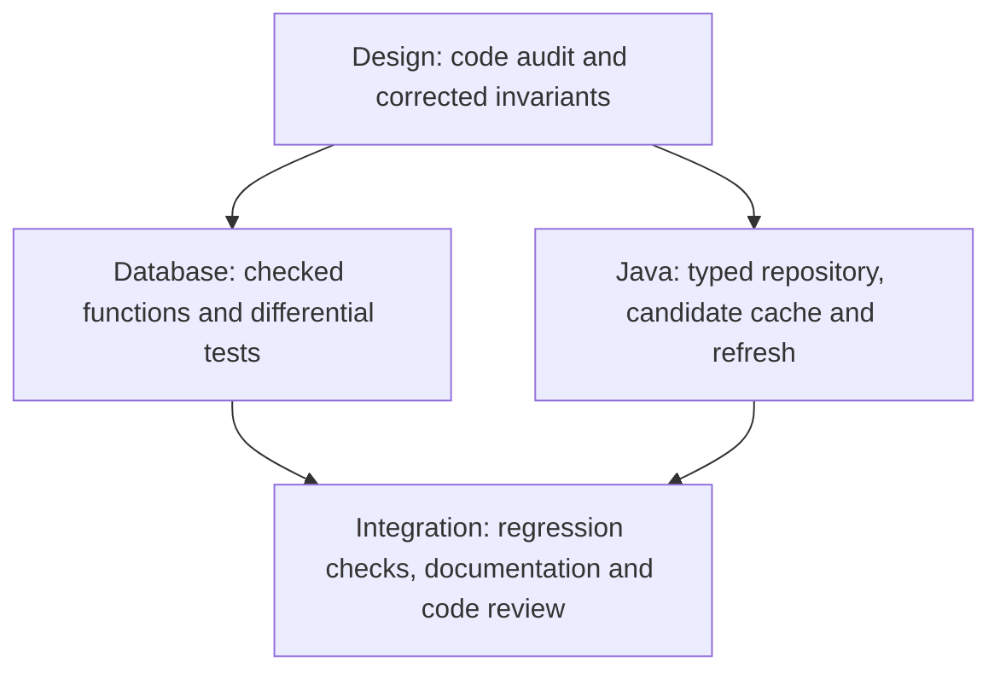

# Exact grant reads inside write transactions

This design was reviewed against `dbf5d2006c307748c1a9a696d61de75c694057a4`.
It extends the [operation read pipeline](query-efficiency-operation-pipeline-design.md).
The rollout property is `plowshare.authority.confirm-in-transaction`, default `false`.
Repository verification and deployment acceptance are separate gates; implementing this
feature does not establish a BETA performance improvement or authorize deployment.

## Review findings

The original proposal confirmed a snapshot by comparing its AUTHORITY allocation
sequence with PostgreSQL's current sequence. That is insufficient:

1. A writer can allocate a sequence value before the snapshot loads, remain invisible
   during the load, and commit afterward without allocating another value. An assigned
   tail writer may even be absent from the capture's pending-XID list. The existing
   `ProjectionVersions.Token` also carries a future-XID boundary, transactional writer
   evidence and its retention floor precisely to close these holes. Confirmation must
   validate the **stored loader token**, not attach freshly captured evidence to old facts.
2. Grant and token expiry use SQL `now()`, the caller's transaction start. A snapshot
   computed after an expiry can disagree with a long READ COMMITTED transaction even
   though the global sequence is unchanged. PostgreSQL must check the caller's
   transaction timestamp against both ends of the snapshot token's expiry window.
3. `AuthoritySnapshot` does not contain its version. The projection cache owns that
   evidence. A candidate API must return the resident facts and their original token
   together, without loading from the caller's write transaction.
4. Rolled-back authority writes advance sequences but deliver no notification. A
   refresh through notification-trusted `current()` alone can keep the stale entry.
   Refresh must invalidate its trusted evidence before loading through the normal fence.
5. A synchronous refresh using another main-pool connection can exhaust the pool when
   callers already hold write connections. Refresh runs on a bounded background worker;
   the current read returns its checked SQL rows without waiting for it.
6. The existing `plowshare.cache_writer_domains` setting already records authority
   writes and rolls back with savepoints. A new flag or replacement source trigger is
   unnecessary and risks losing later trigger behavior.
7. Rolling back a savepoint restores the dirty marker but does not restore the
   sequence. An old snapshot still fails version confirmation; confirmation resumes
   after a fresh capture. A test must not expect the pre-savepoint token to confirm.

## Database contract

V261 owns checked live-grant and lineage functions. Each STABLE function executes under
the caller statement's MVCC snapshot and returns either a confirmation marker or the
original ordered query rows, including an explicit empty-result marker. The repository
maps a typed outcome; raw JDBC data never crosses its boundary. The old read queries
have one owning copy in the functions, including when the rollout switch is disabled.

Confirmation requires:

- READ COMMITTED, with no `authority` member in the transaction-local writer domains;
- matching database identity and AUTHORITY allocation counter;
- caller transaction time inside the stored token's expiry window;
- unpruned, known capture evidence, with no relevant committed journal row at or above
  the future-XID boundary or belonging to a captured pending transaction.

Journal rows and their retention floor are read in the **same statement snapshot**.
An uncommitted writer remains invisible to both SQL authority and journal validation;
a later commit linearizes after this read and is detected on the next statement.
No confirmation is retained across statements. SQL errors propagate rather than being
converted into confirmation or silently retried.

## Cache and recovery contract

The candidate read is a bounded, resident-only lookup: no SQL, capture or load. It
returns the original loader token with its value and refuses disabled, evicted or
not-ready state. Candidate facts are untrusted until the checked call confirms them.

Cold reads and stale-version or expiry outcomes request one coalesced refresh. The
worker has no caller transaction context, invalidates trusted evidence, and uses the
existing bounded loading/publication protocol. It never publishes the caller's
uncommitted facts. Refresh failures remain observable and leave subsequent reads on
SQL. Attempts are separated by at least one second to bound reload work for oversized
snapshots and callers whose historical expiry window cannot be repaired by a reload.
That retry delay affects performance only: unconfirmed reads continue returning SQL
rows. Shutdown closes the worker. A transaction's own authority writes and historical
isolation do not become reasons to publish its state into shared memory.

Outside write transactions, the existing notification-trusted behavior and configured
staleness allowance remain unchanged. Confirmation inside write transactions uses no
notification-staleness allowance. Telemetry distinguishes snapshot, confirmed and SQL
outcomes, including dirty, version, isolation and ineligible reads.

## Trigger and privilege boundary

Authority depends on `admins`, `service_tokens`, `service_token_scopes`,
`authority_accounts`, `authority_scopes`, `authority_roles`, `authority_role_actions`,
`authority_grants`, `project_members`, `projects` and `contained_principals`.
Database tests audit enabled INSERT/UPDATE/DELETE/TRUNCATE authority triggers for
these relations. Cascades and direct SQL writes must preserve that coverage.

Database owners and administrators are trusted to preserve triggers, sequences,
writer evidence and custom settings. The default Docker initialization and runtime
roles coincide; this change does **not** claim that role cannot disable triggers or
set `session_replication_role`. Separating privileged migration and runtime roles is
a deployment concern. Functions are invoker-security and PUBLIC execution is revoked;
a separately provisioned runtime role needs explicit EXECUTE grants alongside its
existing source-read permissions. No fixed account identity is embedded in migrations.

## Delivery graph and agreement gates

| Node | Implementer | Independent reviewer | Completion gate |
| --- | --- | --- | --- |
| A | Coordinator, with implementation audits | Design reviewer | Both approve corrected invariants |
| B | Database implementer | Design reviewer | SQL/race review, focused real-PostgreSQL evidence, both agree |
| C | Java implementer | Design reviewer | Contract/concurrency review, focused unit evidence, both agree |
| D | Coordinator | Design reviewer plus both implementers | Integrated code review, formatting and repository checks; unresolved limits recorded |

Review findings are returned to the owning implementer, fixed, and reviewed again.
A node does not close on an implementation report alone. Final acceptance records
the actual tests run and any external rollout gates still outstanding.

## Verification and rollout

Unit tests cover candidate token identity, invalidation/recovery races, worker bounds,
no confirmation memoization, null/ineligible candidates and telemetry.
Focused `@Tag("full-db")` tests with `-PfullDb` establish behavior only PostgreSQL can
prove: trigger coverage, own writes, savepoint rollback, unchanged-sequence late commit,
assigned-tail writers, transaction-time expiry, isolation, identity and row equivalence.
They also exercise the production repository's typed JDBC binding and row mapping.
Warm reads perform one checked call per grant read, on either branch.

Run Java formatting and repository `check` without the full database suite. BETA then
requires an explicit deployment, enablement, and the representative job with before/after
`pg_stat_statements` deltas and grant-read outcome counters. Keep the rollout switch off
by default until that evidence exists. PROD needs its own before/after evidence. Remove
the switch only after successful production operation.

Per-recipient versioning, lineage materialization and broad caller-loop refactoring are
separate follow-ups requiring measured need; none is necessary for this exact fast path.

## Review agreement record — 15 November 2026

- A: coordinator and `design_review` accepted the corrected invariants.
- B: `db_implementer` and `design_review` accepted the SQL and database slice after
  all 12 `CheckedAuthorityGrantsDatabaseTest` cases passed. The real composition test
  exercises Spring transactions, the resident cache, typed JDBC calls and the actual
  background worker: confirmed reads, own-write SQL fallback, rollback version
  mismatch, independent refresh, then confirmed reads again.
- C: `java_implementer` and `design_review` accepted the Java slice after the focused
  repository, candidate, refresh and snapshot unit tests passed. The resident lookup
  was revised during review to avoid joining any in-flight load.
- Existing `AuthoritySnapshotDifferentialDatabaseTest` (6 cases) and
  `ScopedGrantPersistenceTest` (17 cases) passed with the moved SQL. Together with
  the final 12-case database class and 22 focused unit cases, 57 distinct selected
  tests passed. Java formatting and `formatCheck` passed.
- D: coordinator and independent reviewer accepted the integrated implementation
  and operator documentation, with the repository verification limit below.

Final `./gradlew format formatCheck check --continue` completed with all 7,963
non-database server tests passing, along with the server source/invariant checks.
The repository-wide command still fails `legacyCliAuditCheck`: the committed
`legacy-cli-audit.json` contains an outdated evidence hash for
`sdk/typescript/src/operations/catalog.ts`. The generator, artifact and every input
are unchanged from HEAD; the reviewer independently confirmed the mismatch already
exists in HEAD. That unrelated artifact was left untouched. An initial broad run
also encountered a segmented packet-transport timeout; all six `PacketTransportTest`
cases passed on the final broad run. That test's wiring does not instantiate this
feature's cache, grant repository or worker.

No live BETA or PROD deployment or performance claim is part of this acceptance.
