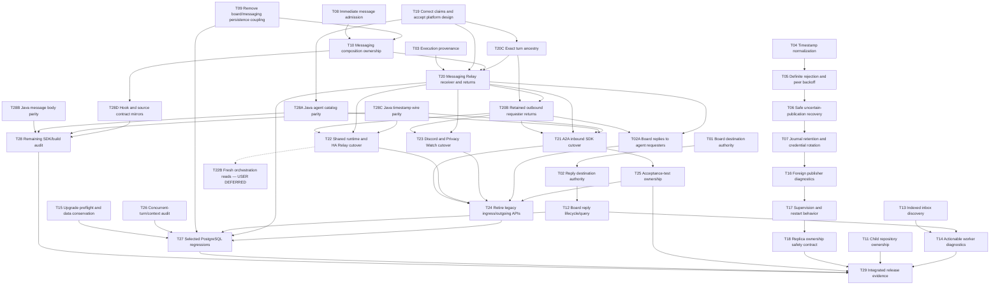

# Relay review remediation task graph

Baseline: `619417819f94b8b59550004c62ae2966cfe9313d`.
Started: 13 November 2026. Coordinator: root agent.

Final active acceptance: **36 tasks accepted; one user-deferred task (T22B)**.
Implementers and independent reviewers completed all active nodes. Formatting,
repository checks, integration boundaries, native SDK and fresh installed-package
gates passed; selected PostgreSQL checks passed. The deployment-data-copy
rehearsal remains a separately pending operational item. Implementation and review
completed before publication. The user separately authorized committing and
pushing this work on 14 November 2026; deployment remains outside this checkpoint.

The user explicitly requested this task graph, parallel implementers and independent
reviewers to execute the TODOs in both supplied reviews. The reviews are evidence;
the user's request authorizes the work. General messaging platform work is a
separate task (T20), governed by a design decision (T19), not an adapter workaround.
No production deployment, destructive data operation or automatic uncertain-effect
replay is authorized by this plan. Existing APIs stay until replacement consumers
and compatibility checks pass.

Sources, preserved as immutable review evidence:

- [Code review](reviews/relay-branch-code-review-61941781.md): C1, I1–I9, M1–M11, S1–S4.
- [Claims check](reviews/a2a-claims-check-61941781.md): claims 1–59, overstated notes 1–7,
  structural-change table and proposed solution 1–7.

## Main-branch integration, 14 November 2026

Main added shipped migrations V238–V241 after this branch diverged. Their bytes
are preserved unchanged. The unshipped Relay sequence was renumbered without
changing its persisted identities or SQL behavior:

| Previous branch versions | Current versions | Purpose |
| --- | --- | --- |
| V238–V243 | V242–V247 | Board bridge, messaging cutover, turn reservation, retention, execution receipts and child completion |
| V244–V246 | V248–V250 | Board destination identity, forum capture and inbox discovery |
| V247–V250 | V251–V254 | Native ingress, requester returns, exact ancestry and board returns |
| V251 | V255 | Legacy outgoing history retirement |

Earlier evidence below retains the version numbers used when those tests ran.
Current source, callback targets, migration fixtures and live guides use the new
versions. Merging main also preserves its Privacy Watch assistant/reference
features while retaining this branch's native-only tool provider and unresolved
legacy-journal fence. Merge-specific verification is recorded below.

- Merged main at `0ba6555c`; the feature parent is `cdb94fc5`. All main migration
  bytes were independently compared with `origin/main`, and no duplicate Flyway
  version remains. Only the unshipped Relay sequence and its owning callbacks,
  upgrade-fixture targets and current documentation were renumbered.
- `main-merge-format37` passed `format`/`formatCheck`. Final
  `main-merge-check38` passed `check integrationBoundaryCheck sdkContractCheck`.
  Import-only corrections preserve main's behavior while removing new qualified
  type uses and wildcard imports from the merged additions.
- Privacy Watch's gate passed **646 Python tests, 108 web tests**, Ruff formatting/
  lint and strict mypy across 121 source files. The first sandboxed fixture run
  could not bind local listeners; the permitted rerun passed without weakening
  the tests. The merged CLI composes the assistant/reference services before the
  native provider and still refuses unresolved legacy peer evidence before intake.
- `main-merge-db33` passed all **23 selected PostgreSQL server tests** covering
  cutover/preflight rollback, archive conservation, execution receipts, child
  completion and main's authority snapshot differential checks. Six A2A cases also
  passed; the seventh exposed a fixture observing a firing's temporary `pending`
  job marker. The fixture now waits for the dispatcher's registered job ID, and
  `main-merge-return35` passed that actual native later-paid-turn case. No production
  lifecycle behavior or SQL assertion was relaxed.
- The separately user-deferred T22B and production-data-copy rehearsal remain
  unchanged. Feature databases using old branch-only migration numbers require
  explicit history reconciliation; this source merge does not perform Flyway
  repair, rewrite applied history or deploy the new schema.

## Completion protocol

Each task has an implementation owner and a different reviewing owner. Implementers
report **ready**, with changed files and tests; they cannot tick their own task.
Reviewers inspect the actual diff against the stated goal, inputs, failure cases,
authority/lifecycle invariants and evidence. Their report must say **PASS** or
**CHANGES REQUIRED**, identify remaining defects, and name checks actually run.
Only the coordinator changes `[ ]` to `[x]` after a PASS and the required checks.
A documented limitation is not an implementation completion unless the task's
explicit goal is to settle that limitation. Rejected reviewer suggestions require
source-based reasoning and reviewer agreement, not a silent omission.

All contributors read AGENTS.md and coding standards. Java requires Google
formatting and explicit imports. SQL stays in specialist stores. Changes to shipped
migrations are forbidden. Default tests use mocks/fakes; PostgreSQL runs are selected,
`full-db` tagged and explicitly justified. Root serializes **all Gradle runs** and
pauses Java edits during compilation. Worker lanes own disjoint files; shared
interfaces/migration numbers are coordinated before edits. No automatic commits,
pushes or deployment are part of this remediation request.

Review roles rotate: board implementer → messaging reviewer; messaging implementer
→ adapter reviewer; adapter implementer → board reviewer. Root implements design,
consumer cutover and integration work; another agent reviews those tasks. Review
assignments below are roles, resolved to live agent names in the execution ledger.

## Graph

Each T node is a TODO. An arrow means the predecessor must be accepted before the
successor can be accepted. Work without a dependency can run concurrently; implementation may overlap after interfaces agree, while acceptance waits for predecessors. A
reviewer may inspect ready work while a different lane implements another task.

## Tasks, deliverables and acceptance goals

| Done | Node / source TODO | Dependencies | Implementer → reviewer | Deliverable and verifiable goal |
| --- | --- | --- | --- | --- |
| [x] | **T01** C1, S2: board destination authority | None | Board → Adapter | Pin post/close to the authorized source project, check current destination write/personal-owner authority, update ADR 0060. Mocked tests reject foreign/personal destinations and revoked writers without writes/wakes/reply binding. |
| [x] | **T02** I8 deputy issue: reply destination authority | T01 | Board → Adapter | Check the publisher's exact reply-topic ingress grant at admission/dispatch and preserve scope. Tests cover existing unauthorized TEXT topics, revocation, and valid explicit grants. |
| [x] | **T02A** I8 inbox gap: board replies to agents | T20, T20B | Board → Root + Adapter | Messaging-owned, retained return binding delivers forum replies/outcomes to the original requesting instance without forged inbox IDs or relaxing publisher validation. Test recipient ownership, reply correlation, cancellation and permission loss. |
| [x] | **T03** I1, S3: execution provenance | None | Messaging → Board | Server-only execution publisher namespace distinct from SDK/human identity; document identity contract and compatibility. Bridge cannot attribute execution as a person; port clients cannot forge execution provenance. |
| [x] | **T04** I3: microsecond receipt identity | None | Adapter → Messaging | Normalize retained/publication timestamps to PostgreSQL precision. Nanosecond-clock lost-ack/reconciliation regression passes without peer resend. |
| [x] | **T05** I2: definite rejections and peer outage | T04 | Adapter → Messaging | Journal/return definite pre-effect rejection and advance only after durable evidence; isolate unavailable peers with bounded retry/backoff. Preserve hard stops for gaps, journal corruption and uncertain effects. Poison/UUID-conflict/unknown-peer tests show unrelated work progresses. |
| [x] | **T06** I4: uncertain publication recovery | T05 | Adapter → Messaging | Explicit, bounded operator recovery and paged log inspection; classify known-not-submitted separately from unknown. No inference of non-delivery from absence/expiry, no blind replay or new external send. Test committed, absent, pruned, conflicting and still-uncertain cases. |
| [x] | **T07** I5: journal lifetime and credential rotation | T06 | Adapter → Messaging | Durable compaction/archive with retained dedup/task ownership, and explicit identity-preserving configuration migration. Routine rotation/timeout changes recover safely; destination/principal changes cannot silently adopt old tasks. Test capacity, crash mid-compaction and retention boundaries. |
| [x] | **T08** I6: immediate message admission | None | Messaging → Board | After-commit bounded per-inbox admission nudge plus periodic recovery. Remove/redirect pre-admission drain. Tests verify no precommit execution, no duplicate admission, busy worker recovery and prompt multi-hop delivery. |
| [x] | **T09** I7, S1 persistence: remove dead checks | None | Messaging → Board | Remove board hot-path messaging-topic lookups and update capture triggers in a new migration. Keep historical former-topic data only where needed; behavior and query-use tests demonstrate forum independence. |
| [x] | **T10** S1, M1, M2: messaging owns composition | T08, T09 | Messaging → Board | Dedicated messaging configuration, tools/extras, routing/maintenance/properties and wake ownership; messaging-owned refusal/origin semantics. Remove stale comments and board-owned construction of messaging without dropping lifecycle/grants. Startup and routing tests pass. |
| [x] | **T11** M3: child completion repository owner | None | Messaging → Board | Move JDBC implementation to orchestrations and update composition/imports; identical repository semantics and focused completion tests. |
| [x] | **T12** M4, M7: bounded board replies | T02 | Board → Adapter | Pending selection driven by indexed outstanding outbox work, and explicit terminal destination-gone handling without endlessly retrying deleted topics. Tests preserve ordering, transaction rollback, receipts and live-request replies. |
| [x] | **T13** M5: indexed inbox keysets | None | Messaging → Board | Typed numeric/project+topic tuple cursors and matching indexes; ready/drained/retired scans avoid computed text sort keys and preserve fair bounded iteration. Include PostgreSQL query/mapping evidence where required. |
| [x] | **T14** M6: diagnosable worker failures | T12, T13 | Root → Messaging | Topic/request identity and failure category in worker diagnostics without bodies, secrets or unsafe labels. Tests/inspection prove a failed inbox/request can be located and unrelated work continues. |
| [x] | **T15** M8: migration data conservation | None | Root → Messaging | Audit pre-V239 allowance/project invariants; add append-only preflight/recovery as actually required. Synthetic legacy fixtures cover missing allowances/orphans; failures are actionable and transactional, and no body/route is silently lost or marked published without a publication. |
| [x] | **T16** M9: foreign producer visibility | T07 | Adapter → Messaging | Bounded counter/log diagnostic for skipped publishers without payload disclosure or unbounded cardinality. Skip remains side-effect free. |
| [x] | **T17** M10: supervision/backoff | T16 | Adapter → Messaging | Document and verify supervisor/restart contract, bounded transient backoff and explicit operator-stop categories. Restart never repeats uncertain mutation. |
| [x] | **T18** M11: replica ownership safety | T17 | Adapter → Messaging | Verify supported shared-journal single-owner deployment and reject unsupported replica modes. Document/prove that a local epoch alone cannot fence independent journals; do not claim distributed exactly-once. Any stronger mechanism needs actual shared/remote fencing evidence. |
| [x] | **T19** Claims notes 1–7, S4: factual correction and design | None | Root → Board | Correct 0065/0058/manual claims: existing incoming path, agent.list catalog, message schedules, socket-fixture limits, complete return loop and retained generation provenance. Separate platform ADR defines a general messaging-owned Relay receiver, authority/context/command/reply ownership, scheduling reuse, migrations, SDK-only alternatives and compatibility tests; no replacement WS operation family. |
| [x] | **T20** Claims solution 1–6: general messaging receiver | T03, T10, T19, T20C | Messaging → Root + Board | Registered typed ingress/cancel receiver using existing Relay envelope/operations and internal native admission. Server-derived principal, route-pinned targets, no asserted instance/account authority, live grants/command checks, isolated contexts, durable receipts and messaging-owned return publications. Preserve schedule behavior and paid execution. Unit plus selected transaction/locking tests required. |
| [x] | **T20B** Claims solution 6: retained outbound requester returns | T03, T10, T19, T20, T20C | Board → Root + Messaging | Typed execution-publication observer atomically binds configured exports to the exact native message participant or explicitly owned caller instance. Messaging-owned return receiver accepts only the configured adapter and original export identity; ordinary reply semantics preserve cancellation, budgets and no forged completion. Board/A2A/runtime returns reuse this service. Selected transaction/race and mocked authority tests required. |
| [x] | **T20C** T20 lifecycle acceptance: preserve effect ancestry | T19 | Root → Board | Atomic per-turn causal reservation, exact authenticated run/turn source repository, explicit message/delegate job ancestry and unchanged conversation history. Different roots sharing one conversation cannot replace each other; unavailable history never grants a fresh root. Mocked job-order and selected PostgreSQL reservation/rollback/trigger/source-isolation tests. |
| [x] | **T21** Claims solution 7: A2A receiving/return cutover | T20, T20B, T28A, T28C | Adapter → Messaging + Board | SDK-only inbound adapter uses Relay ingress/egress and agent.list discovery, preserves alias/context/task/command/approval/artifact semantics; outbound results reach the original requester through retained bindings. Independent A2A client and crash/no-replay tests cover the full loop. |
| [x] | **T22** I9, claims solution 7: runtime/Home Assistant | T20, T20B, T28C | Board → Adapter + Messaging | Adapt Gateway/runtime and HA to their Relay topic contracts, preserving journal/effect semantics and eliminating legacy outgoing dependence. Adapter acceptance uses SDK boundaries; preserve tests rather than deleting security assertions. |
| [ ] (deferred) | **T22B** I9/claims solution 7 discovered consumer compatibility gap | Future separately resumed task | User deferred → future reviewer | Fresh Home Assistant reads from manually started orchestrations remain unsupported by the initial native export contract. The user explicitly chose to defer this work. A future SDK-only tool-provider migration must preserve identity, durable receipts, feedback and no-replay semantics; no implementation is claimed here. |
| [x] | **T23** I9, claims solution 7: Discord/Privacy Watch | T20, T20B | Root → Board | Migrate both consumers and tests from legacy ingress/outgoing operations while retaining public SDK-only access, consent/context isolation and no mutation replay. |
| [x] | **T24** I9, S4, claims removal: clean core cutover | T02A, T21, T22, T23, T25 | Root → Adapter + Messaging + Board | Remove obsolete incoming/outgoing operation families, clients, tool/API catalogs and adapter-shaped core queue after all consumers migrate. Preserve/rehome native admission used by schedules and required historical records. Regenerate contracts; compatibility and negative-boundary tests prove one path. |
| [x] | **T25** Claims reverse dependencies: test ownership | T21 | Root → Board + Messaging | Place independent adapter acceptance in the owning test harness without server production dependencies. Existing test-only reverse dependency is not misrepresented as a production violation; any relocation preserves end-to-end coverage. |
| [x] | **T26** Unverified: concurrent turns/compaction | None | Root → Adapter | Review reservation, projection, context and compaction under two definitions sharing one conversation. Add targeted races for loss/duplication/order; fix demonstrated defects, or document reviewer-verified invariants. |
| [x] | **T27** Review DB verification and upgrade rehearsal | T09, T12, T15, T20, T24, T26 | Root → Messaging | Run the smallest relevant full-db migration/locking/rollback sets with stated reasons. Rehearse legacy representative upgrade with conservation checks. A real deployment-data-copy rehearsal is recorded separately and stays pending if no authorized sanitized copy is available; synthetic evidence is not labelled production evidence. |
| [x] | **T28** Unreviewed SDK/build remainder | T28A–T28D | Root → Adapter | Audit regenerated SDK contracts/blob helpers, Java facades, accounting changes and formatting hooks against actual public contracts. Record reviewed scope and meaningful checks; new findings become explicit nodes rather than hidden completion assumptions. |
| [x] | **T28A** T28 discovered SDK parity gap: agent catalog | T19 | Adapter worker (separate SDK platform scope) → Root + Messaging | Public typed Java AgentClient.list/async over existing agent.list, complete validated command projection, explicit project and actual request correlation. No new WS operation or generic raw transport escape hatch; focused facade tests. |
| [x] | **T28B** T28 discovered valid message body mismatch | None | Adapter worker (separate SDK platform scope) → Root | Java MessagingClient.Delivery must accept valid server-configured message bodies beyond the erroneous 32768-character ceiling, while keeping a documented bounded output contract. Regression proves valid long Unicode/text output; no runtime/native body limit bypass. |
| [x] | **T28C** T28 discovered Java timestamp wire mismatch | None | Root → Adapter | Java SDK requests serialize temporal values as ISO strings matching the public DTO schema; response decoding rejects numeric/malformed timestamps. Public Relay SDK wire regression and affected consumer tests pass without relaxing fixtures. |
| [x] | **T28D** Final integrated audit: shared hook/source mirrors | T10 | Root → Board | Add the implemented native `message` origin to the hook type contract; retain exact server/type equality. Inventory Home Assistant's already existing HTTP client exposed by explicit imports, with current ownership documentation and unchanged exact-set guard. Existing mirror/invariant tests must pass. |
| [x] | **T29** Final integrated acceptance | All active prior tasks; user-deferred T22B excluded | Root → Board + Adapter | Run format, formatCheck, check, integrationBoundaryCheck and required SDK/package gates. Record actual DB/transport/client evidence, residual limitations and migration/rollback guidance. No merge-ready or complete claim with unresolved critical/required nodes. |

## Execution ledger

Migrations are allocated centrally: Board lane reserves V244; Messaging lane
reserves V245–V246. Native ingress reserves V247; retained outbound returns reserve V248; exact turn ancestry reserves V249; native board returns reserve V250; legacy transport retirement reserves V251. Other migrations require coordinator allocation. Do not edit
V238–V243 or another lane's files without coordinating.

| Wave | Implementer | Nodes | Reviewer | State / evidence |
| --- | --- | --- | --- | --- |
| 1 | board_worker | T01, T02, T12 | adapter_worker | Accepted; first-wave evidence below |
| 1 | adapter_worker | T04–T07, T16–T18 | messaging_worker | Accepted; first-wave evidence below |
| 1 | messaging_worker | T03, T08–T11, T13 | board_worker | Accepted; first-wave evidence below |
| 1 | root | T19, T14–T15, T26 | independent board/messaging/adapter reviewer | Accepted; first-wave evidence below |
| 2 | messaging_worker | T20 native ingress | root + board_worker | Accepted; source, unit and selected SQL evidence below |
| 2 | board_worker | T20B, T02A outbound requester returns | root + messaging_worker + adapter_worker | Accepted; exact-source/return and board SQL evidence below |
| 2 | adapter_worker | T21, T28A Java adapter/catalog | root + messaging_worker + board_worker | Accepted; full native/A2A loops and strict DTO tests |
| 2 | board_worker + messaging_worker | T22 runtime/HA | adapter_worker + messaging_worker + root | Accepted; runtime and actual HA harness, T22B explicitly deferred |
| 2 | root | T20C, T23, T25, T28C | independent lane reviewers | Accepted; causal source, client migration, harness and timestamp evidence |
| 3 | root + all three worker lanes | T24 retirement | independent cross-lane reviewers | Accepted; native history preserved and old contracts removed together |
| 3 | root | T27–T29, T28D | messaging_worker + adapter_worker + board_worker | Accepted; final actual gates and exact mirror/import reviews below |

Reviewer reports and exact validation results are appended here. Checkboxes above
are the authoritative completion state; queued/running/ready is not done.

### Review evidence: first wave

- **T19 accepted:** board_worker independently reported PASS after requiring and
  re-reviewing corrections in 0058, 0065, 0066, relay-finishing and both retained
  A2A manuals. Existing admission/catalog and schedule coupling are now accurate;
  the documents do not claim the pending cutover has shipped. Source/link review
  is the relevant check for this documentation task.
- **Static PASS, pending tests:** board_worker reviewed T03, T08–T11, T13, T15 and
  T26; adapter_worker reviewed T01, T02, T12 and T26; messaging_worker reviewed
  T04–T07 and T16–T18. These are not checked off until required tests pass.
- Review-required corrections already incorporated: indexed board outbox head
  selection, journal byte-pressure compaction, launcher exit/backoff regressions,
  in-turn completed-prefix fencing and common fold ownership. Initial test runs
  also exposed compilation/fixture errors; those failures are not acceptance.
- Root's T14 diagnostics add validated inbox/request/destination coordinates and
  fixed operation categories without exception content. A discovery page attempts
  independent inboxes before surfacing its first failure.

- **T04–T07, T16–T18 accepted:** messaging_worker final independent PASS after
  source review and the corrected journal-pressure/launcher tests. Actual root
  run `/tmp/plowshare-review-wave1-focused3.log`: **112 server tests and 49 A2A
  tests passed**, `format` and `formatCheck` passed. This establishes local SDK
  transport/recovery behavior, not a live deployment or distributed exactly-once.
- T28 source audit covered native blob helpers, Java forum/swarm/messaging/Relay
  facades, TypeScript operation validators, generator/native constraints and hook
  installation. Independent adapter_worker audit found no blocking defect; native
  schema artifacts matched semantically (296 input/results plus four HTTP types).
  Provider accounting files were unchanged from the reviewed base; altered Budget,
  AutomaticLimits and JobRuntime claim paths preserve canonical durable claims.
  Full SDK/package and integrated checks remain required; T28 is still unchecked.

- **T15 accepted:** board_worker final independent PASS after inspecting actual
  PostgreSQL results: three preflight tests passed, including orphan project,
  corrupt allowance and valid identity preservation. This is synthetic upgrade
  evidence. A deployment-data-copy rehearsal remains separately pending in T27.

- **T01–T03, T08–T14, T26 accepted:** board_worker, adapter_worker and
  messaging_worker final PASS against their independent assigned scopes. Root
  evidence: focused3 passed; `/tmp/plowshare-review-wave1-db3.log` passed the
  four corrected DB classes and three diagnostic/worker unit classes in 53 s.
  The other three selected DB classes already passed in db2. Initial db2 failures
  were corrected with deterministic fixture hints, valid identity inserts and
  forum/member fixtures; none were suppressed or removed. Board tests include
  actual deletion/recreation and reply/failure races, indexed EXPLAIN selection,
  transaction rollback and shared-topic publication.
- First selected DB startup stalled on the host's stale Testcontainers socket
  setting. The run was cancelled and retried against Docker's working socket;
  the host setting and repository defaults were not changed.
- Hook audit: `python3 -B -m unittest scripts/test_git_hooks.py` passed 11 tests;
  this worktree's repository-local `core.hooksPath` is `.githooks`.
- Wave 2 is now editing: messaging_worker T20, board_worker T20B,
  adapter_worker T21; root owns T23 consumer migration. All Gradle commands wait
  for the next coordinated Java pause. Final integrated acceptance remains open.

### Contract discoveries in wave 2

T20C is an acceptance prerequisite discovered while preserving the reviews' lifecycle
and effect-bound goals: conversation-global causation cannot represent independent
native roots. V249 retains exact turn ancestry. Typed reservation/submission
establishes job-to-turn identity; the job trigger checks for a matching retained
conversation source but does not independently store a job turn ordinal.

T28A/T28B are explicit audit findings, rather than hidden adapter changes. Java's
public SDK lacked existing agent.list coverage, and its delivery facade rejected
valid bodies above 32768 characters despite the server's configurable native limit.
These are separately scoped SDK parity tasks with no new WS/API shape.

Task history now has bounded immutable reply chunks, fixed-head traversal and a
FOLLOW cursor so status polling reads only new replies. Snapshots have monotonic
current header revisions; each inspection UUID retains its own receipt. External
returns honor the native configured body-byte ceiling. They are never silently
truncated, split into automatic paid fanout, or accepted by bypassing that limit.
Large reports require explicit native body-limit configuration and retain full
adapter evidence if admission is refused.

### Review evidence: second wave in progress

- **T20C accepted:** board_worker and adapter_worker independently reported source
  PASS. Focused `CausalMessageTurnTest` passed in
  `/tmp/plowshare-review-wave2-units1.log`; all five
  `NativeTurnRelaySourcesDatabaseTest` cases passed in
  `/tmp/plowshare-review-wave2-db1.log`. Atomic reservation/rollback, immutable
  causation, exact source isolation and delegated child ancestry are covered.
- **T28B accepted:** root independently reviewed the Java delivery change against
  server configuration and the shared bounded TEXT contract. The long-body and
  NUL-rejection regression passed with all three `AgentCatalogTest` cases in
  `/tmp/plowshare-review-wave2-units1.log`. This changes SDK output validation,
  not native admission limits.
- The second-wave compile/format gate passed in
  `/tmp/plowshare-review-wave2-compile6.log`; focused mocked/server/SDK tests
  passed in `/tmp/plowshare-review-wave2-units1.log`. This is intermediate evidence.
- The selected PostgreSQL run in `/tmp/plowshare-review-wave2-db1.log` ran
  **104 tests: 89 passed, 15 failed**. Failures include fixture setup, a final
  Spring repository proxy and still-open integration checks. They are being
  corrected and do not count as acceptance of T20/T20B/T02A/T21.
- Independent review also found lost persisted receiver coordinates, stale
  source-incarnation adoption, asynchronous chunk ordering and adapter partial
  paging recovery. These remain required corrections before their nodes pass.

- **T23 Privacy consumer checks:** root's native-provider cutover passed Ruff,
  strict mypy (107 source files), **503 Python tests and 69 web tests** in
  `/tmp/plowshare-review-privacy-check2.log`, using explicit current-worktree
  SDK/consumer imports. The retired peer's six capabilities reuse the existing
  eight-tool Relay facade. Read-only legacy receipt validation fences every
  unresolved phase before intake; no work identity is silently adopted/replayed.
  This does not yet accept the combined Discord/Privacy node.
- **T25 harness preparation:** real A2A/server acceptance is being preserved in
  the test-only `integrations/acceptance` project. The server's reverse test
  dependency on the adapter is removed; neither production module gains a new
  dependency. Acceptance still waits for the native boundary checks; it must pass before T24.

- **T28A accepted:** root and messaging_worker independently reported source PASS
  against the existing agent.list/CommandCatalog contract and SDK correlation.
  The focused `AgentCatalogTest` passed all three cases in the serialized unit
  run. The facade exposes a typed, bounded immutable command projection and
  explicit project; discovery never grants command execution authority.

- **Dependency correction:** T25 now precedes T24. The preserved independent
  acceptance harness must pass before retiring the old API/tests, so removal
  cannot erase its own verification prerequisite. This changes execution order,
  not the required coverage or acceptance standard.

- **T28C discovered during the HA gate:** the independent consumer fixture
  received a numeric epoch timestamp from Java's public Relay facade, while the
  public schema requires a date-time string. This is tracked as a separate general
  SDK contract correction. The fixture remains strict; accepting numeric time
  there would conceal the client mismatch.

- Second-wave checkpoint `/tmp/plowshare-review-wave2-compile10.log` passed
  formatting/compilation, **71 A2A tests and 98 runtime tests**. Focused server
  unit tests passed in `wave2-units2`; its two HA pipeline failures exposed T28C.
  `/tmp/plowshare-review-wave2-temporal1.log` then passed both new SDK temporal
  regressions and all **13 selected HA consumer tests**, preserving the strict
  independent fixture.
- `/tmp/plowshare-review-wave2-db2.log` ran **113 selected server database tests:
  112 passed, one failed**. All 16 retained export/native-board tests and the new
  migration preflight passed. Actual broker admission caught a remaining SQL
  receiver-shape constraint missing the new native receiver forms. Both A2A
  acceptance cases also failed and remain open. Gradle stopped before the HA
  harness task; prior HA unit XML is not evidence that its full-db cases ran.
- T23 independent source reviews are PASS for both consumers, with **87 Discord
  tests plus typed lint/compiler** and the Privacy gate above. Acceptance waits
  for the required native messaging predecessors. T22's read-only result search
  progress is being made durable before its final acceptance.

- **T22B discovered compatibility work:** the initial native export contract
  deliberately supports TURN/MESSAGE sources. Event workflows reuse their
  supplied authorized reading, but a manual orchestration still needs a fresh
  integration read. Root is proceeding with preservation through the existing
  public SDK Relay tool-provider API, pending any user steering on the optional
  scope question. This is consumer work, not a request to widen core source kinds.
  T24 remains gated on the replacement; the limitation is not counted as done.

- **T28C accepted:** adapter_worker independently reported source and focused-test
  PASS; board_worker reviewed the follow-up diagnostic redaction. The full Java
  SDK run in `/tmp/plowshare-review-wave2-compile11.log` passed **188 tests**,
  including ISO wire serialization, strict temporal decoding and the private
  marker regression. Other new fixture compilation failures in that combined
  run are separate and do not invalidate its completed SDK test task.

### Explicit user scope decision

The user selected **“Defer fresh orchestration reads as a documented limitation”**
for T22B. It remains unchecked and outside the current acceptance barrier. No
native export source-kind widening or tool-provider implementation is authorized
by this deferred node. Event-triggered workflows reuse their supplied authorized
reading; direct TURN/MESSAGE requests support fresh integration reads. A manually
started orchestration without supplied evidence must report that gap and cannot
claim equivalent fresh-read capability. This supersedes root's earlier stated
preservation assumption.

### Accepted native contract and consumer nodes

- **T20 accepted:** root and board_worker independently reviewed the strict
  receiver, immutable source-generation proof, persisted route coordinates,
  batched grant snapshot and task-before-topic terminal fence. The focused unit
  checks passed, and `/tmp/plowshare-review-wave2-db3.log` passed all **65 selected
  server tests**, including actual broker admission, strict old/new receiver
  constraints, rollback/cancellation/chunk ordering, deleted-task handling and
  the latch-controlled concurrent terminal-debt regression. The migration preflight
  and existing delivery/board regressions also passed. No envelope change is made.
- **T20B accepted:** root, messaging_worker and adapter_worker reported independent
  source PASS; all **16 MessageExportsDatabaseTest** cases passed in `wave2-db2`,
  alongside focused unit checks. Exact source proof, retained publisher/channel/
  generation ownership, transaction rollback, expiry and lifecycle races are
  covered. Only the exported request is finalized by a return.
- **T02A accepted:** root and adapter_worker source PASS, plus the same actual
  export/board database cases, cover agent authorship without private log links,
  one canonical forum effect across groups, changed-target conflicts, refusal
  races, full native replies and safe unavailable/transient debt outcomes.
- **T23 accepted:** board_worker independently reviewed Discord and Privacy
  implementations and their actual evidence: **87 Discord tests with compiler
  and typed lint**, **503 Privacy Python tests, 69 web tests, Ruff and strict mypy**.
  Required native platform predecessors now pass. This verifies local contracts
  and recovery; no live Discord/household deployment is claimed.
- The same `wave2-db3` run still failed **seven A2A acceptance cases** and **four HA
  harness cases**. The former exposed topic/group-generation conflation plus
  outbound fixture membership setup; the latter failed fixture model declarations
  before execution. T21/T22/T25 remain unchecked until corrected real loops pass.

- **T22 accepted:** messaging_worker closed independent source review after
  unknown-depth, exact persisted phases/projections/scope and decimal recovery
  fixes. `/tmp/plowshare-review-wave2-compile14.log` passed all **101 runtime
  tests**; `compile15` passed both corrected HA pipeline fixtures, with the other
  11 HA consumer tests passing in `compile14`. `/tmp/plowshare-review-wave2-db5.log`
  passed all **four real HA harness cases**: direct available/unavailable reads
  through an exact native export/return, plus default/scripted event workflows
  reusing their supplied authorized evidence and delivering one completion action.
  The explicitly user-deferred fresh manual-orchestration case remains T22B.
- Real inbound A2A acceptance now passes both cases in `wave2-db4` and `wave2-db5`.
  Five new outbound acceptance cases remain open: their declared Application
  access policy must include the legitimately configured adapter, in addition to
  its project role. The test must satisfy both boundaries rather than bypass one.

- T25 relocation source review is independently **PASS** from board_worker: the
  acceptance project is test-only, both original inbound scenarios and all four
  legacy outgoing scenarios remain preserved, and its README maps replacement
  coverage and deliberate lifecycle differences. Test acceptance remains gated.
- `wave2-outbound6` passed three new outbound cases, including the actual native
  later-paid-turn return, lost-publication recovery and broker/journal fencing.
  `outbound7` passed the unknown-send/no-replay/cancel case. Definite refusals use
  a source-derived receipt UUID; fixture assertions now correlate the retained
  authenticated source event instead of mistaking an untrusted body UUID for that
  receipt. The remaining discovery case is still under verification.
- T21 review also found that private reply assembly borrowed the smaller HTTP
  projection's character limit. Its correction must preserve the complete native
  body before an explicit HTTP oversize refusal, including ASCII and JSON-escape
  expansion cases. T21 is not accepted while that finding remains open.

### Consumer replacement barrier accepted

- **T21 accepted:** messaging_worker independently reported final source PASS
  for receiving/returns and the private native-body fix. `format16` passed
  `format`/`formatCheck`; `units17` passed **76 A2A tests**, including four raw-body
  storage regressions. `inbound9` passed both actual A2A HTTP → public SDK → native
  persistence → private reply cases after the storage change. All five new outbound
  cases passed across `outbound6` (three), `outbound7` (unknown-send/cancel) and
  `outbound8` (discovery/refusal). The native execution case used an actual agent
  TURN and a distinct later paid message job, without fabricating source proof.
- **T25 accepted:** board_worker independent source PASS plus the inbound/outbound
  replacement evidence above closes the relocation gate. The test-only harness
  preserves equivalent security/receipt/ownership checks and documents deliberate
  queued-cancellation, advertisement-TTL and explicit-polling lifecycle changes.
  The old outgoing harness may now be retired with its obsolete API.
- The additive standalone integration-runtime result split has root and
  messaging_worker independent source PASS; `units17` passed **107 runtime** and
  **13 HA** tests. Its private journal JSON remains readable without a rewrite.
- T24 is now released in parallel: root owns core transport/tools/access and docs;
  adapter_worker owns Java SDK/A2A protocol ownership; board_worker owns TS/native
  handwritten contracts and owning generators; messaging_worker owns V251 and
  native/archive preservation tests. Existing native message admission and schedule
  state remain. No deployment-data-copy rehearsal is claimed.

### Legacy retirement and selected upgrade accepted

- **T24 accepted:** messaging_worker independent source PASS for root core removal
  and adapter Java retirement; adapter_worker independent source PASS for TS/native
  contracts and the corrected package build owner; board_worker and root source
  PASS for V251. Native `message.*`, exact Relay envelope and schedule admission
  remain. The 11 obsolete WS operations, tools, SDK facades, adapter-shaped queue
  code and core A2A DTOs are removed. Adapter DTO/codecs retain literal wire/hash
  and v1 task-journal compatibility tests; shared IntegrationPayload remains for
  live typed tools/runtime contracts.
- `wave3-focused19` passed **145 Java SDK, 115 A2A, 107 runtime and 13 HA** tests.
  Its server test compilation failed on two missing explicit imports; those were
  fixed and `server21` passed **255 focused server tests**, including scanned
  registration refusal for every retired operation, tool/catalog and permission
  boundaries. `format18` and corrected `server-format20` passed.
- TS owning generators now produce **285 request/result roots**, 279 CLI requests
  and 269 one-shot operations, preserving exact set/count checks. The full TS
  suite passed **1009 tests**. Native schema/DTO fixture, capabilities and CLI audit
  owners were regenerated and checked. Incremental JavaScript builds now remove
  their validated compiler outputs; six cleaner boundary and three package-source
  tests passed. Fresh installed package validation remains a required T29 gate.
- **T27 accepted:** messaging_worker reviewed actual `wave3-db22` log and fresh XML:
  **13 server + seven A2A + four HA tests passed**, zero failures/errors/skips. V251
  verifies exclusive-lock waiting, transactional refusal of every unresolved state
  including UNKNOWN, complete archived rows, scope-name snapshots, immutable
  statements/TRUNCATE, no cascading FKs, native source/context/task/body/inbox/
  allowance identity and schedule receipt/context preservation. Earlier selected
  board/receiver/locking sets remain recorded above. This is representative
  **synthetic** upgrade evidence. A deployment-data-copy rehearsal remains a
  separate pending operational item; no authorized sanitized copy was supplied.
- Final repository/native SDK/installed-package gates are running. A final import
  audit found a few qualified type uses and wildcard imports in changed files;
  import-only cleanup is queued after the current run. Formatting alone does not
  establish compliance with this rule. T28/T29 remain unchecked.

### Final gate findings

- `final-check23` completed the native **sdkCheck** and fresh installed-consumer
  **sdkPackageCheck**, including Node/Python/Go/.NET conformance and shared renewal
  checks. The overall command failed on two exact-mirror assertions: the hook
  Origin union omitted native `message`, and the HTTP client inventory omitted
  Home Assistant's existing client after wildcard imports became explicit. T28D
  records these discovered findings; equality guards remain unchanged. The server
  run passed 7647 of 7648 tests before the hook correction.
- Board independently approved the narrow mirror fixes against current owning
  sources. Root and adapter are also replacing remaining qualified Java type uses
  and wildcard imports in changed files; no namespace clash justifies them. Final
  formatting and repository verification will rerun after that source cleanup.

### Final independent acceptance

- **T28D accepted:** board_worker source PASS and actual `final-check27` PASS for
  the unchanged exact hook-origin and HTTP-owner equality assertions. Hook types
  now include native `message`; the inventory documents Home Assistant's existing
  external client without introducing a new core HTTP path.
- **T28 accepted:** adapter_worker final independent PASS over the remaining
  generator/native/blob/facade/accounting/grant/hook scope and the actual SDK/package
  evidence. Current TypeScript JUnit reports **1010 tests, zero failures/errors**.
  Native contracts retain exact 285 request/result roots and the four binary HTTP
  shapes. Fresh installed packages verify retired subpaths/methods are absent.
- **T29 accepted:** board_worker and adapter_worker independently read the actual
  final logs and reported PASS. `final-format26` passed `format`/`formatCheck`;
  `final-check27` passed `formatCheck check integrationBoundaryCheck` in 3m40s.
  The full server suite passed, including both corrected mirrors. The earlier
  `final-check23` independently passed **sdkCheck** and **sdkPackageCheck**, shared
  Node/Python/Go/.NET conformance, cross-SDK identity/renewal fencing and fresh
  installed consumers. Its two overall server-mirror failures are documented above
  and superseded by their actual passing rerun; they are not labelled a passing
  combined invocation. No SDK source changed after its successful package gate.
- The final masked source audit covers **277 changed/new Java files**, with zero
  wildcard imports or qualified type uses outside imports/comments/string literals.
  No actual name clash required an exception. `git diff --check` passed. The
  executable tracked pre-push gate remains installed as `core.hooksPath=.githooks`
  and runs read-only formatting verification with outgoing-revision input fencing.
- Two missing imports from the final wildcard expansion initially failed server
  test compilation in `final-check25`; they were corrected, formatted and verified
  by the complete successful `final-check27`. SQL/lifecycle behavior did not
  change after the passing **24 selected DB/transport cases** in `wave3-db22`, so
  that actual evidence remains applicable without an unrelated database rerun.
- **T22B stays unchecked by explicit user choice.** A production/deployment-data-copy
  rehearsal and live deployment remain unperformed. Neither synthetic fixtures
  nor local SDK conformance is described as that operational evidence.
