# Relay

Topic names support up to 1,024 ASCII characters, using the existing lower-case
letter/digit segments separated by `.`, `_` or `-`. This supports long hierarchical
paths without truncation. `/` remains outside the topic grammar. Subscriber names
retain their 160-character limit; SDK consumer groups retain 140 characters.

Relay is Plowshare's internal durable publication broker. Publishers append typed
facts to scoped topics. Each subscriber has an independent position; admitting an
input copies its payload and selected routes into durable fan-out branches before
advancing that position. A seen position means input became available to that
subscriber, not that execution finished. Board remains a message board and swarms
keep their existing behavior.

The scheduler publishes `schedule.due` through Relay. Its built-in subscriber
admits existing firing rows in the same transaction as schedule advancement and
publication. Jobs start after commit through the existing event dispatcher.
Job, approval, orchestration, public Board and private messaging lifecycle changes
publish committed reference notices through a transactional outbox. Messaging and
Board wakes use private Relay availability topics and independent conversation
consumer groups. Their existing inboxes retain instructions, start claims,
continuations and outcome receipts.

## Lifecycle publishers and native wakes

Source-row triggers capture the following actual changes with their owning
transaction. A rollback produces no notice. Independent virtual publisher workers
per scope/topic append each notice and remove its outbox row together; stable
event IDs make a failed transaction retry the same publication. The broker orders
committed appends. A source sequence orders currently visible outbox rows, without
claiming to order transactions that have not committed.

| Topics | Scope and references |
| --- | --- |
| `job.started`, `job.ended` | Owning project, or system for global jobs. Subject is the job ID, context is the persisted agent definition, state is submitted or the actual ending. |
| `approval.requested`, `approval.resolved` | Owning project. Subject is the approval ID; context is its conversation; related is the requesting job. State preserves the decision and subsequent grant lifecycle. |
| `orchestration.started`, `.resumed`, `.ended`, `.question.asked`, `.question.answered`, `.child.completed` | Conductor project, or system for a global conductor. Subject is the orchestration; context is the conductor conversation; related is its parent or question/answer ID. |
| `board.opened`, `.message.posted`, `.resolved`, `.closed` | Public Board topics in their project. References identify the topic, message, root, parent or resolution; the original text stays on Board. |
| `message.accepted`, `.reply.recorded`, `.handling.ended`, `.instance.changed` | Server-private system scope, preserving account-private mailbox visibility. References identify instances, messages and replies. |
| `message.wake.requested`, `board.wake.requested` | Server-private system scope. Typed wake references identify an already admitted firing and destination conversation. |

Lifecycle payloads use `source`, `subject`, `state`, nullable `context` and nullable
`related`. Route manifests declare `kind: 'lifecycle'`. Routes can filter a job's
`context` to exclude the receiving agent and avoid feedback loops. Notices include
no message body, command, question, answer or orchestration result. Private mailbox
topics are classified at transaction end and checked again before publication.

### Human approval Inbox

`approval.requested` and `approval.resolved` have a built-in
`builtin.approvals.inbox` subscriber per project. It routes every command approval,
including a foreground chat request, to the owning account's durable Inbox. The
existing `inbox.changed` account notification alerts connected clients; GUI, TUI
and CLI read and answer the same approval ID through the public operations. A
chat question is a display of that decision, never a request for the model to ask
the person or grant itself permission.

The notification consumer waits for the requesting execution to close before
delivering a question. A pinned background recipient takes precedence; otherwise
the retained foreground root owner receives it. No recipient, missing read authority
or an Inbox failure leaves the approval pending and discoverable. Inbox delivery
never starts a model, answers an approval or executes a command.

An Inbox commit or socket send is not proof the person saw an alert. While the
approval remains pending and its notice unread, the worker retries `inbox.changed`
after `plowshare.events.question-alert-retry-interval` (30 seconds by default,
configurable from 1 second to 1 hour). The persisted attempt timestamp bounds retries
across restart and concurrent workers. Marking the item read or answering the
approval stops retries. An agent reading the Inbox does not acknowledge command
approval alerts or mark those notices read. No retry resets read state, creates another item or executes
a command. With internal Relay workers disabled, this periodic retry is unavailable;
the direct fallback only delivers on drain/boot.

Inbox admission is idempotent by account and question. Re-delivery preserves read
and settlement state. Acknowledging a Relay availability notice does not acknowledge
the human decision: bounded, rotating scans repair pending requests without Inbox
items and settled decisions whose old items remain visible. Those owning rows
survive a dropped push, worker restart and Relay publication expiration. Retention
gaps are recorded before their offset is acknowledged. Upgrade republishes retained
pending identities whose notifications were previously missing; no command is replayed.

With internal Relay workers explicitly disabled, owning direct-delivery recovery
uses the same account Inbox path. It never delivers a question into a model turn.

Each native wake topic/destination pair has a stable `builtin.wakes.*` group,
independent offset, virtual worker and database ownership lease. Notification
callbacks signal workers; they do not start native work through a parallel legacy
drain. Discovery only manages worker lifetimes. Bounded passes, keyset rotation,
publisher/consumer worker-slot quotas and parking waits keep unrelated partitions
independent. Polling recovers lost local signals.

The native adapter derives its principal from the owning Board topic and project;
project JS cannot choose it or manufacture a wake. Native start claims are atomic
with a live lease check before and after database waits. Runtime effects begin
after commit, through existing messaging/Board APIs. Mixed schedule/wake queues
keep their existing continuation priority and one-running-target invariant.
Unknown starts are never replayed merely because a consumer lease expires.
Owning startup recovery runs before these workers start. Upgrade captures only
queued native wakes; it does not manufacture historical lifecycle events.

An expired wake notice does not erase an already admitted native inbox item. The
built-in consumer records the exact expired boundary and pending inbox count before
acknowledging that availability gap. The log viewer displays this recovery audit;
it is not proof of successful handling. Ordinary project groups still require
explicit gap acknowledgement. Native offsets remain while their conversation
exists; bounded cleanup removes offsets after the conversation is gone only when
no queued or uncertain start remains. Recovery audits use operator retention.

Built-in adapters run by default. `plowshare.relay.internal-enabled=false` disables
them and retains direct owning dispatch for isolated fixtures or an intentional
fallback deployment. Never run competing direct and broker dispatchers for the same
native occurrence. Pending outbox rows survive publisher pauses independently of
topic retention; this is recovery state, not a log eviction policy.


Explicit per-topic server policies are configured at deployment and applied on
the next publisher registration, including after restart. Unlisted topics keep
their durable policy or the four-day registration default:

```yaml
plowshare:
  relay:
    system-topics:
      - name: message.wake.requested
        retention: P2D
        max-records: 100000
      - name: job.ended
        retention: P7D
```

Project lifecycle topics use the same user-editable `Relay/topics.json` policy
mechanism as custom topics. System settings never change a project's policy.
Removing a deployment override leaves the last persisted policy intact.

## Project convention

Create `Relay/` in the project's definitions tier:

```text
Relay/
  active.json
  topics.json                 # optional retention overrides
  notices/
    routes.js
    scripts/
      review.js               # optional handler
```

Server projects use their definitions workspace. Personal projects use their
owner's existing union provider; remote projects use their authenticated union
provider and hash-verified source transfers. Reads enforce the provider's normal
root and symlink fences. Missing, invalid or offline active sources refuse the
pass, without falling back to another tier.

`active.json` selects packages explicitly. Other folders are ignored:

```json
{"version":1,"active":["notices"]}
```

Routing is a bounded, synchronous ES module with no host, filesystem, network or
import access. It declares subscriptions and returns named receiver selections:

```js
export const manifest = {
  version: 1,
  subscriptions: [
    {name: 'due', topic: 'schedule.due', kind: 'schedule.due', start: 'oldest-retained'}
  ]
};

export function route(event) {
  return [
    {name: 'review', receiver: 'agent.run', work: {agent: 'code_reviewer'}},
    {name: 'record', receiver: 'script.run', script: 'review.js', work: {agent: 'code_reviewer'}}
  ];
}
```

Supported payload families are `empty`, `text` and `schedule.due`. Start positions
are `latest` or `oldest-retained`. Subscriber identities are
`relay.<package>.<subscription>`. A route may return no branches, or up to 32
uniquely named branches. Scripts are optional. `orchestration.start` selects a
granted definition with `work: {agent: 'caller', definition: 'review'}`.
`work.project` optionally selects another project through existing two-sided
messaging route authority and destination access checks. `relay.publish` with
`publishTo: 'another.topic'` forwards the original typed payload within the source
project. Topic payload families cannot be changed by routing. Forwarding and
Relay-started `agent.run`, `script.run` and `orchestration.start`
share one server-configured effect limit, eight by default
(`plowshare.relay.max-forwarding-hops`, 1–32). Each effect increments immutable
`causation: {rootId, parentId, depth}` metadata; lifecycle notices copy it without
incrementing it. Thus `job.ended → agent.run → job.ended`, two-agent cycles and
mixed publication/work chains cannot acquire fresh budgets by changing project,
subscription, worker lease or server process. The next effect fails with
`receiver.causation-limit.refused`, recorded on the branch before launching work.

Causation is pinned with admission input and committed with the owning job or
orchestration before execution. Conversation turns and nested orchestrations
inherit it, and lifecycle capture copies it into the transactional outbox.
Publication expiry and settled admission cleanup do not remove a live job's
budget. New independent jobs have depth zero. Legacy work, pending pre-upgrade
notices and missing derived ancestry have unknown depth (`-1`) or absent metadata;
another effect fails with `receiver.causation-unavailable`. Retained legacy
publication-forwarding ancestry can still be resolved from its admissions; missing
links refuse work. Unknown history is never treated as a fresh root.

Read-only receipt reconciliation bypasses the effect limit and never resubmits
`UNCERTAIN` work. Old SDK peers may omit `causation`; new decoders preserve absence
and validate known metadata. Routing may inspect causation but cannot supply or
change it, and causation never grants destination access.

Routing grants no execution authority. Dispatch checks live project access,
exported agents, orchestration grants and any remote session ownership again.
Agent and orchestration receivers are asynchronous, one-way submissions. An
`ACCEPTED` branch records the owning job or orchestration receipt; completion is
reported by that runtime and its conversation log.

## JS handlers

`script.run` pins the selected file before admission and executes it using the
existing durable script driver as an event job. The chosen agent supplies normal
tools, grants, hooks, workspace fences, approvals, cancellation and budgets. The
handler manifest cannot expand those permissions. For example, `review.js`:

```js
// plowshare-script v1
export const manifest = {};
export function step(input) {
  const event = JSON.parse(input.message);
  return {state: null, command: {finish: `Received ${event.eventId}`}};
}
```

`input.message` contains the fixed original event envelope, including string
positions and project IDs. A handler may issue existing script tool commands and
consume their recorded results on later steps. `finish` is an event-handler
terminal command; orchestrations still use their stage completion contract.
Steps, command intents, results, source hashes and the answer are journaled and
visible through the owning trajectory. A tool fence checks the effective
arguments after pre-hooks and before recording a command start or calling a tool.

A dispatch intent commits before submission. A retained accepted receipt prevents
a second job; an intent with an unknown outcome is `UNCERTAIN` and never blindly
replayed. Read-only reconciliation can use an owning receipt. Handler edits do
not rewrite admitted source. Event handlers requiring conductor-only input pause
with an unavailable result rather than acquiring orchestration authority.

## Retention and processing

Topic retention defaults to four days. Optional `topics.json` overrides:

```json
{"version":1,"topics":{"schedule.due":{"retentionDays":4,"maxRecords":10000}}}
```

Retention removes a prefix of publications and records its expiry boundary.
Lagging subscriptions report a gap. It does not silently advance or acknowledge
their positions. Copied delivery input survives topic expiry; settled admissions
have a separate 30-day cleanup policy. Accepted execution receipts and pinned
handler source are cleaned only after their broker delivery is gone and the
owning conversation log has closed. Unknown execution intents remain retained.
Each subscriber admits at most 1,000 pending branches; exceeding that cap refuses
admission without advancing its position.

`relay.process` performs one authenticated pass over active subscriptions in
configuration order. It admits at most one publication per subscription and at
most 32 inputs and 32 branch dispatches overall, or the requested lower limit.
Each subscription uses the same distributed ownership lease as automatic workers;
a subscription with another live owner is skipped for that pass.
It requires contributor access. A contributor pass preserves the stored topic policy,
or uses the standard four-day registration default for a new topic; declared policies
in `Relay/topics.json` do not block processing and cannot change retention under that
identity. A manager pass applies explicit policies for its active subscription topics
before consumption. Editing or deploying the policy file alone does not apply those
values; inspect `relay.log` for the effective persisted policy. Repeated passes drain
queued input. Gaps stop new admission for that subscription while previously admitted
branches can still dispatch. The result
reports the gap; managers can acknowledge an inspected gap explicitly through
`relay.operate`. Reading or running a pass never acknowledges it.

## Automatic subscription workers

Automatic operation requires an explicit processing identity. A deployed Application
can declare it in root `server/relay-workers.json`, without changing server startup
configuration:

```json
{"version": 1, "account": "application-service-principal"}
```

Use the service token's returned principal and grant its owning account CONTRIBUTOR
project membership. The declaration grants no membership or topic-policy authority.
It is validated on deployment and read through the Application workspace fence.
Removing or changing it, or revoking work access, updates enrollment at
`configuration-interval` (default 30 seconds). Redeploy reviewed source to change it;
agents cannot edit their own enrollment. Conflicting Application/startup identities
pause that project's enrollment until corrected. Up to 32 projects may be enrolled.

Other server projects can retain explicit project/account bindings in the server's
startup configuration. This supplies execution identity; Relay JavaScript cannot
choose or expand authority. For example, using your deployment's project and account names:

```json
{
  "plowshare": {
    "relay": {
      "workers": {
        "projects": [
          { "project": "my-project", "account": "my-account" }
        ]
      }
    }
  }
}
```

The default list is empty. Each configured project has local lifecycle supervision
that reads its `active.json` and starts an independent virtual-thread consumer for
each `(scope, topic, group)` subscription. The group is the existing subscriber
name. Supervision starts and stops workers; it does not route or dispatch events,
and it never processes an undeclared project. Application enrollment and project
activation changes are detected at `configuration-interval` (default 30 seconds).
Legacy startup bindings remain startup configuration. Each processing pass also reloads configuration and checks live access.
Invalid configuration, lost authority and offline remote sources pause work with
bounded backoff, preserving durable input. Restoring access resumes from the
persisted offset.

Consumers acquire database leases per processing batch. Only their live owner and
fencing epoch can atomically admit input or claim branches. The database clock
controls expiry; stale commits and stale releases cannot affect a successor.
Servers may share the same bindings and database without a singleton dispatcher.
Each server's local fair concurrency semaphore limits active passes; it does not
hold a central work queue. Groups progress independently, within that resource
limit. Already admitted branches drain before new admission so the pending cap
cannot prevent freeing queue capacity. Receiver submission is asynchronous;
agent/orchestration completion never blocks the consumer loop.

Committed publications wake consumers across servers through PostgreSQL
LISTEN/NOTIFY, as well as local coalesced signals. The shared listener commits its
registration before taking a recovery baseline. Startup/reconnect/outage wake
readers to rescan durable state; notifications carry only a fixed domain hint.
Outbox/inbox rows, offsets and leases remain authoritative. Notifications never
acknowledge work or authorize replay.

Healthy consumers and internal discovery wait for a hint or the bounded
`reconciliation-interval` (default 30 seconds). During listener outages, or in
standalone local-only composition, `idle-interval` remains the fallback (default
five seconds). External long-poll ports register before reading and wait for a
hint, their deadline or at most five seconds; unhealthy transport retains the
100 ms fallback. Every read after a wait rechecks live port/membership authority.
Workspace enrollment continues its existing configuration polling. Failed passes
wait `failure-backoff` (default 30 seconds), even when hints keep arriving.

`max-signal-waiters` bounds all local consumers, discovery and long polls together
(default 4,096; allowed 1–65,536). Each waiter coalesces hints into one pending wake;
closing releases its slot and interrupts a blocked wait. See the
[query/cache/wakeup receipt](query-efficiency-relay-slice.md) for version fences,
inspection cache limits, query budgets and verification.

Local defaults are `max-workers: 256`, `concurrency: 8` and `batch-size: 8`.
Limits are respectively 1–4,096, 1–64 and 1–32. Worker intervals accept one second
through five minutes. An over-capacity project activation is refused and retried;
its existing source, offsets and branches remain retained. This does not constitute
a storage quota or a distributed rate limit.

Removing an active relay stops its automatic workers. It does not delete offsets,
pinned branches or uncertain effects; reactivation resumes them. Shutdown
interrupts workers, releases matching leases when possible, and leaves remaining
claims to the existing expiry/reconciliation rules. An interruption observed
before receiver invocation records a definite no-effect stop. An effect already
in progress keeps the normal uncertainty contract. Manager controls described
below allow explicit gap acknowledgement, receipt reconciliation, abandonment
and removal of inactive empty metadata.

Scheduling's compatibility subscriber continues to drain automatically through
its owning ticker, independently of these project bindings.

## Inspection and clients

Authenticated WebSocket operations are:

| Operation | Request | Effect |
| --- | --- | --- |
| `relay.topics` | `{project, limit?}` or `{system:true, limit?}` | Lists existing scoped topics. |
| `relay.log` | `{project, topic, after?, limit?}` or the system equivalent | Reads publications, policy, positions, gaps and recent branches. |
| `relay.process` | `{project, limit?}` | Runs the bounded admission/dispatch pass. |
| `relay.operate` | Explicit request below | Administers one inspected project subscription or topic. |

`after` and returned positions are canonical nonnegative 64-bit decimal strings.
Read limits are 1–100. A forward event page contains at most 16 events to leave
room for subscriber and branch metadata within frame limits; follow `next` to
continue. Branches are a separate recent window, including admissions whose
original topic input has expired. Reading never creates a subscriber or advances
its position. Project inspection requires live access; Personal logs are owner
only and system inspection requires server administration. Private execution
receipts and conversation links are returned only to their submitting owner.
Owned conversation links carry their current project metadata so clients route
archived handler logs through the normal authorized project session.

A Relay-started agent or conductor's initial trajectory utterance records
`source: {kind: "relay", reference: <delivery UUID>}`. This is the immediate
delivery identity, distinct from the event ID and effect-budget ancestry; the
utterance's event envelope holds publication and publisher details. Runtime entries
also expose their actual owning job IDs. A recovered atomic orchestration start
receipt repairs the retained Relay conversation link without starting work again.
Repeating an identical repair is idempotent; conflicting receipts are refused.
Older canonical `event relay <delivery UUID>` harness markers resolve to the same
Relay source. Legacy unbound jobs and unknown origins remain explicit absences. These references
do not change retention policy or grant access to another record.

Java's `RelayClient` and the shared TypeScript client expose these operations.
The CLI provides `relay topics`, `relay log`, `relay process` and `relay operate` through its normal
JSON command payloads and explicitly configured server connection. Transport
failure does not authorize automatic retry of processing or administration.

The desktop Relay page selects a project or authorized system scope, displays
retained publications, expiry gaps, seen positions, delivery status and pinned
source hashes, and opens owned execution trajectories. Refresh and paging are
read-only. Event cards show typed message content, with full payloads and event
identities under Event details. Delivery status and subscribers appear alongside
the feed; source hashes and management controls expand on demand. The layout
stacks these panels in narrow windows. System scope is offered to server
administrators. Changing scope or topic clears the previous selection; failed
refreshes of the same selection retain a clearly labeled prior snapshot with
management controls and paging disabled.


## Explicit operational controls

Controls require live project manager access; Personal requires its exact owner.
System topics and `builtin.*` subscriptions remain managed by their owning
runtime. A user-managed subscriber must begin with `relay.`. Every control uses
an explicit reason (1–256 characters) and canonical UUID `requestId`, plus the
`topicGeneration` returned by inspection. Subscription controls also use its
`subscriptionGeneration`. Recreating a name produces a new generation, so a
stale removal cannot affect the recreated cursor. No arbitrary offset reset,
forced history purge, receiver cancellation or dispatch replay is provided.

`relay.operate` accepts a project and topic, those identities, and one action:

| Action | Additional fields | Outcome |
| --- | --- | --- |
| `ACKNOWLEDGE_GAP` | `subscriber`, `subscriptionGeneration`, exact decimal `expiredThrough` | Advances only through the inspected expired boundary. A changed gap requires inspection again. |
| `RECONCILE` | Subscriber identities, `deliveryId`, decimal `fence`, `expectedState` (`UNCERTAIN` or `ABANDONED_UNCERTAIN`) | Queries the owning receiver receipt outside the database transaction, then records only a known resolution. Absence remains unknown. |
| `ABANDON` | Subscriber identities, `deliveryId`, `fence`, `expectedState` (`READY` or `UNCERTAIN`) | Ready work becomes `ABANDONED`; an unknown effect becomes `ABANDONED_UNCERTAIN`. Live claims cannot be abandoned. |
| `REMOVE_SUBSCRIPTION` | Subscriber identities | Requires valid current configuration proving inactivity, no live consumer lease and no retained admission, including settled input. |
| `REMOVE_TOPIC` | None | Requires no active declaration or explicit topic policy, subscriptions or retained publications. |

Fields belonging to another action are rejected. Branch state and fence must
still match the inspected snapshot. For example, substitute UUID generations
from your inspected log into this CLI JSON payload:

```json
{
  "requestId": "26e48bfd-0664-47ab-b3a1-88984c02e8fa",
  "project": "Release review",
  "topic": "release.observed",
  "topicGeneration": "11111111-1111-1111-1111-111111111111",
  "action": "ACKNOWLEDGE_GAP",
  "subscriber": "relay.notices.release",
  "subscriptionGeneration": "22222222-2222-2222-2222-222222222222",
  "expiredThrough": "9007199254740993",
  "reason": "Accept expiry of the previously inspected input"
}
```

The SQL mutation and its audit receipt commit together. Receipts include the
operator, action, reason and outcome and survive empty metadata removal. The same
request ID with identical fields returns that outcome; changed fields or a
changed actor are refused. Retention defaults to 90 days, configured with
`plowshare.relay.operator-retention` / `PLOWSHARE_RELAY_OPERATOR_RETENTION`.
Clients send each mutation once. If transport delivery is uncertain, inspect
current state or explicitly query the identical request ID; do not submit a new
ID as an automatic retry.

Known abandoned input uses the normal settled retention. Unknown abandoned
input stays retained until an owning receipt proves acceptance or definite
failure. Abandonment stops broker consideration; it does not assert that an
already dispatched receiver effect stopped. Configuration reads and metadata
removal are not one atomic filesystem/database operation: a late worker may
recreate empty metadata, with a fresh generation. Admission still checks active
configuration and ownership before effects.

The desktop page offers these explicit controls with a required reason. Buttons
bind to the displayed project, generations and delivery fence, and are disabled
after failed refresh or disconnection. Reading, refreshing and paging remain
read-only. Server authority and generation checks remain decisive.

## SDK topic ports

`relay.publish`, `relay.consume` and `relay.ack` expose configured project topics
through the public SDK/WebSocket. They support arbitrary application text,
including JSON owned by a consumer, without requiring a Plowshare lifecycle
event. Egress can read any existing project topic family; ingress publishes TEXT.
System scope has no SDK port.

Deployment configuration supplies `plowshare.relay.ports.bindings`: exact
`project`, `topic`, authenticated `account`, `direction` (INGRESS or EGRESS) and,
for EGRESS, a nonempty list of allowed `groups`. There are no grants by default.
Live project work membership and Personal ownership are checked independently of
these grants. See [message filtering](message-filtering.md) for a complete
JSON request/response configuration example and loading instructions. The server
also supports YAML configuration files; project Relay configuration remains JSON.

| Operation | Contract |
| --- | --- |
| `relay.publish` | UUID `requestId`, project/topic, nonblank text within the configured raw UTF-8 allowance (5 MiB default, 50 MiB ceiling), stable ISO `occurredAt`, optional correlation and parent topic/event. |
| `relay.consume` | Project/topic, group, UUID consumer instance, `start` OLDEST_RETAINED or LATEST, limit 1–100 (default 100), waitMs 0–30,000 (default 0). |
| `relay.ack` | Exact project/topic/group/consumer, batch UUID, decimal fence and, for a gap, its exact `expiredThrough`. |

The [segmented SDK transport](decisions/0009-segmented-sdk-message-transport.md)
reassembles a logical request, response or push from bounded 64 KiB byte ranges.
The TEXT allowance counts raw UTF-8 bytes and excludes the envelope. Configure
`plowshare.relay.max-text-bytes` with a positive byte count; it defaults to
`5242880` (5 MiB) and cannot exceed `52428800` (50 MiB). Invalid configuration
fails startup. For example, this opts into the current maximum:

```yaml
plowshare:
  relay:
    max-text-bytes: 52428800 # 50 MiB; omit to retain the 5 MiB default
```

The repository applies this policy only to new TEXT publications. SDK DTOs,
stored payloads and retained reads use the 50 MiB ceiling, so lowering the setting
does not block an identical publication UUID replay, reading or admitting retained
work. Other payload families and tool-specific limits retain their own contracts.
Encoded payload JSON allows worst-case escaping; the complete SDK message is
independently bounded at 320 MiB. The setting takes effect at server startup.

Use a stable UUID per running consumer instance. Same-group instances compete;
different groups have independent cursors. Start applies only when registering a
new group. Batches return DATA, EMPTY, GAP or BUSY. DATA/GAP carry a 30-second
lease, batch token and fence. EMPTY/BUSY carry no acknowledgement authority.
Reading never advances a cursor. While the lease remains live, the owner receives
the same token and complete boundary again; asking for a smaller limit that hides
part of an outstanding batch fails. A competing owner gets BUSY.

A batch may contain fewer than the requested limit to keep its encoded events
within 319 MiB on a segmented connection or 768 KiB on a legacy connection,
leaving room for the envelope. A legacy read refuses an undeliverable first event
without issuing a lease or advancing the cursor.
JSON escaping and UTF-8 bytes count toward this budget. Acknowledgement covers
only the returned prefix; the next batch delivers the remaining records.

After handling every publication, explicitly acknowledge that batch. The server
advances only its issued boundary. Repeated acknowledgements remain idempotent
until a successor batch is issued. Expired/superseded tokens or a different
account/consumer cannot advance a cursor. A retention GAP has no deliverable
events: inspect the exact loss before acknowledging it. This never implies that
lost external effects succeeded. SDK groups use a separate `sdk.*` subscriber
namespace. Removing a deployment grant retains its cursor and published data;
this first port surface has no group-deletion operation.

This provides ordered, at-least-once availability per topic/group. It has no
partition assignment, lease renewal or exactly-once guarantee for external
side effects. Bound handler work to the lease, record application receipts and
reconcile uncertain effects instead of replaying them automatically. Neither the
SDK nor server automatically retries a publication or acknowledgement after
uncertain transport delivery. Inspect `relay.log` by event identity to reconcile a
publication; absence after retention cannot prove it never occurred.

Ingress publisher identity is derived from authentication. Retained equal reuse
of the request UUID returns the original position; conflicting reuse fails.
Parent references require authorized egress from the source topic, a retained
parent and a known remaining causation budget. Independent ingress creates a new
root. Ports do not grant tools or runtime execution authority.

A TypeScript listener can perform bounded `requirePayload(await client.request('relay.consume', request))`
in a loop and explicitly call `relay.ack` after handling the batch. Python, Go,
.NET and Java expose the same typed operations. The detector protocol described
in [message filtering](message-filtering.md) uses these ordinary ports: consuming
or acknowledging a review request is separate from publishing its acceptance.

## SDK validation cost

The shared TypeScript SDK validates Relay text synchronously on the client's
event loop. Large payloads therefore consume client CPU before transmission and
when decoding consumed events. Publication decoding runs the owning Relay
validation once, after schema validation; it does not repeat the full text scan
through command validation. UTF-8 byte counting uses an ASCII fast path and an
allocation-free Unicode scan, preserving Java's replacement semantics for other
SDK file operations. Relay still rejects unpaired surrogates and NUL.

To inspect SDK validation cost with several clients running concurrently:

```sh
node --experimental-strip-types scripts/relay-validation-benchmark.mjs
```

This fixed workload releases four independent client event loops together. Each
validates twelve 5 MiB publications, including ASCII, multibyte and JSON-escaped
text. It reports the elapsed time before a queued callback can run. It exercises
the real SDK decoder without a server and measures synchronous client delay,
not broker throughput. A recorded [before/after measurement](../test-support/performance/relay-validation-2026-10-17.json)
documents the timeout investigation. Database concurrency tests separately cover
publication ordering/idempotency, consumer ownership and exclusive branch claims;
they require the explicit full-database test mode.

## Schema

The diagram below is the current Relay schema, from migrations `V117` through
`V193`. `PK, FK` marks a column belonging to both the primary key and a
composite foreign key. Columns carrying only `CHECK` bounds are listed without
them; the migrations remain the authority for every constraint.

```mermaid
erDiagram
    projects ||--o{ relay_topics : "scopes (NULL = system)"

    relay_topics {
        TEXT scope_key PK "project:<id> or system"
        TEXT name PK "lower-case segments, <=1024"
        BIGINT project_id FK "NULL for system topics"
        TEXT payload_kind "EMPTY TEXT SCHEDULE_DUE LIFECYCLE WAKE_REQUESTED"
        BIGINT retention_seconds
        BIGINT max_records "nullable"
        BIGINT last_position "allocated under row lock"
        BIGINT expired_through
        UUID generation "reset invalidates subscriptions"
    }

    relay_topics ||--o{ relay_publications : "append-only log"
    relay_publications {
        TEXT scope_key PK, FK
        TEXT topic PK, FK
        BIGINT position PK "commit order"
        TEXT event_id UK "idempotency per topic"
        TEXT publisher
        TIMESTAMPTZ occurred_at
        TIMESTAMPTZ published_at
        TEXT correlation_id
        TEXT causation_id
        INTEGER schema_version
        TEXT payload_digest FK "NOT NULL; names the relay_payloads row holding the bytes"
        JSONB relay_causation "rootId parentId depth"
    }

    relay_payloads ||--o{ relay_publications : "referenced by digest"
    relay_payloads ||--o{ relay_admissions : "referenced by digest"
    relay_payloads {
        TEXT digest PK "SHA-256 of the serialized payload, lower-case hex"
        JSONB payload "object; text <=50 MiB, encoded <=300 MiB"
        BIGINT byte_length "octet_length of the stored JSONB text"
        TIMESTAMPTZ ejection_at "next sweep examination, never a deletion authority"
        TIMESTAMPTZ created_at
    }

    relay_topics ||--o{ relay_subscriptions : "named cursors"
    relay_subscriptions {
        TEXT scope_key PK, FK
        TEXT topic PK, FK
        TEXT subscriber PK
        BIGINT seen_through "offset, outlives expiry"
        TIMESTAMPTZ seen_at
        UUID generation
        TEXT reader_account "set iff reader: name"
    }

    relay_subscriptions ||--o{ relay_subscription_authority : "read authority per account"
    relay_subscription_authority {
        TEXT scope_key PK, FK
        TEXT topic PK, FK
        TEXT subscriber PK, FK
        TEXT account PK
        UUID topic_generation "must match topic"
        TIMESTAMPTZ established_at
    }

    relay_subscriptions ||--o{ relay_admissions : "admitted + routed"
    relay_admissions {
        TEXT scope_key PK, FK
        TEXT topic PK, FK
        TEXT subscriber PK, FK
        BIGINT publication_position PK
        TEXT event_id
        TEXT publisher
        TEXT payload_kind
        TEXT payload_digest FK "NOT NULL; the digest of the admitted publication"
        TEXT routing_path
        TEXT routing_source
        TEXT routing_hash
        INTEGER branch_count
        TIMESTAMPTZ admitted_at
        JSONB relay_causation
    }

    relay_admissions ||--o{ relay_deliveries : "one row per branch"
    relay_deliveries {
        UUID id PK
        TEXT scope_key FK
        TEXT topic FK
        TEXT subscriber FK
        BIGINT publication_position FK
        INTEGER branch_index UK
        TEXT branch_name UK
        TEXT receiver
        TEXT handler_path
        TEXT handler_source
        TEXT handler_hash
        TEXT state "READY CLAIMED DISPATCHING ACCEPTED FAILED UNCERTAIN ABANDONED*"
        BIGINT fence "claim epoch"
        TEXT worker
        TIMESTAMPTZ lease_until
        TEXT receipt_namespace "set iff ACCEPTED"
        TEXT receipt_id
        TEXT failure_code
        TEXT publish_to
        TEXT work_agent
        TEXT work_project
        TEXT work_definition
    }

    relay_subscriptions ||--o| relay_consumer_leases : "exclusive consumer"
    relay_consumer_leases {
        TEXT scope_key PK, FK
        TEXT topic PK, FK
        TEXT subscriber PK, FK
        TEXT worker
        TEXT account
        BIGINT epoch
        TIMESTAMPTZ lease_until
    }

    relay_subscriptions ||--o| relay_sdk_batches : "in-flight SDK batch"
    relay_sdk_batches {
        TEXT scope_key PK, FK
        TEXT topic PK, FK
        TEXT subscriber PK, FK
        TEXT account
        UUID consumer_id
        UUID batch_id
        BIGINT fence
        BIGINT through_position
        BIGINT gap_through "nullable"
        TIMESTAMPTZ lease_until
        BOOLEAN acknowledged
    }

    relay_subscriptions ||--o| relay_native_consumers : "server-side wake target"
    relay_native_consumers {
        TEXT scope_key PK, FK
        TEXT topic PK, FK
        TEXT subscriber PK, FK
        TEXT target
        TEXT account FK "admins.handle"
        BIGINT project_id FK "projects.id"
    }

    relay_native_consumers ||--o{ relay_native_gap_recoveries : "retention gaps"
    relay_native_gap_recoveries {
        TEXT scope_key PK, FK
        TEXT topic PK, FK
        TEXT subscriber PK, FK
        BIGINT expired_through PK
        BIGINT pending_inbox
        TIMESTAMPTZ recovered_at
    }

    relay_subscriptions ||--o{ relay_approval_gap_recoveries : "approval gaps"
    relay_approval_gap_recoveries {
        TEXT scope_key PK, FK
        TEXT topic PK, FK
        TEXT subscriber PK, FK
        BIGINT expired_through PK
        BIGINT pending_approvals
        TIMESTAMPTZ recovered_at
    }

    projects ||--o{ relay_executions : ""
    relay_executions {
        UUID request_id PK "client idempotency"
        TEXT account
        BIGINT project_id FK
        TEXT handler_source
        TEXT handler_hash
        TEXT receipt_namespace
        TEXT receipt_id
        TEXT conversation_id FK "conversations.id"
        TIMESTAMPTZ started_at
        TIMESTAMPTZ accepted_at
    }

    projects ||--o{ relay_operator_receipts : ""
    relay_operator_receipts {
        UUID request_id PK
        BIGINT project_id FK
        TEXT account
        TEXT fingerprint
        TEXT topic
        TEXT action "ACKNOWLEDGE_GAP RECONCILE ABANDON REMOVE_SUBSCRIPTION REMOVE_TOPIC"
        TEXT subscriber
        UUID delivery_id
        TEXT reason
        TEXT status
        BIGINT seen_through
        TIMESTAMPTZ completed_at
    }

    projects ||--o{ relay_source_events : "lifecycle outbox"
    relay_source_events {
        UUID id PK
        BIGINT sequence UK "identity"
        BIGINT project_id FK "NULL for wake requests"
        TEXT topic
        TEXT family "LIFECYCLE or WAKE_REQUESTED"
        TEXT subject
        TEXT state
        TEXT context
        TEXT related
        TIMESTAMPTZ occurred_at
        TIMESTAMPTZ captured_at
        JSONB relay_causation
    }

    projects ||--o{ relay_tool_invocations : ""
    relay_tool_invocations {
        UUID id PK
        BIGINT project_id FK
        TEXT account
        TEXT run_id
        TEXT call_id
        TEXT fingerprint
        TEXT binding
        TEXT request
        JSONB causation
        TEXT result
        TEXT agent
        JSONB hosted
        TIMESTAMPTZ occurred_at
        TIMESTAMPTZ completed_at
    }

    information_revisions ||--o{ information_revision_events : "history by relay position"
    information_revision_events {
        UUID revision_id PK, FK
        BIGINT relay_project PK, FK
        BIGINT relay_position PK "position Relay allocated"
        BIGINT generation
        TEXT actor_handle FK
        TEXT stage
        TEXT action
        TEXT detail
        TIMESTAMPTZ recorded_at
    }
```



Two tables form the spine. `relay_topics` owns a scope's topics and allocates
positions under its own row lock, in the appending transaction, because a global
sequence cannot express commit order. `relay_publications` is the append-only log;
`event_id` is unique per topic, so a retried publish is the same record.

A scope is a text key, not a project id: `project:<id>` for a project topic and
`system` for a server-wide one, with the nullable `relay_topics.project_id`
cascading real project deletion while system topics survive it.

Payload bytes live in `relay_payloads`, keyed by the SHA-256 digest of the
serialized payload; a publication or an admission holds only `payload_digest`, a
`NOT NULL` foreign key to it. `relay_payloads` carries the payload bounds once per
stored byte: an object whose `text` member is at most 50 MiB of raw UTF-8, inside a
separately bounded encoded envelope of at most 300 MiB. That ceiling is the portable
storage contract, not the admission policy — new TEXT appends are checked against
`plowshare.relay.max-text-bytes` (5 MiB by default), so lowering the allowance never
blocks reading or admitting what is already retained.

Content addressing stores one copy per distinct payload, however many subscribers
admit it and however often identical content is republished. A payload near the
ceiling is therefore not multiplied by fan-out: the remaining per-subscriber cost is
one digest reference in `relay_admissions`. Retention can still delete a prefix of
the log while admitted work keeps its input, because the admission's reference keeps
the payload row reachable. There is no reason to limit subscribers on a topic that
carries large TEXT, or to hold the bytes elsewhere behind a reference payload, to
avoid copying.

A payload row is reclaimed by a sweep on the retention schedule, and only when no
publication and no admission references it. `ejection_at` schedules the next
examination and never authorizes a deletion. The sweep is governed by three
settings, which are not independent:

| Setting | Default | Meaning |
| --- | --- | --- |
| `plowshare.relay.payload-staging-window` | 1 hour (5 minutes to 7 days) | Minimum protection for a stored but not yet referenced payload; it must exceed the longest append and the expected clock skew between nodes |
| `plowshare.relay.payload-deferral-ceiling` | 24 hours (1 hour to 30 days) | Longest a sweep defers the next examination of a referenced payload |
| `plowshare.relay.payload-sweep-batch` | 100 (to 1000) | Candidates examined per pass |

Every referenced payload is re-examined at least once per deferral ceiling, so the
sweep must cover the whole corpus in that time. The corpus fits only while
`distinct payloads <= payload-sweep-batch * payload-deferral-ceiling / cleanup-interval`,
which is about 144,000 for the defaults (100 per pass, one pass a minute, 24 hours),
and lowering the ceiling lowers that capacity in proportion. Beyond it, candidates are
taken oldest `ejection_at` first, so newly orphaned payloads can queue behind overdue
referenced ones and unreferenced bytes accumulate. A pass that fills its whole batch
logs a warning naming the batch size; treat it as a sign to raise the batch or the
ceiling. (This is how the sweep is designed to behave; no test exercises a saturated
corpus.)

**Deploy ordering.** `V193` drops the old `payload` columns, so it must not be
applied while any instance that predates the payload-store release is still serving:
such an instance selects a column that no longer exists, so its reads of that column fail.
`V193` locks both tables and backfills any row written without a digest, which covers
an old instance *appending* while the migration runs; it does nothing about an old
instance *reading* after it. Drain old instances before the release that carries
`V193`. `V192` rewrites every row of `relay_publications` and `relay_admissions` in a
single transaction, so `prune` and `admit` block until it finishes; schedule it for a
quiet period on a large installation.

`relay_subscriptions` holds each subscriber's independent position. It has no
foreign key to a publication on purpose, so an offset outlives the records
retention has already removed. Everything per-subscriber hangs off it:

- `relay_subscription_authority` records the read authority resolved once when a
  subscription is established, keyed by account as well as by subscription, with
  `topic_generation` as its invalidation fence. Membership changes delete rows in
  the same transaction as the change.
- `relay_admissions` copies the publication and its selected routes at admission.
  `relay_deliveries` is one row per fan-out branch and carries the claim state
  machine: `state`, the `fence` epoch, `worker`, `lease_until`, and then either an
  accepted receipt or a `failure_code`.
- Consumer bookkeeping is one row per subscription: `relay_consumer_leases` for an
  exclusive worker, `relay_sdk_batches` for an in-flight SDK batch, and
  `relay_native_consumers` for a server-side wake target. The two gap-recovery
  tables record each retention boundary a lagging consumer had to cross.

The remaining tables sit beside the log rather than on it. `relay_executions` and
`relay_operator_receipts` give handler runs and operator actions request-id
idempotency. `relay_source_events` is the lifecycle outbox, with an identity
sequence of its own to order currently visible rows and a nullable project for
wake requests. `relay_tool_invocations` records tool calls with their causation.
`information_revision_events` is the one non-`relay_` table keyed by a Relay
position: revision history kept after the second delivery substrate was removed.
