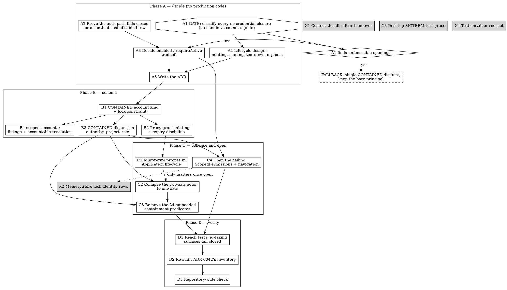

# Contained proxy principal — work graph

> **Status: nothing here is authorized.** This is the shape of the work, not a
> plan to execute. It exists so the decision can be taken with the costs in
> view. Phase A produces the evidence; everything after Phase A is conditional
> on what A1 finds.

**Findings register below** records everything the audit rounds have established.
Items carry **[A1]** amendments; the register is the authority where the two
disagree.

**A1 has been run.** Its result is
[the no-credential surface audit](2026-11-08-a1-no-credential-surface-audit.md):
verdict PROCEED, kill condition not triggered. It decides A3, shrinks A2,
re-scopes B2 as the highest-risk item, and makes B1/B2/B3/C3 one atomic change.
The notes below marked **[A1]** are its amendments.

**Origin.** Slice four (PR #174) delivered the contained information actor at the
repository and store layer. No production surface above that layer admits a
contained principal, because `authority_project_role`
([V156:304](../../../plowshare-server/src/main/resources/db/migration/V156__scoped_rbac_grants.sql))
filters `s.kind='PROJECT' OR (s.kind='PERSONAL' …)` and never learned the fifth
scope kind `CONTAINED` added by V216. `ScopedPermissions` has no second arm, so
NULL becomes `false`.

**The proposal this graph costs out.** Replace the bare-UUID contained principal
with a **derived proxy principal**: a real identity row that holds the parent's
delegated authority attenuated to the child's `CONTAINED` scope, and that cannot
authenticate. **[A4] It is durable, not temporary** — one proxy per contained
scope, minted and retired with it (F9, F10). An earlier framing called it a "temp
account"; F9 shows identity rows cannot be reclaimed, so the lifetime that is
actually bounded is the grant's, not the identity's. Authority is inherited; the namespace is the fence; the fence is
the grant table, which every predicate already consults.

**Why it is believed buildable.** The schema already separates *identity row*
from *credential material*.
[V155:15](../../../plowshare-server/src/main/resources/db/migration/V155__explicit_authority_identities.sql)
locks `BUILTIN` accounts (`SYSTEM`, `GLOBAL`) with `NOT enabled`,
`session_version=0` and `password_hash='!locked-built-in'`: full authority
accounts that nobody can sign in as. A `CONTAINED` account kind would be the
same construction, minted per child and time-bounded by the `expires_at` and
`revoked_at` columns `authority_grants` already has.

**What it would retire.** The 24 hand-embedded containment predicates across 8
files; the acting/attribution split in `InformationActor` (a proxy has a handle,
so `information_job_inputs.owner_handle` and `memories.formed_by` can name the
child directly); and the per-call-site confinement the spec itself names as the
failure mode.

**What it reverses.** V218's no-credential property, on which ADR 0042 rests
eleven surface closures. The spec says in terms that "a design that works by
handing a child a credential would open all eleven." That is the gate.

---

## Findings register

Each finding is evidence-backed and names the construct, not just a line. `F1`–`F3`
come from the A1 audit; `F4`–`F7` from the follow-on audit of the nineteen rows
execution *does* reach, which A1 named as its own gap.

| # | Finding | Effect |
| --- | --- | --- |
| F1 | `authority_grant_insert` (V216:198) raises on `subject_kind NOT IN ('USER','SERVICE')` **and** on `destination.kind IN ('RESTRICTED','CONTAINED')` | B2 must relax two conjuncts in the schema's most sensitive trigger. The "issuance" half of ADR 0042's exclusion. |
| F2 | `contained_scope_readable`'s self arm (V223:159) admits the child only while `NOT EXISTS(… admins WHERE handle=$1)`; V229's write gates and V232's memory arm share the assumption | A proxy **removes** slice four's capability unless the self arms change in the same migration. Fail-closed. |
| F3 | `account_active` (V138:31) admits by exclusion — any kind that is not `SERVICE_TOKEN` is active whenever `enabled` — across 9 Java files and 13 migrations | Decides A3: `enabled=false`. An enabled proxy flips liveness true at 22 sites at once. |
| F4 | The no-general-read invariant is keyed on the actor's **string shape**: `contained_knowledge_actor` (V229:30) is a UUID regex plus a `contained_principals` match, and V229:43 reads `NOT contained_knowledge_actor($2) AND knowledge_general_readable(r.id)` | A proxy whose identity string is not the bare canonical UUID loses **all** knowledge reads (fail-closed) — and if the opening conjunct is "fixed" without re-keying this one, the general arm **opens**. Constrains A4. |
| F5 | `authority_live_grants()` (V216:161) excludes `s.kind IN ('RESTRICTED','CONTAINED')` **and** requires `account_active(u.handle)` | The proxy's grant would be dead twice over — the "coverage" half of the exclusion, and a **direct conflict with A3's `enabled=false`**. B2 grows to four conjuncts across two constructs. |
| F6 | The same function's `ROOT_POLICY` base case already admits a disabled account explicitly: `u.account_kind='BUILTIN' AND NOT u.enabled` (V216:154–155) | **Resolves F5's conflict.** A kind-local exemption inside `authority_live_grants` is shaped like something already shipped, and leaves `account_active` — and its 22 sites — untouched. A3's decision survives. |
| F7 | `contained_scope_readable`'s ancestor arm filters `ancestor.kind IN ('PROJECT','PERSONAL')` with a comment saying it "mirrors `authority_project_role`'s own fence rather than adding one" | B3 makes that comment **false**. The filter stops being redundant and becomes load-bearing, and B3 must decide explicitly whether a contained parent reads its contained descendants. |
| F8 | F6's exemption severs `enabled` from the proxy's authority, and the proxy is already `enabled=false` by A3 | **The platform's normal kill switch does not work on a proxy.** Accounts are retired by `UPDATE admins SET enabled=false` — the only `DELETE FROM admins` is bootstrap removal — so an operator disabling a runaway child changes nothing. Revocation is the only kill switch, and it must be surfaced as one. |
| F9 | Grants are **revoke-only** (no `DELETE FROM authority_grants` anywhere) and `authority_grants.subject_account` (V156:64) carries no `ON DELETE` clause, so it is `NO ACTION` | Once a proxy has ever held a grant, the `admins` → `authority_accounts` cascade is blocked forever. **Proxy identity rows are structurally immortal.** A sweep cannot reclaim them, and it cannot disable them either (they already are). |
| F10 | `contained_principals.scope_id` is already `UNIQUE` — exactly one principal per contained scope | **Resolves F9 by bounding the count.** The proxy must be 1:1 with the `CONTAINED` scope, minted with it and retired with it — not one per run. "Temp account" is the wrong framing: accumulation then matches the number of contained Applications, which the platform already creates and destroys. Time-bounding belongs on the grant, not on the identity. |

| F11 | **60** foreign keys reference `admins(handle)`. **58 carry no `ON DELETE` clause**, so they are `NO ACTION` and block the delete. The only two cascades are `auth_session_chains` (V81:5) and `relay_native_consumers` (V125:11) | Disable-not-delete is not a house convention, it is **the only thing the schema permits**. The two cascades are ephemeral session/runtime state, which is where cascade belongs — so there is **no provenance data-loss hazard**, and equally no cheap delete. |
| F12 | Read-time resolution of a child to its accountable ancestor needs none of that rewriting, and it is already the vocabulary slice four uses: `InformationActor` calls the container "accountable" (`:36`, `:42`, `:77`) | **The attribution axis, moved from write time to read time.** Correct by construction for all 60 columns and for every table added later, and unlike the recorded axis it survives the child's deletion. |
| F13 | V218 states the principal has "no handle, no reference into `admins`, `authority_accounts` or `service_tokens`", and no handle→scope link exists; no accountable-account resolution exists in SQL today | **A `scoped_accounts` table has a real job** — supplying exactly that missing link, which F9's orphan problem needs. Its job is linkage and resolution, not migration. |

| F14 | `admins` is **not an administrators table** — it is the universal identity registry. `server_admin` is one column on it (V37), `account_kind` has four values (V111:2), and V111:4 structurally bars every non-`USER` kind from `server_admin`, `bootstrap` and `must_change_password` | A proxy in `admins` acquires **no administrative privilege** — that is barred by a shipped constraint, not by care. `admins` is an issue for three unrelated reasons: V218 forbade the row (A1 reversed that with evidence), it is the most-referenced table so its rows are immortal (F9/F11), and `account_active` makes a new kind live by default (F3). None of them is privilege. |
| F15 | The chain forcing `admins` is `authority_grants.subject_account → authority_accounts.id`, and `authority_accounts.legacy_handle` is `NOT NULL REFERENCES admins(handle)` (V155:27). But `authority_project_role(project TEXT, account TEXT)` is **handle-keyed** — it joins `a.legacy_handle=account` | A handle-less proxy is **unaskable** through the entire role API. See the handle-less variant under B1: architecturally cleaner, but it changes the authority API's shape rather than adding a branch to it. |

| F16 | **The ceiling is deliberate, not an omission.** V216 updated exactly five functions for the new kind — `authority_map_project`, `authority_scope_shape`, `authority_live_grants`, `authority_grant_insert`, `authority_membership_changed` — and three of those *exclude* `CONTAINED`. It did not update `authority_project_role` because, with no grant able to target a contained scope, that function can never answer for one | **Supersedes this graph's original framing.** `CONTAINED` is an authority-free scope kind by design, and the exclusions in F1 and F5 are that one decision stated three times. The proposal is therefore **not a bug fix** — it replaces authority-free containment with authority-bearing containment. A5 must argue it on those terms. |
| F17 | **The fallback as first written is a no-op.** `authority_project_role` finds grants whose scope's project is the named one, and no grant can exist against a contained scope, so widening its `s.kind` filter finds nothing. It also joins `a.legacy_handle=account`, so it can never answer for a handle-less bare principal at all | The real fallback is a `CONTAINED` **branch** that walks `contained_scope_ancestors` and checks the *container's* grant on an ancestor `PROJECT` scope — the walk `contained_scope_readable` already performs. And it opens only the **container-facing** half of the ceiling; the child's own run still cannot pass, because it has no account row. |

| F18 | **The authorization decision surface is tiny.** `ScopedPermissions.allows` is called from **three files** — `InformationAccess` (3 calls), `BoundMemoryWrites` (2), `BoundMemoryQueries` (1) — and the interface is held by 7 files including its own declaration, implementation and config | **Corrects this document's own framing.** The 24 embeddings are SQL predicate references inside repository queries — the data-layer fence, which is where a fence belongs. The *authorization decision* lives at 6 call sites. A second path for contained principals can be sealed behind one dispatcher, not scattered. |

| F19 | **Structure nests; agency does not.** `contained_scope_ancestors` recurses to 64 in SQL, and `ContainmentBounds(maxDepth, maxLiveDescendants)` is **mandatory and fail-closed** — `ContainmentConfig:74` refuses to start without both, saying "containment is not unbounded by omission". But `application.child.run` is a frame behind `Asking.requireHandle`, and a credential-less principal reaches no frame, so ADR 0042 records that "a child cannot start a grandchild on its own initiative" and "transitive containment needs such a driver per hop" | The hierarchy can be arbitrarily deep and is already budgeted on **both** axes. What cannot recurse is a child's ability to extend it. ADR 0042 states the confinement property and the capability limitation are "the same fact". |
| F20 | **The proxy does not fix F19.** It confers authority (grants), not a door (a session). A proxy still cannot sign in — `JdbcDurableSessions:64` allowlists `account_kind='USER'` — so it still reaches no frame, and still cannot drive a hop | **The nesting limitation survives the entire proposal.** The two are orthogonal, and this graph never said so. The fix for F19 is to expose the hop as a **retained tool** authorized server-side against the run's admission ceiling — the way every other thing a child does already works — with `ContainmentBounds` as the brake. ADR 0042's argument for leaving it closed treats the authenticated driver as *the* brake; F19 shows it is the **second** one. |

**Verdict after both rounds: still PROCEED.** No finding is fail-open as shipped,
and F5's conflict has a resolution with precedent (F6). What changed is where the
risk sits: it has concentrated almost entirely in B2.

## The graph

`A2`, `X1`, `X3` and `X4` have no prerequisites and can start at any time.

---

## Phase A — decide

### A1 — GATE: classify every no-credential closure

ADR 0042 closes a set of surfaces on one structural fact: a contained principal
"cannot sign in, holds no handle, and reaches no frame" (§ frame inventory). A
proxy principal breaks exactly one half of that: it **holds a handle**. It still
cannot sign in, if `A2` holds.

So every closure must be re-read and sorted into one of four buckets:

| Bucket | Meaning | Survives the proxy? |
| --- | --- | --- |
| `SIGN_IN` | closed because the principal opens no session | yes — sentinel hash |
| `GRANT` | closed because it resolves no role/grant | yes — attenuated grants |
| `HANDLE` | closed *because no handle exists to name* | **no — needs new work** |
| `OPENED` | closed by nothing that survives | **no — needs a fence** |

Rows to classify, from ADR 0042's frame inventory and addressability inventory:
`ProjectAuthorization.require`; `JdbcProjectMembers` `role`/`mayAdminister`/
`readableProjects`; `ProjectStore` `allFor`/`all`; `knowledge_scope_readable` and
`information_project_readable`; `knowledge_read_authority` and
`knowledge_readable_candidates`; `information_public_policy` and
`general_readable`; `JdbcInformationEventRecords`; `ProjectMessageRouting`;
`ContainedDeclarations` tool bindings; `UnionStore`; the schedule sites
(`JdbcScheduleStore`, `FileScheduleDefinitions`, `ScheduleListHandler`);
`WorkspaceApplicationPolicy`; and `ApplicationIdentity.project`.

**Exit criteria.** Every row carries a bucket and a citation — a predicate body
or a named test, not an inference. ADR 0042's own rule applies: an inventory
whose reason is a predicate body is only as current as that body, so each
citation names the construct, not just a line number.

**Kill condition.** If any row lands in `HANDLE` or `OPENED` with no fence that
is cheaper than the 24 embeddings this proposal removes, the proposal loses its
argument and the work becomes `FALLBACK` instead.

**No code.** This is a reading task with a definite answer.

### A2 — Prove the authentication path fails closed

A `CONTAINED` row's safety rests on `password_hash='!locked-contained'` plus
`enabled=false`. That is only sound if every authentication path compares against
a stored hash and never short-circuits.

**Exit criteria.** A test asserting a `CONTAINED`-kind row cannot open a session
by *any* path: password login, durable session resume, service-token exchange,
and the bootstrap path. `BUILTIN` relies on the same property, so this likely
documents existing behaviour — but a per-child, high-churn kind should not
inherit that confidence untested.

**[A1] Shrunk.** Session creation allowlists `account_kind='USER'`
(`JdbcDurableSessions.java:64`), so a new kind is excluded by construction
rather than by the sentinel hash. This becomes a regression test pinning that
allowlist, not an investigation.

### A3 — Decide the `enabled` / `requireActive` tradeoff

`DocumentNavigation` calls `requireActive(account)` (`:298`) and
`lockAccount(account)` (`:315`). `requireActive` will reject `enabled=false`. So
either the proxy is enabled — and safety rests entirely on the sentinel hash — or
`requireActive` learns the account kind.

This is the one place the two safety mechanisms trade off against each other, so
it is decided explicitly and recorded, not settled by whichever is convenient.

**[A1] DECIDED: `enabled=false`, and `requireActive` learns the kind.**
`account_active` admits by exclusion (any kind that is not `SERVICE_TOKEN` is
active whenever `enabled`), and it is referenced by 9 Java files and 13
migrations. An enabled proxy would flip liveness true at all 22 sites at once —
a fail-open change across the substrate to save one call site. The sentinel hash
remains defence in depth.

**[A1] The conflict F5 raised, and why the decision stands.**
`authority_live_grants()` requires `account_active(u.handle)`, so `enabled=false`
would kill the proxy's own grant and with it B3's whole purpose. The resolution is
F6: exempt the kind inside `authority_live_grants` only — where the `ROOT_POLICY`
base case already admits a disabled `BUILTIN` account — rather than inside
`account_active`, which would reopen all 22 sites. The decision is unchanged; B2
carries the cost.

### A4 — Lifecycle design

- Minting: who creates the proxy, in which transaction, on child spawn.
- Handle naming: `admins.handle` is `UNIQUE`, so a scheme is required, and it
  must not leak container or child naming into an addressable namespace.
- Teardown ordering: `authority_accounts.legacy_handle` is `ON DELETE CASCADE`
  from `admins(handle)`, while `authority_scopes.container` is `ON DELETE
  RESTRICT`. Those pull in opposite directions; the order is a design question.
- Crash orphans and the sweep that collects them.
- Expiry: `authority_grants.expires_at` / `revoked_at` already exist — decide
  whether the proxy's authority is time-bounded, revocation-bounded, or both.

### [A4] Resolved — the design

**The handle: the principal's canonical lower-case UUID text.** Checked, and both
ways it could have failed are ruled out:

- `admins.handle` is `TEXT PRIMARY KEY` whose only constraint is
  `admins_handle_named CHECK (handle <> '')` (V37:67). A UUID-shaped handle is
  schema-legal.
- Service classification keys on a **prefix**, not on shape:
  `ServiceCredentials.principal` is `account.startsWith("@service/")`
  (`ServiceCredentials.java:13`), and `@service/<uuid>` handles are minted at
  `ServiceAccounts.java:165`. A bare UUID is therefore not classified as a service
  principal — but the proxy **must never** take the `@service/` prefix, which would
  make it one everywhere. That is a hard constraint on B1, not a style note.
- One mint-time failure mode to handle rather than discover: V155:75's trigger
  refuses an ordinary account whose handle is one of the six reserved authority
  UUIDs. Astronomically unlikely from `gen_random_uuid()`, fail-closed, but the
  mint path must surface the error and retry rather than wedge.

The cost of a bare-UUID handle is legibility: it is self-describing in no log or
provenance column. Prefixing (`@contained/<uuid>`) would fix that and would force
F4's option 2 — re-keying the predicate that carries the no-general-read
invariant. Legibility is not worth that rewrite now; if it wins later, the
`ServiceCredentials` prefix-classification pattern is the shape to copy.

**Minting and retirement.** One proxy per `CONTAINED` scope (F10), created in the
same transaction as the scope and its `contained_principals` row. Retirement is
**grant revocation**, not account disablement (F8). Teardown order is forced by the
foreign keys: revoke the grant, then delete the scope — which cascades
`contained_principals` (V218:19, `ON DELETE CASCADE`) — while `authority_scopes.container`
is `ON DELETE RESTRICT`, so descendants go depth-first. The `admins` and
`authority_accounts` rows stay behind by design (F9); they are inert once the grant
is revoked.

**What this leaves open for A5.** Accumulation is permanent and bounded by the
number of contained Applications ever created. That is a real operational cost — the
identity table is referenced by many foreign keys — and it is the decision A5 must
state plainly rather than bury: the alternative is hard-deleting grant rows, which
destroys the audit trail the grant table exists to keep.

**[A1] F4 constrains the handle, and there is a cheap answer.** Two coherent
options:

1. **The proxy's `admins.handle` *is* the principal's canonical lower-case UUID
   text.** `contained_knowledge_actor` keeps matching, `information_global_read_member`
   stays false through `enabled=false`, and the only conjunct that must go is F2's
   `NOT EXISTS(… admins …)`. It also makes C2 fall out for free: provenance columns
   can carry that handle directly.
2. Re-key `contained_knowledge_actor` on the account kind or on a
   `contained_principals` join by account id, dropping the string-shape regex.

**Recommended: option 1.** It is strictly the smaller change, and option 2 touches
the predicate that currently carries the no-general-read invariant — the one place
F4 says a careless rewrite fails open. Option 2 remains the fallback if handle
validation rejects a UUID-shaped handle, which A4 must check.

**Depends on:** A1.

### A5 — Write the decision record

A new ADR beside `0042`, covering: the general platform need, the SDK-only
alternatives considered, the authorization and lifecycle impact, the
compatibility tests, and the explicit reversal of V218's no-credential property
with A1's evidence as its justification.

**Depends on:** A1–A4. **Blocks:** all of Phase B.

---

## Phase B — schema

Migration numbers are **not** reserved here. The spec records that this branch
has already renumbered three times and asks that a long-lived branch's numbering
be treated as colliding by default; the current maximum is V232. Take the next
free numbers at the time of writing, and never edit a shipped migration.

### B1 — `CONTAINED` account kind

Add `'CONTAINED'` to `admins.account_kind`, plus a lock constraint in the
`builtin_accounts_are_locked` mould: `NOT enabled` (pending A3), `NOT bootstrap`,
`NOT server_admin`, `NOT must_change_password`, `session_version=0`,
`password_hash='!locked-contained'`. The existing non-USER constraint already
bars the admin flags, so the new constraint pins the rest.

**Depends on:** A5.

#### Variant considered and not adopted: the handle-less proxy

Give the proxy an `authority_accounts` row with **no `admins` row at all**, by
making `legacy_handle` nullable — a column whose name already suggests transitional
intent.

**What it would buy.** V218's prohibition would be only half reversed: still no
handle, still no credential, still no `admins` row. **F2 dissolves** — the self arm's
`NOT EXISTS(… admins …)` keeps passing. **F4 dissolves** — the actor string stays the
bare UUID. **F11 stops applying** — the proxy is invisible to all 60 handle keys,
so F9's immortality shrinks to one table's rows.

**What it would cost, and why it is not adopted now.** `authority_project_role` takes
a **handle** and joins `a.legacy_handle=account`, as does the rest of the role
family. A handle-less account cannot be asked about through any of it, so the work
becomes a parallel id-keyed resolution path through the authority substrate rather
than a disjunct in one predicate — against 83 SQL occurrences of `legacy_handle` and
11 Java files. It also forfeits C2: provenance columns keyed on `admins(handle)`
cannot name the proxy, so the two-axis actor survives.

**Worth revisiting if** B2's four-conjunct relaxation proves too risky to defend.
This variant moves the cost from the authority fences to the authority API, which is
larger but less dangerous.

### B2 — Proxy grant minting and expiry discipline

A grant whose `subject_account` is the proxy and whose only scope is the child's
own `CONTAINED` scope, issued by the container, with the expiry policy A4 chose.

**[A1] HIGHEST-RISK ITEM. The earlier note here — "no change expected" — was
wrong.** `authority_grant_insert` (V216:198) raises on both halves of this:
`subject_kind NOT IN ('USER','SERVICE')` bars the proxy from receiving any grant
anywhere, and `destination.kind IN ('RESTRICTED','CONTAINED')` bars any grant
targeting a contained scope for any subject — which ADR 0042 states as
deliberate. B2 is a narrowly-conditioned relaxation of two conjuncts in the most
security-sensitive trigger in the schema, and needs its own adversarial tests
and its own reversal argument in A5.

**[A1] And F5 doubles it.** `authority_live_grants()` (V216:161) also excludes
`s.kind IN ('RESTRICTED','CONTAINED')` and requires `account_active(u.handle)`, so
a grant B2 managed to insert would still never be live. B2 therefore touches
**four conjuncts across two constructs** — the issuance trigger and the live-grant
recursion — and it is where essentially all of this proposal's risk now sits. Both
relaxations have a shipped precedent in the same function's base case (F6), which
is the argument A5 should make; the precedent does not excuse the tests.

**Depends on:** B1.

### B4 — `scoped_accounts`: linkage and accountable resolution

**Adopted, in one of its two proposed roles.** A table recording, for each proxy
identity, the contained scope it belongs to and the account accountable for it —
supplying the handle→scope link F13 shows is genuinely absent — plus a resolution
that answers "who is accountable for this row?" by walking
`contained_scope_ancestors` to the nearest uncontained ancestor.

**What this buys.** It defangs F9 rather than fixing it. The immortal identity rows
remain, but nothing needs them to answer accountability any more, so they become a
storage cost instead of a correctness problem. It also makes the orphan class
expressible for the first time, and it is the same notion slice four already
records at write time (F12) — generalised, and durable across the child's
destruction, which the recorded axis is not.

**What is refused: migration by rewrite.** The proposal's other half — on deletion,
reattribute the child's actions to the parent — is not adopted. F11 is why: 58 of
the 60 foreign keys to `admins(handle)` are `NO ACTION`, so a delete is blocked
until every referencing column is rewritten, exhaustively, and **every table added
later inherits that obligation silently**. That is the "check at each call site"
failure mode the spec names, transplanted from reads into the lifecycle. Rewriting
`authority_grants.subject_account` is worse still: it would manufacture a record
saying the parent held a grant on a contained scope that it never held, inside the
structure `authority_live_grants` recurses over.

Resolution at read time gets the same answer without asserting anything false.

**Depends on:** B1. **Blocks:** nothing — it is additive, and the fallback can take
it on its own.

### B3 — `CONTAINED` disjunct in `authority_project_role`

One disjunct, structurally the same shape as V231's navigation arm. Safe by
construction once B1 and B2 hold, because the only accounts holding grants on a
`CONTAINED` scope are proxies. This is the clause that is the entire ceiling.

**Depends on:** B1. **Blocks:** C2, C3, C4.

---

## Phase C — collapse and open

**[A1] B1, B2, B3 and C3 are one atomic change, not a sequence.** V223's self arm
admits the child only while it has *no* `admins` row, and V229's write gates and
V232's memory arm share that assumption. Minting a proxy therefore removes the
capability slice four delivered unless the self arms are rewritten in the same
change. Fail-closed, so not a security finding — but the old arms and the new
grant path cannot coexist across a release boundary.

### C1 — Mint and retire proxies in the Application lifecycle

Wire A4's design into child spawn and teardown.

**Depends on:** B2.

### C2 — Collapse the two-axis actor

With a handle, `InformationActor.acting()` and `attribution()` converge.
`information_job_inputs.owner_handle`, `memories.formed_by` and
`embedding_queries.account_id` can all name the child directly. Retire
`InformationActor.contained(principal, container)`, `JobRuntime.memoryActingAxis`
and the three memory-path sites that exist only to pick an axis.

**Depends on:** C1, B3.

### C3 — Remove the embedded containment predicates

The 24 occurrences across `InformationActor`, `ContainedActorGuard`,
`JdbcInformationCatalogueRepository`, `InformationAccess`, `MemoryStore`,
`MemoryQueries`, `MemoryWrites` and `JobRuntime`. Each removal must be justified
by a grant-table equivalent, one at a time — this is where a silent widening
would hide, so it is not a sweep.

**Depends on:** C2, B3.

### C4 — Open the ceiling

`EffectiveProjectPermissions` needs no change once B3 lands — verify that rather
than assume it. `DocumentNavigation`'s account resolution follows A3's decision.

**Depends on:** B3, A3.

---

## Phase D — verify

### D1 — Reach tests for id-taking surfaces

The failure mode this design must not have: a surface that takes a document,
revision, scope or blob identifier rather than a project name, where the proxy's
inherited authority answers for the parent's whole reach. Test each such surface
with a sibling's, an ancestor's and a stranger's identifier.

**Depends on:** C3, C4.

### D2 — Re-audit ADR 0042's inventory

ADR 0042 requires that every slice editing one of its predicates re-audits the
rows that depend on that body. B3 and C3 edit several.

**Depends on:** D1.

### D3 — Repository-wide check

`./gradlew format && ./gradlew formatCheck && ./gradlew check`, plus the narrow
`-PfullDb` selection the schema work requires, with the database-specific reason
stated. Not the whole database suite unless its breadth is necessary.

**Depends on:** D2.

---

## Self-similar nesting is a separate axis, and the costlier item does not buy it

**[F19/F20]** Two independent questions were tangled together in this document:

1. **Can the layer slice four built be reached?** The ceiling. Answered by the
   preferred direction below, or by the proxy, or by the fallback.
2. **Can a child extend the hierarchy itself?** Self-similar nesting. Answered by
   **none of them** — it needs the containment hop exposed as a retained tool rather
   than as a frame, because the blocker is the absence of a *door*, not the absence
   of authority.

Anyone reading this graph to decide about nesting should know the proxy buys nothing
there. The honest sequencing is: take the preferred direction for (1), and treat (2)
as its own task whose brake already exists in `ContainmentBounds`.

## Preferred direction: go with V216 (sealed second path)

**[F18] This supersedes the proxy as the recommended plan.** V216 decided contained
scopes carry no RBAC authority. Rather than reverse that, serve the child through a
second, explicitly-typed authorization path and keep the first one untouched.

Both halves of the ceiling open, and neither half touches V218, the issuance
trigger, or the live-grant recursion:

1. **Container-facing half** — the ancestry-walking `CONTAINED` branch in
   `authority_project_role` described under Fallback below. The container resolves a
   role on its descendant's project; navigation works because the container has an
   `admins` row.
2. **Child-facing half** — a typed `ContainedPermissions` contract beside
   `ScopedPermissions`, and one dispatcher that routes by the principal's shape:
   contained principal → containment path, account → `ScopedPermissions`, anything
   else → refuse. Six call sites across three files (F18).

**What this costs, stated honestly.**

- **Two authorization paths.** The standing risk is a surface asking the wrong gate.
  It is containable here because the dispatch is one decision in one place with a
  fail-closed default, and because an exhaustiveness test over the consumers is
  writable. It is still two paths, and every future authorizing surface inherits the
  obligation to route rather than to choose.
- **A permanent capability ceiling.** A child can never do anything role-gated — no
  audience setting, no project operations, no membership, no management. ADR 0042
  intends exactly that. But it becomes structural: if the roadmap later wants a child
  to publish to its container or manage a sub-space, that reversal gets paid then,
  with more code resting on the assumption.
- **The two-axis actor is permanent**, since provenance columns keyed on
  `admins(handle)` cannot name a handle-less child. It already works; it just never
  collapses, so C2 is off the table.
- **A standing constraint on future tables**: any new durable table recording who
  acted must use the container's handle or a column with no `admins` foreign key.
- `DocumentNavigation`'s `requireActive`/`lockAccount` need a dispatch too, not a
  widening.

**Why this is preferred over the proxy.** B2 — the four-conjunct relaxation of the
schema's two most sensitive constructs, and the item carrying essentially all of the
risk — **disappears entirely**. So do F1, F2, F4, F5, F8, F9 and F10, which are all
consequences of minting an identity row. What remains is one SQL branch, one typed
interface, one dispatcher and B4's resolution.

**What it does not do.** It leaves the capability ceiling in place permanently. That
is the trade: the proxy buys a child that can hold authority, at the cost of
reversing a deliberate design and touching the authority fences. This buys a child
that works within V216's design, and never more than that.

## Fallback

**[F17] Rewritten. The earlier text here was wrong** — it called for a single
`CONTAINED` disjunct in `authority_project_role`, which finds nothing, because no
grant can exist against a contained scope for it to find.

The real fallback is a `CONTAINED` **branch** in `authority_project_role` that walks
`contained_scope_ancestors` upward and resolves the *container's* grant on an
ancestor `PROJECT` or `PERSONAL` scope — lifting the walk
`contained_scope_readable`'s ancestor arm already performs into the role predicate.
Keep the bare principal, keep the two-axis actor, keep the 24 embeddings.

**What it does and does not open.** It opens the **container-facing** half of the
ceiling: `ScopedPermissions.allows(container, containedProject, …)` starts
answering, and navigation works for the container because it has an `admins` row
for `requireActive`. It does **not** open the child-facing half — a run carrying the
bare principal still resolves no role, because `authority_project_role` joins
`a.legacy_handle=account` and the child has no account row.

So the two halves of the ceiling are independent, and only the proxy (or F15's
handle-less variant, which needs an id-keyed path) reaches the second. That
distinction was missing from this document and is the single most important thing
F16 and F17 add.

---

## Carried from slice four

These are independent of everything above.

- **X1** — The handover in
  `docs/superpowers/plans/2026-11-07-nested-applications-slice-four.md` states
  the ceiling as a possibly-forbidden choice between credentialing the child and
  redesigning the contract. The real obstacle is one clause that never learned
  the fifth scope kind. Correct it.
- **X2** — `information_lock_scope(acting, scope)` in `MemoryStore.lock`/
  `lockRead` locks no identity rows for a contained principal. Not a live hole
  today: the post-lock `require(...)` re-pin re-evaluates admission on a fresh
  snapshot. First thing to re-examine once C4 lands.
- **X3** — `plowshare-desktop`'s "withdrawal waits for a command that ignores
  SIGTERM to be killed" is load-sensitive on a five-second deadline. Wants more
  grace, not another investigation.
- **X4** — `~/.testcontainers.properties` pins a Docker socket that exists but
  has no listener, so Testcontainers hangs indefinitely rather than failing.
  Worked around with a command-scoped `DOCKER_HOST`; the machine-wide config is
  untouched and still wrong.
