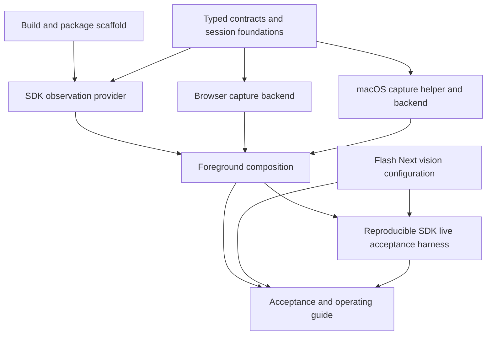

# P0/P1 delivery graph

Scope: [merged design](../../docs/computer-control-design-and-plan.md), P0/P1.
Observation only; no P2/P3 input tools, core changes or automatic deployment.
Every node needs implementer evidence and explicit approval from its independent
reviewer. A downstream implementation is accepted only against approved contracts.

| Node | Implementer | Independent reviewer | State / acceptance evidence |
| --- | --- | --- | --- |
| N0: package/build/lint integration | coordinator | reviewer | APPROVED after frozen install, compilation, policy tests, integration boundary and bounded-runner checks. Final exact-tree `check`, `formatCheck` and isolated packed-SDK consumer all passed. |
| N1: contracts, geometry, deadlines, sessions | contracts_impl | reviewer | APPROVED with 17 independent tests; wire precision, cancellation and uncertain physical-settlement fencing corrected and re-reviewed. |
| N2: reusable SDK provider and journal reservation | contracts_impl | reviewer | APPROVED; same-socket embedding, typed images, dedupe/recovery, receipt geometry and physical drain. Namespace and synchronous parent-deadline deltas re-approved with independent provider/config/runner tests. |
| N3: browser capture | backends_impl | contracts_impl | APPROVED after eight independent deterministic tests and real isolated changing-canvas capture. Startup/capture/cleanup bounded; no input tools. |
| N4: macOS helper/capture | backends_impl | reviewer | Code APPROVED after independent 28-test selection and macOS 14.2 compile/no-prompt protocol checks. Physical lock/reap races corrected. Live native capture OPEN: no OS screen-capture permission. |
| N5: foreground composition | contracts_impl | reviewer | APPROVED after independent strict compilation, typed lint and 26 selected provider/config/runner tests. Shared startup/pass budgets, bounded metadata, exact principals, lease headroom and late-result uncertainty verified. |
| N6: acceptance and operating guide | coordinator | reviewer | DOCUMENTATION APPROVED, including foreground/configured acceptance guides and exact-tree verification. Full configured Relay/model LIVE test remains OPEN; the user chose to continue without live validation after login failures. See [documented gaps](PLATFORM-GAPS.md); approval of docs is not live acceptance. |
| N7: Flash Next vision configuration (additional user instruction) | coordinator | reviewer | Exact profile and guarded operator patch APPROVED. Direct synthetic PNG inference passed; BETA config applied and server healthy with unchanged image/schema. Owned synthetic server probe refused on identity/scope mapping, so server image inference unverified and PROD remains unchanged (candidate staged only). Mac routing preserved. |
| N8: reproducible SDK live acceptance harness | contracts_impl | reviewer | Code APPROVED after independent strict compilation, typed lint, formatting and 13 regressions. One original SDK session, authenticated identity, two pixel-only trials, exact route/invocation/PNG receipt linkage and bounded no-replay cleanup. Serialized evidence snapshots are provisional until successful return/zero exit. Live execution DEFERRED by user instruction. |

P0/P1 implementation, reviewer approval and live acceptance are separate states.
OS consent or a configured endpoint may limit live evidence; record that limit
instead of substituting a mocked result for live validation. Local native probes
must not request permissions or send physical input without an explicitly chosen
controlled target and appropriate authority.

## Reviewed implementation evidence before N8

- `./gradlew check formatCheck :plowshare-computer-control:computerControlConsumerCheck`
  passed before the acceptance harness was added (147 tasks). No `-PfullDb` or database
  smoke test was enabled.
- The new integration and isolated packed-public-SDK consumer each passed 66
  tests with one explicit live-browser test skipped by default. The controlled
  browser test separately passed under both implementer and independent reviewer.
- The independent native check compiled the macOS 14.2 helper and verified strict
  no-prompt status/invalid-request framing; it did not capture pixels.
- Two independent source traces confirmed that Relay's `call.run` is the retained
  execution identity across successive model dispatches, so session ownership
  survives the open/observe loop. It is not the job or individual model-call ID;
  a separate execution intentionally cannot adopt the session.
- The repository check also passed the existing 14-test
  `TypedPngObservationTest` and three-test `ImageContextBudgetTest`: controlled
  next-request projection, OUTPUT exclusion, hook redaction, missing bytes,
  durable-write failure and context overflow remain enforced without database
  opt-in. These are deterministic server-path evidence, not live GPU acceptance.
- The final independent documentation check passed 62 local links, five JSON
  examples, code fences and whitespace checks.
- No input tools, TUI/GUI controls, core runtime/API/SQL/shared SDK changes or
  product image deployment were included. BETA's separately reviewed vision
  configuration change and its live limits are recorded above.

N8 source and its configured operating guide received independent approval after
13 regression tests, including delayed physical evidence writes, late login,
two-second identity reads, uncertain scope connection and invalid evidence.
The final approved tree, including N8 and the updated base, passed
`./gradlew check formatCheck :plowshare-computer-control:computerControlConsumerCheck`
(147 tasks). Both integration and fresh packed-SDK consumer passed 79 tests with
one explicit live-browser skip each. No database opt-in was enabled. Live gates
remain open.

The saved operator account's live setup/probe refusals were preserved. On user
continuation the proposed saved human BETA connection was selected for a public
identity check, which returned LoginRequired. Its connection metadata is not an
authenticated session. The user was asked to sign in privately; no credentials
were extracted and no further identity fallback or live mutation was performed.
The user subsequently reported broader BETA login failures and explicitly chose
to continue without live validation. No further acceptance attempts are planned
within this implementation delivery.
