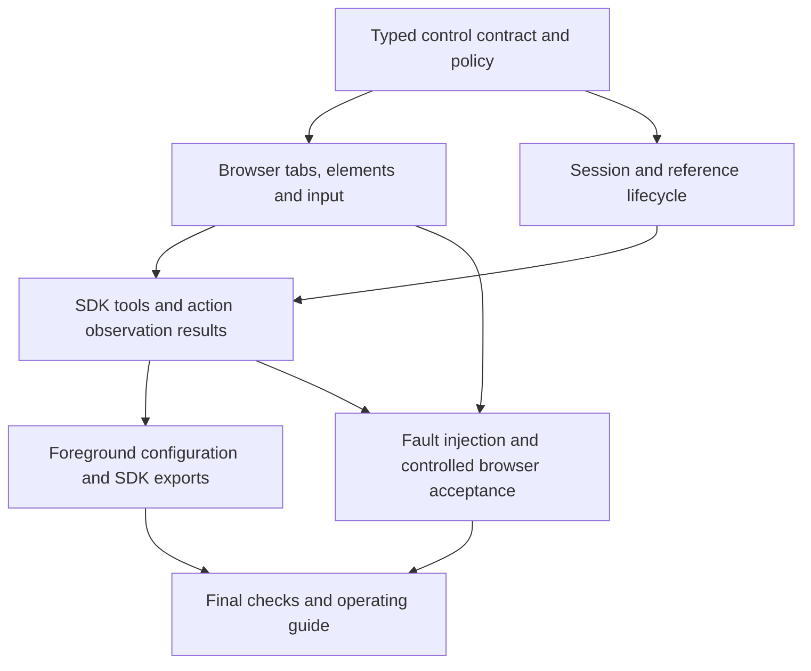

# P2 browser control delivery graph

Scope: the [merged plan](../../docs/computer-control-design-and-plan.md), P2.
The reusable public-SDK provider gains an explicitly enabled browser control loop.
TUI, GUI and standalone hosts share its contracts; client controls and native
desktop input remain later phases. No core, API, SQL or shared SDK changes are
authorized by this integration.

This branch builds on the independently reviewed P0/P1 implementation in draft
PR #293. The user requested P2 source work while configured server/model and
native live acceptance remain deferred. Advancing implementation does not close
those earlier live gates or authorize a deployment.

| Node | Implementer | Independent reviewer | Acceptance / state |
| --- | --- | --- | --- |
| P20: typed control contract and explicit policy | contracts_impl | reviewer | APPROVED after independent strict compile, typed lint/formatting and 15 contract tests plus foundation coverage. Typed capability, strict validators, policy, outcomes and bounds are frozen; the exposed-focus truncation delta was independently re-approved. |
| P21: browser backend and driver | backends_impl | reviewer | APPROVED after independent strict compile, typed lint/formatting, 25 deterministic tests and an isolated Chrome fixture. Covers predispatch origin guards, explicit popup quarantine, exact handles, bounded DOM, input/dialogs, deadline admission, private child environment and physical cleanup. |
| P22: session/reference lifecycle | contracts_impl | reviewer | APPROVED after independent strict compile, typed lint/formatting and 40 selected tests. Controlled close/expiry retains occupancy; only visible owner-bound frame/snapshot/window references are actionable. |
| P23: SDK tools and post-action observation | coordinator | reviewer | APPROVED after independent strict compile, typed lint/formatting, 24 new SDK polling/journal fault tests and 14 existing provider tests. Includes preflight capacity, known/partial/uncertain outcomes, bounded metadata, modal fallback evidence and automatic idle cleanup; P21 dependency is approved. |
| P24: foreground configuration and SDK composition | coordinator | reviewer | APPROVED after independent whole-module strict compile, typed lint/formatting, 54 selected SDK/provider/configuration tests and documentation checks. Exact injected snapshots are admitted before filesystem/ownership effects; default mode, exports and catalogue/journal identities verified. |
| P25: fault injection and controlled browser acceptance | backends_impl | reviewer | APPROVED: independent real browser UI fixture and real browser + SDK polling/private journal/synthetic binary-admission fixture. Changed PNG/SHA evidence, one actual POST and duplicate invocation with effects=1/uploads=2 verified. P23 independently supplies the fault-injection matrix. No configured server/model was used. |
| P26: verification and operating guide | coordinator | reviewer | APPROVED after independent final log/documentation review. Whole-repository `check`, `formatCheck` and isolated packed-SDK consumer passed (147 tasks); both integration suites passed 163 tests with three explicit browser skips. Documentation checks passed; configured live gates remain deferred. |

Every node requires agreement from its implementer and independent reviewer on
the actual source and evidence. Shared-working-tree file ownership is disjoint:
contracts/session state, browser driver/backend, and provider/composition/docs.
Contract changes require reviewer approval and coordination before consumers
change. Final checks run against the combined approved tree.

## Approved contract decisions

- Preserve the existing observation-only factory and catalogue by default. A
  separate controlled browser factory requires explicit enabled tools and exact
  HTTP(S) origins. Controlled observation and input require its backend-held
  owner lease; bare capture cannot bypass it through another SDK provider.
- Each controlled lease creates an isolated browser context. Release disposes
  its handles and storage, releases only owned input, and waits for physical
  settlement before making the target available. A durable exclusive marker in
  an explicit ownership directory predates context navigation and all input;
  uncertain physical cleanup or a host crash retains its marker across SDK
  hosts. After proven quiescence, marker removal can precede a failed parent
  fsync; the releasing instance stays fenced although another process can safely
  acquire the already-quiet resource.
- Structured inspection is a bounded semantic DOM projection with exact element
  handles, not a claim of complete accessibility-tree fidelity. Replaced elements
  and stale document/layout/focus references are refused without retargeting.
  Truncated snapshots support a bounded subtree read through an already observed
  exact element, with no model-supplied selectors.
- A dialog decision is explicit and one-use on its initiating action, with an
  expected kind and optional exact message. Unanticipated, mismatched or second
  dialogs stop the operation. Arbitrary interactive modal recovery is outside
  this initial browser envelope.
- Unambiguous initial popup document navigation is blocked before dispatch. The new tab is
  quarantined, receives a navigation guard, and needs a separate explicit
  navigation before input. Navigation guards cover redirect destinations;
  ambiguous multiple unbound requests fail-stop instead of guessing a tab.
  Subresource networking is not a network sandbox. Child-frame targeting is
  unsupported and must fail explicitly.

Default verification uses fake transports/backends/clocks and temporary journals.
Explicit browser acceptance may use a provider-owned isolated browser and a
controlled synthetic fixture. No user browser, desktop, live model, login,
deployment, PostgreSQL or database smoke test is part of this phase's current
verification authorization. External effects after uncertain delivery are
reconciled from original receipts, never repeated to obtain cleaner evidence.

## Combined verification evidence

- Final combined command:
  `./gradlew check formatCheck :plowshare-computer-control:computerControlConsumerCheck`
  passed (147 tasks). No database opt-in or database smoke task was enabled.
- Integration and fresh packed-public-SDK consumer each passed 163 tests, with
  three explicitly gated browser tests skipped by default. The consumer imported
  the reusable package exports and verified explicit browser catalogue selection.
- The independent P2 UI fixture passed on an isolated Chrome instance, including
  Unicode/form actions, dialogs, scroll/drag, stale/sensitive/frame refusals,
  redirect/network counters, bounded observation failure and context isolation.
- The independent browser/SDK fixture used the public SDK polling path, private
  file journal and lock, a synthetic binary-admission peer and actual PNG bytes.
  It verified changed post-action image SHA/geometry and duplicate delivery with
  one actual POST effect and two uploads (initial and post-action observations).
- Configured server/model validation remains deferred. No native desktop input,
  client controls, core/API/SQL/shared-SDK changes or deployment was included.
