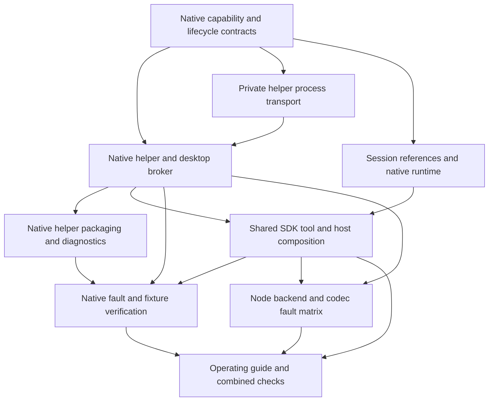

# P3 macOS desktop control delivery graph

Scope: the [computer-control plan](../../docs/computer-control-design-and-plan.md),
P3. Extend the reusable public-SDK provider with explicitly enabled native macOS
control. TUI, GUI and standalone SDK hosts use the same implementation on their
existing authenticated connection. Dedicated client controls, other operating
systems and deployments remain separate deliverables.

This graph records the initial foundation and its no-input evidence. The
[verified readiness continuation](READINESS-IMPLEMENTATION.md) adds host-only
local confirmation and scoped live evidence to make native input usable. Native
acceptance remains separately tracked there; the matrix must pass before claiming
the phase complete. Historical evidence below does not qualify the continuation.

This work builds on the reviewed P2 source in draft PR #295, itself stacked on
draft PR #293. Implementation does not close their deferred configured
Plowshare/model acceptance gates. The user owns the BETA/PROD redeployment.

| Node | Implementer | Independent reviewer | Acceptance / state |
| --- | --- | --- | --- |
| P30: native capability and lifecycle contracts | contracts_impl | reviewer | APPROVED: independent source review, strict focused compile, typed lint, formatting and 23 selected contract/foundation tests. Kernel exclusion and cleanup feasibility independently inspected and rerun with a unique no-input semaphore. Unknown readiness refuses input; usable native readiness stays OPEN at P34. |
| P31a: private helper process transport | coordinator | reviewer | APPROVED: independent source review, strict focused compile, typed lint, formatting and eleven transport fault tests. Bounded typed JSONL, startup deadline, strict incoming/outgoing codec capabilities, owned pipe errors, one cancellation lane, actual-exit cleanup proof and permanent uncertainty fencing. Actual native codec/helper implementation is reviewed separately. |
| P31b: native packaging and diagnostics | contracts_impl | reviewer | APPROVED: independent 17 Python lifecycle/validation tests, Black and compile checks; final helper compile/protocol/no-post checks and fresh ad-hoc bundle/configured-identity diagnostics. Explicit signing and finite shared build/check budgets; no consent/input permission or real signing identity is implied. |
| P31: native helper and desktop broker | backends_impl | reviewer | APPROVED: independent Node source review with 39 selected tests, whole-module strict compile, typed lint/formatting; six Swift sources independently reviewed, compiled for macOS 14.2 with guarded newer APIs, strictly formatted and checked through both protocols plus no-post fixtures. Exact ownership, per-event acknowledgement, focus confirmation, cancellation cleanup and receipt attribution findings resolved. Production unknown readiness still refuses input. |
| P32: native session references and runtime | contracts_impl | reviewer | APPROVED: independent whole-module strict compile, typed lint/formatting, eight reference tests and 25 runtime/provider tests including 15 runtime fault cases. Covers owner/generation/freshness, exact emitted references, post-action image admission, known versus uncertain effects, deferred cleanup/upload, idle/stop and no replay. Credential-wait freshness corrections were independently re-approved with 51 browser/native SDK tests. |
| P33: shared SDK tool and host composition | coordinator | reviewer | APPROVED: independent whole-module strict compile, typed lint and SDK/provider/configuration/host/catalogue tests, including separately re-approved credential-wait corrections. One catalogue routes exact browser/native ports, native integer scrolling and macOS chords are explicit, injected admission precedes effects, and default/P2 declarations remain unchanged. P31/P32 dependencies and combined checks passed. |
| P34: native fault and fixture verification | backends_impl | reviewer | OPEN native acceptance: compile/no-prompt/no-post source checks independently approved, including 19 protocol, eight acknowledgement and six executor fixture cases. Permission-backed pixels, controlled GUI/cross-application input, mixed displays, revocation/lock/interference and helper death during real held input remain unverified. This node and P3 native acceptance are not closed by simulated evidence. |
| P34a: Node backend and codec fault matrix | coordinator | reviewer | APPROVED: independent strict compile, typed lint/formatting and 39 selected tests cover strict codec, durable ownership, concurrent lifecycle, known/uncertain outcomes, monotonic expiry and old-helper coordination. No real OS input or capture; native live acceptance remains separate. |
| P35: operating guide and combined checks | coordinator | reviewer | APPROVED source verification: reviewer checked the combined repository/consumer log, native and Python evidence, operating guide and links/examples. Repository check/formatCheck/fresh consumer passed (147 tasks); both integration suites passed 264 tests with three explicit browser skips. P34 and configured model gates remain open; no merge or deployment is implied. |

A node closes only when its named implementer and independent reviewer agree
on the actual source and evidence. Findings return to the implementer. Contract
changes require another review before dependent implementations adopt them.

Shared-working-tree ownership is disjoint: native contracts/session/runtime;
native backend/helper/scripts; provider/catalogue/configuration/exports/docs.
Default tests use fake SDK transports, clocks and native process boundaries.
Native compilation and permission preflight do not establish capture or input.
No test should request OS consent or inject input into an arbitrary user window.

## Native acceptance gates

The phase's live matrix includes a controlled native app and cross-application
workflow, menus/dialogs, Unicode insertion, mixed-display geometry, permission
revocation, a locked session, detectable local interference and helper death
mid-drag. Held inputs must be released or the desktop remain fenced. Browser
fixtures and mocked native processes cannot close these native gates.

Configured Plowshare/model validation remains deferred by the user's earlier
instruction. No core runtime, API, database or shared SDK extension is authorized
to make this integration pass.

## Contract decisions under implementation

- Native and browser tools share model reference shapes, with one catalogue and
  one public SDK invocation lifecycle. Native control has no navigation or
  automatic browser dialog policy. Its exact application policy narrows the
  server's tool grant.
- Native guards and accessibility references remain native contracts. An AX
  window is distinct from a display capture surface; no title-based association
  with a capture window ID is accepted.
- Capture, accessibility, event-posting and event-listening permissions are
  separate facts. Unknown readiness refuses input. Console-active status does
  not prove the screen is unlocked. Establishing a usable real-backend readiness
  envelope remains an OPEN native acceptance gate; code implementing input
  primitives does not close it.
- Input outcomes describe established local dispatch, not application success.
  Failed post-action observation preserves known dispatch evidence. Helper
  death does not prove owned keys or buttons were released.

## Combined verification evidence

- `./gradlew check formatCheck :plowshare-computer-control:computerControlConsumerCheck`
  passed: 147 tasks, without database opt-in. Integration and fresh packed-public-SDK
  consumer each passed 264 tests, with three explicitly gated browser tests
  skipped. Both credential-wait freshness corrections are included.
- Seventeen Python lifecycle/validation regressions, Black and Python compilation
  passed. Native source checks compile the six explicit Swift files, validate
  both strict helper protocols and run no-post memory fixtures: 19 protocol,
  eight acknowledgement and six executor cases.
- A fresh explicitly ad-hoc signed bundle passed signature, configured identity,
  preflight and clean-stop checks. Its preflight reported all four permissions
  false and readiness unknown. No actual capture, native input, permission prompt,
  real signing identity or production semaphore acquisition was used.
- The actual earlier shipped helper parser was compiled separately. Coordinated
  status and capture envelopes were refused as invalid before its capture path,
  corroborating the old-helper swap regression without taking pixels.
- Five operating/design documents passed 42 local-link checks, five JSON example
  parses and code-fence checks. Native packaging details are in [NATIVE.md](NATIVE.md).

These checks establish reviewed source behavior and no-input packaging/protocol
evidence. They do not close native P3 acceptance, configured model validation,
signed production distribution, deployment or the later TUI/GUI client controls.
