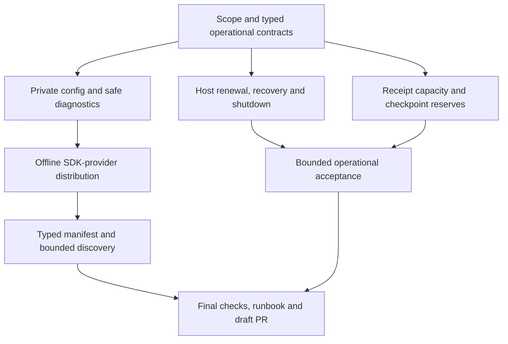

# P4 operational hardening delivery graph

Continue the reviewed P2/P3 provider through the same public SDK boundary.
P3 positive native capture/input acceptance remains OPEN; configured
Plowshare/model acceptance remains separately deferred. This phase does not
supply those missing proofs, change platform contracts, grant OS permissions,
merge upstream phases or deploy a provider.

| Node                            | Implementer    | Independent reviewer | Acceptance and state                                                                                                                                                                                                                                                                                                                                                                                                                                                                |
| ------------------------------- | -------------- | -------------------- | ----------------------------------------------------------------------------------------------------------------------------------------------------------------------------------------------------------------------------------------------------------------------------------------------------------------------------------------------------------------------------------------------------------------------------------------------------------------------------------- |
| H0: scope/contracts             | coordinator    | reviewer             | APPROVED contract: preserve SDK-only ownership, terminal event-socket identity, original receipts, finite work and conservative physical fences.                                                                                                                                                                                                                                                                                                                                    |
| H1: host lifecycle              | backends_impl  | reviewer             | APPROVED source: renewal under the operator-declared server lease, bounded admission/startup/stop under load, original publication reconciliation and explicit restart without replay or scope adoption; 44 targeted lifecycle tests passed. backends_impl owns production; contracts_impl contributed three SDK lock/active-handler cases.                                                                                                                                         |
| H2a: private config/diagnostics | contracts_impl | reviewer             | APPROVED source: bounded single-FD private configuration, strict decoding, typed code-only diagnostics and owned late authentication cleanup; 15 targeted tests passed.                                                                                                                                                                                                                                                                                                             |
| H2b: offline distribution       | contracts_impl | reviewer             | APPROVED source: exact six-package production closure, bounded hash manifest and exclusive offline installation; 17 Python fault cases plus fresh runtime/CLI/typed-consumer checks passed without authentication, browser/helper startup or network. Final frozen artifact is H4.                                                                                                                                                                                                  |
| H2c: typed packaging contracts  | coordinator    | reviewer             | APPROVED source: frozen manifest/package/member/support DTOs, immutable file collections, strict selector projection and lazy bounded discovery; 21 packaging fault cases plus fresh offline consumer checks passed.                                                                                                                                                                                                                                                                |
| H3a: journal capacity           | coordinator    | reviewer             | APPROVED source: fixed publication checkpoint slot through terminal settlement, immutable payload-free aggregate capacity report and conservative restoration; eight capacity tests passed.                                                                                                                                                                                                                                                                                         |
| H3b: operational acceptance     | coordinator    | reviewer             | APPROVED fixture evidence: public SDK polling with synthetic Relay/admission peers and private file journals; 64 discovery passes/eight admitted images, duplicate and stale-generation refusal, full 1,000-receipt zero-effect refusal, actual Node crash/reap and explicit fixture-only recovery without a second fake effect; three tests passed.                                                                                                                                |
| H4: final evidence              | coordinator    | reviewer             | APPROVED source/checks: repository check/formatCheck/offline consumer passed in 53 seconds (148 tasks); integration suite 346 tests, 342 passed and four explicit live skips. Fresh offline runtime/CLI/typed consumer and 21 packaging fault tests passed separately. The final scanner distribution/consumer/format recheck passed in five seconds (53 tasks). Publication requires independent clean-revision manifest and exact remote-head checks, recorded with the draft PR. |

Each node closes only after its implementer and independent reviewer agree on
the actual diff and evidence. Source, fixture verification, merge, deployment
and real server/OS validation are distinct. Native no-input PENDING/revoke proof
from P3 is not positive capture, compositor, routing or held-input evidence.

## Recovery contract

An event connection is terminal after loss. This phase does not replace the
host's session, replay login/refresh, or transplant an interactive scope to a new
socket. A separately authorized Application-bound host can be explicitly
restarted with its original private journal and catalogue intent after physical
cleanup is proven. Retained publication reads may confirm an original receipt;
absence, expiry or failed reads never authorizes a resend of uncertain effects.
Native local grants are never automatically renewed.

`catalogue.leaseSeconds` describes the operator's expected server-configured
catalogue lease; it is not a negotiated lease or a value sent by SDK publication.
Missing general public lease/archival/cancellation capabilities remain platform
gaps, not permission to add core changes in this integration.

## Final verification boundary

- The full repository checks ran without database opt-in. The integration suite
  ran once; the offline consumer smoke is a separate runtime/type/CLI check, not
  a second execution of all integration tests.
- Forty-four targeted host lifecycle cases include original metadata/result
  reconciliation, lease expiry, ignored cancellation, held SDK lock admission,
  shutdown during capture and hung startup promises. Source/fixture approvals do
  not establish physical native input or a configured server connection.
- Packaging uses only the installed, explicit six-package production closure;
  browser/native helper installation, OS grants and live authentication are not
  part of this distribution's smoke tests. Manifests distinguish dirty working
  builds from clean committed revisions.
- Automatic event-socket reconnect, general journal archival, rolling image
  context and immediate remote cancellation remain public platform gaps. P4
  supplies fail-stop, bounded ownership and original-receipt recovery through
  the current public contracts.
