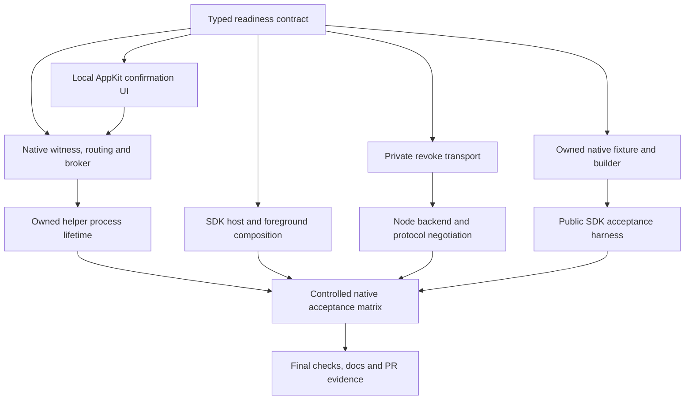

# P3 verified interactive readiness delivery graph

Continue the [P3 foundation graph](P3-IMPLEMENTATION.md) with a usable native input
loop through the same public-SDK provider for TUI, GUI and standalone hosts.
Configured Plowshare/model acceptance remains deferred. Native acceptance uses
owned fixture applications and independent application/pixel evidence.

| Node                                     | Implementer    | Independent reviewer | Acceptance / state                                                                                                                                                                                                                                                                                                                                                                                                                      |
| ---------------------------------------- | -------------- | -------------------- | --------------------------------------------------------------------------------------------------------------------------------------------------------------------------------------------------------------------------------------------------------------------------------------------------------------------------------------------------------------------------------------------------------------------------------------- |
| N0: typed readiness contract             | contracts_impl | reviewer             | APPROVED: strict host-only DTOs, exact lease/helper generation, short monotonic grants and scoped live witness; eight independent contract tests passed.                                                                                                                                                                                                                                                                                |
| N1a: local AppKit confirmation UI        | contracts_impl | reviewer             | APPROVED source: focused Swift compile, strict format and 29 no-GUI cases. Actual AppKit metadata exposed an already-satisfied activation-policy setter and fractional initial-frame rounding; both corrections preserve strict final-state guards. Actual GUI qualification is N4.                                                                                                                                                     |
| N1b: native witness, routing and broker  | backends_impl  | reviewer             | APPROVED source: 67 no-post readiness cases, Inspector serialization/status/quiescence and unresolved own-route fencing. Real-host corrections cover optional session fields, no-window AppKit preparation and strict current-mode pixel geometry. No actual input qualification inferred.                                                                                                                                              |
| N1c: owned helper process lifetime       | backends_impl  | reviewer             | APPROVED source: synchronous process owner, one asynchronous worker, bounded autorelease/run-loop turns and two no-GUI stopped-loop regressions. Private own-UI comparison completed its delayed worker and close. Matched-artifact real session stayed PENDING and stopped cleanly; receipt independently APPROVED. No capture, input or compositor witness inferred.                                                                  |
| N2a: private revoke transport            | coordinator    | reviewer             | APPROVED: independent source review, compile/lint/format and 15 transport tests; exact normal/control correlations, finite cleanup and no replay.                                                                                                                                                                                                                                                                                       |
| N2b: SDK host and foreground composition | coordinator    | reviewer             | APPROVED: independent source review, whole-module compile, 48 selected tests and typed lint/format. Admission precedes effects; malformed/uncertain responses fence; host revoke suppresses deferred pixels/refs while preserving known dispatch text.                                                                                                                                                                                  |
| N2c: Node backend and private protocol   | coordinator    | reviewer             | APPROVED: independent v3 source review and 38 backend/codec/transport tests. Read-only negotiation precedes acquire; zero-acquire cleanup requires actual child exit and original work settlement; failed reap fences. Initial adapter work was contributed by backends_impl.                                                                                                                                                           |
| N3a: owned native fixture and builder    | contracts_impl | reviewer             | APPROVED source: independent fixture/builder review, ten codec and four builder cases, and per-run UUID window-title/child identity hardening. Final fixture bundles built; no GUI/input qualification inferred.                                                                                                                                                                                                                        |
| N3b: public SDK acceptance harness       | contracts_impl | reviewer             | APPROVED source: independent compile/lint/format and lifecycle review. Exact per-run fixture identity, private SHA-linked PNGs, original setup/image settlement, fresh proof and the fixed 16-image cap. Opt-in test skipped; native execution is N4.                                                                                                                                                                                   |
| N4: controlled native acceptance matrix  | coordinator    | reviewer             | OPEN: real unarmed AX discovery, capture denial, stable unapproved PENDING, host revoke and clean helper/fence release passed; receipt independently APPROVED. Positive capture/routing/input, Unicode, cross-app focus, menus/dialogs, scroll/drag, held-input cleanup, displays and faults still require real OS evidence and operator participation.                                                                                 |
| N5: final checks, docs and PR evidence   | coordinator    | reviewer             | APPROVED source and documentation: final repository check/formatCheck/fresh packed-SDK consumer passed in 52s (147 tasks); integration and fresh consumer each passed 290 tests with four explicit live skips. Native checker passed nine-source compile, protocols 1/3, legacy control-envelope rejection and no-post cases; 19 script plus four builder tests passed. Draft PR #297 retains the OPEN positive native acceptance gate. |

Each node needs implementer and reviewer agreement on actual source and evidence.
The coordinator owns integration and final acceptance; contributors do not approve
their own work. Uncertain physical work retains its identity and fence. No test
replays an effect to get a cleaner receipt.

## Evidence boundary

The host-only request returns PENDING promptly. A gesture on the helper's local
confirmation surface can grant at most 30 seconds of input readiness. Model
arguments and configuration cannot supply that proof. Status, unlock and witness
refresh never renew the grant. This is a scoped interactive capability, not
universal or atomic screen-unlocked attestation.

The helper verifies own-GUI routing and compositor evidence, then keeps current
permission, session, display, application, secure-input, target and monitoring
checks. Observed loss revokes input and stops new posts. A posted event at the
instant OS evidence changes can have unknown delivery; cleanup/no-replay fences
remain authoritative. Helper UI/processes are excluded from model action and
normal model captures mask their exact expanded regions.

Local **Stop input** and host `revoke` have distinct publication semantics; see
[the operating contract](READINESS.md). Capture retains independent configured
observation authority. Local Inspector setup is serialized before model control
in the initial acceptance envelope; generic settled failures do not prove that
mutating actions were not dispatched.

## Current real-host setup evidence

- Read-only inventory outside the sandbox found two active displays. Coordinate
  metadata differed between the original command-line and later packaged AppKit
  launch contexts. Neither inventory qualifies negative origins, mixed-scale
  capture or input transforms.
- A packaged protocol-3 qualification candidate passed signature/identity,
  read-only preflight and clean-stop checks outside the sandbox: Accessibility,
  event posting and event listening were granted; Screen Recording was false.
  Secure input and the global fence were clear. No capture, input, permission
  prompt or production ownership acquisition occurred.
- An actual foundation protocol-2 helper was rebuilt from the prior committed
  source. The new backend's instrumented operation trace contained only preflight;
  it returned NOT_ACQUIRED/UNSUPPORTED_ACTION and removed its own empty marker
  after actual child exit. It sent no acquire or revoke and claimed no desktop.
- Final source changes supersede earlier ad-hoc candidate/fixture bundles. Build
  the exact reviewed tree before permission setup; do not infer effective TCC
  identity or grants from a bundle signature. Operator-visible identity must be
  checked in the actual launch path.

Real-host negative trials exposed session-field, AppKit bootstrap and geometry
assumptions that deterministic fixtures had not established. The reviewed fixes
retain strict state validation and never substitute a simulated ready state.
The later packaged helper successfully read unarmed AX windows and refused an
actual screenshot with PERMISSION_DENIED while Screen Recording was false. Its
confirmation request reached PENDING but was revoked by presentation validation
before any compositor or routing witness existed. A private
own-UI diagnostic then isolated initial-frame rounding and an unfinished async
process lifetime. An entrypoint-only comparison completed its delayed worker and
close without presentation loss; production source and stopped-loop regressions
were independently approved. Failed receipts remain
failed. No input was posted, no local grant supplied and no pixels admitted.
Each acquired trial removed only its own marker after settlement; independent
subsequent preflight found the global fence clear.

The final reviewed nine-source bundle then passed a new negative qualification:
unarmed AX discovery, PERMISSION_DENIED before pixels, one request remaining
PENDING across two status reads separated by 300 ms without approval, host
revocation, settled helper
stop, removal of its own empty local marker and independent global-fence-clear
preflight. Its executable and all nine source hashes matched the build manifest.
Actual Accessibility, input-posting and input-listening permissions were true;
Screen Recording remained false. This is a successful negative boundary, not
positive input readiness. The earlier failed receipts remain failed.

The own-UI lifecycle comparison did not establish visible compositor content:
the consent panel's occlusion-visible flag remained false. The sentinel's
separate visibility and pixel guards remain required. No compositor witness,
local grant, posted HID input or admitted screenshot has been qualified.

Positive native readiness, actual held-input cleanup and the operating fault
matrix remain OPEN. Source, no-post fixtures and read-only preflight cannot close
those gates or establish configured Plowshare/model vision.
